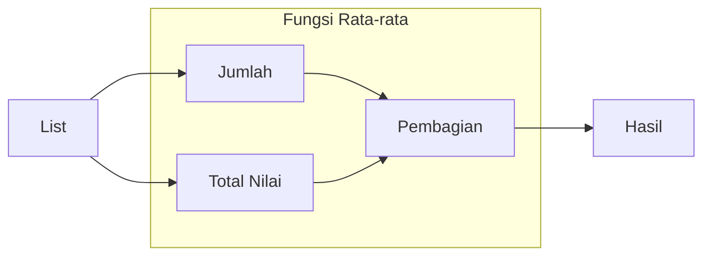

# Menghitung Rata-rata

## Ringkasan

Kode ini menghitung rata-rata dari sebuah list dengan fungsi yang dibuat sendiri.

## Baris-per-Baris

### List

- `list_num = [1, 2, 3, 4]` : membuat list yang berisi angka 1, 2, 3, dan 4

### Fungsi Rata-rata

- `def avg(list) :`:  awalan pembuatan fungsi. Sintaksnya: `def nama_fungsi(masukan):`. Nama fungsinya adalah `avg` yang mengambil masukan berupa variabel `list`

#### Total Nilai

- `total = sum(list)`. Total nilai disimpan dalam variabel `total` dengan perintah `sum()`

#### Jumlah

- `jumlah = len(list)`. Jumlah nilai dihitung dengan perintah `len()` yang mengambil masukan dari *list* yang didefinisikan oleh variabel global `list` dalam variabel `jumlah`.

#### Pembagian

- `hasil = total/jumlah`: Pembagian `total` dengan `jumlah` (`total / jumlah`) menghasilkan nilai rata-rata dan disimpan dalam `hasil`
- `return hasil` Hasil yang disimpan dalam variabel `hasil` dikembalikan sebagai keluaran fungsi `avg()`

### Hasil

- `rerata = avg(list_num)`: `rerata` adalah variabel yang menyimpan hasil perhitungan rata-rata dengan fungsi yang sudah dibuat `avg()` dan mengambil masukan dari variabel `list_num` yang sudah didefinisikan di awal
- `print(rerata)`: nilai `rerata` ditampilkan ke layar dengan perintah `print()`
