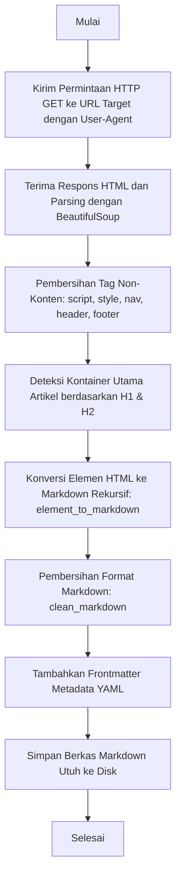

# Dokumentasi Kode: `convert_to_markdown.py`

Dokumen ini berisi dokumentasi teknis untuk skrip otomasi ekstraksi laman web Google Cloud Learn (`cloud.google.com/learn`) menjadi dokumen Markdown utuh (`what-is-artificial-intelligence.md`).

---

## Ringkasan

Skrip `convert_to_markdown.py` bertugas mengunduh dokumen HTML dari laman Google Cloud Learn, melakukan pembersihan komponen non-konten (seperti navigasi global, header, footer, skrip, dan gaya CSS), menemukan kontainer utama artikel, serta mengonversi elemen-elemen HTML (seperti judul, paragraf, daftar berpoin/berangka, tabel, gambar, dan tautan) menjadi format Markdown yang bersih dan terstruktur secara otomatis.

### Diagram Alir Kode



---

## Baris-per-Baris

### 1. Inisialisasi Dependensi dan Modul
```python
import urllib.request
from bs4 import BeautifulSoup, Tag, NavigableString
import re
import os
```
* **Penjelasan**: Mengimpor pustaka `urllib.request` untuk penanganan HTTP GET, `BeautifulSoup` untuk parsing DOM HTML, `re` untuk manipulasi ekspresi reguler (string/whitespace), dan `os` untuk pengelolaan jalur berkas.

### 2. Fungsi Rekursif Konversi HTML ke Markdown (`element_to_markdown`)
```python
def element_to_markdown(el):
```
* **Penjelasan**: Fungsi inti yang mengonversi setiap simpul (node) HTML menjadi sintaks Markdown yang setara.
  * **Simpul Teks (`NavigableString`)**: Merapikan spasi ganda menjadi spasi tunggal.
  * **Pembersihan Element Tersembunyi/Non-Konten**: Mengabaikan elemen `script`, `style`, `noscript`, `svg`, `iframe`, `form`, atau elemen berkategori `display:none`.
  * **Judul (`h1` - `h6`)**: Dikonversi menjadi `#` sesuai level tingkatannya.
  * **Paragraf (`p`)**: Dibungkus dengan dua perpindahan baris (`\n\n`).
  * **Format Teks (`strong`, `em`, `code`)**: Dikonversi menjadi `**teks**`, `*teks*`, dan `` `teks` ``.
  * **Tautan (`a`)**: Mengubah jalur relatif menjadi URL absolut `https://cloud.google.com...` dan format `[teks](url)`.
  * **Gambar (`img`)**: Dikonversi menjadi ``.
  * **Daftar (`ul`, `ol`, `li`)**: Menyusun poin berurutan atau berangka dengan indentasi teratur.
  * **Tabel (`table`, `tr`, `th`, `td`)**: Menyusun tabel Markdown dengan pembatas pipa (`|`).

### 3. Fungsi Pembersihan Markdown (`clean_markdown`)
```python
def clean_markdown(md):
```
* **Penjelasan**: Merapikan jarak antar-paragraf agar tidak terdapat baris kosong berlebih (`\n\n\n+` disederhanakan menjadi `\n\n`) dan menghapus spasi ekstra di akhir baris.

### 4. Alur Utama Ekstraksi (`extract_google_cloud_learn`)
```python
def extract_google_cloud_learn(url, output_path):
```
* **Penjelasan**:
  * Mengunduh HTML dari URL target dengan header `User-Agent` browser Chrome.
  * Menyongsong metadata `title` dan `description` dari elemen `<head>`.
  * Menemukan blok utama artikel (kontainer `div` terluar).
  * Mengonversi isi kontainer dan menambahkan header YAML (frontmatter).
  * Menuliskan hasil akhirnya ke berkas target `.md` dengan enkoding `utf-8`.
