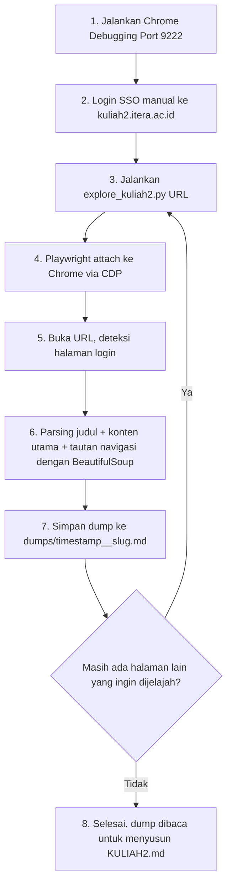

# Eksplorasi kuliah2.itera.ac.id dengan Chrome DevTools Protocol (CDP)

Proyek ini adalah hasil penggandaan (bukan `git clone`) dari [`cdp-web-scrape`](../cdp-web-scrape/README.md), diadaptasi untuk tujuan berbeda: bukan men-scrape tabel nilai ke Google Sheets, melainkan **menjelajahi laman `kuliah2.itera.ac.id`** (instance Moodle ITERA) sambil login sebagai dosen, lalu men-dump kontennya ke berkas Markdown lokal supaya bisa dibaca untuk menyusun catatan penelaahan di [`Guide/KULIAH2.md`](../../Guide/KULIAH2.md).

Metode CDP dipakai dengan alasan yang sama seperti proyek asal: melewati proteksi SSO/anti-bot dengan mengendalikan Chrome asli yang sudah login manual, alih-alih membuka browser otomasi baru yang mudah terdeteksi.

---

## 1. Prasyarat

* **Google Chrome** asli terinstal (`C:\Program Files\Google\Chrome\Application\chrome.exe`).
* Environment conda **`web_scrape`** (sudah ada, dibagi bersama proyek `cdp-web-scrape`) yang berisi `playwright` dan `beautifulsoup4`. Tidak perlu instalasi ulang — cukup jalankan skrip dengan python dari environment ini:
  ```powershell
  & "C:\Users\IKHLAS\.conda\envs\web_scrape\python.exe" explore_kuliah2.py <URL>
  ```

## 2. Cara Kerja



1. **Chrome mode debugging**: semua jendela Chrome ditutup, lalu dijalankan ulang dengan `--remote-debugging-port=9222` dan profil terpisah `--user-data-dir`.
2. **Login manual**: pengguna (Pak Abdul) login SSO ke `kuliah2.itera.ac.id` sendiri di jendela debug tersebut. Skrip ini **tidak pernah** menangani kredensial.
3. **`explore_kuliah2.py <URL>`**: Playwright *attach* ke sesi Chrome yang sudah login, membuka URL yang diberikan, lalu men-dump judul, konten utama (`#region-main` bila ada), dan daftar tautan navigasi ke berkas Markdown di `dumps/`.
4. Dump inilah yang dibaca satu per satu untuk menulis `Guide/KULIAH2.md`.

## 3. Menjalankan Chrome dalam Mode Debugging

```powershell
& "C:\Program Files\Google\Chrome\Application\chrome.exe" --remote-debugging-port=9222 --user-data-dir="C:\chrome_debug_profile"
```

Lalu di jendela Chrome yang terbuka: buka `https://kuliah2.itera.ac.id`, login SSO, pastikan bisa membuka kursus yang dituju (mis. "Statistika").

## 4. Struktur File

* `explore_kuliah2.py`: skrip utama, dipanggil per URL, men-dump satu halaman per pemanggilan.
* `dumps/`: hasil dump per halaman (**di-gitignore** — bisa memuat data pribadi mahasiswa dari halaman gradebook/peserta).
* `.claude/skills/playwright_cdp_scraper/`, `.antigravitycli/skills/playwright_cdp_scraper/`: skill & template CDP yang dipakai sebagai acuan, dibawa apa adanya dari `cdp-web-scrape`.

## 5. Catatan Privasi

Dump di `dumps/` bisa memuat nama/NIM/nilai mahasiswa karena diambil dari sesi login dosen sungguhan. Berkas ini **tidak boleh di-commit** dan hasil akhirnya (`Guide/KULIAH2.md`) hanya boleh mencatat *fitur/struktur* Moodle, bukan data pribadi mahasiswa.
