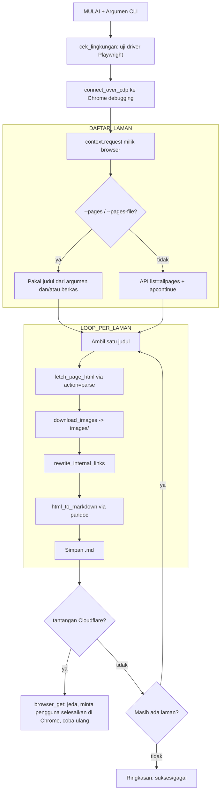

# Ekstraktor Dokumentasi Moodle (`method_claude.py`)

Dokumentasi untuk [[method_claude.py]] — skrip yang mengekstraksi dokumentasi Moodle 502 (docs.moodle.org) menjadi berkas Markdown. Alur kerjanya berakar dari [[SARAN_CLAUDE.md]] dan [[RINGKASAN.md]]; sejak September 2026 lapisan lolos-Cloudflare-nya diganti dari cookie `cf_clearance` + `curl_cffi` menjadi **Playwright lewat Chrome CDP** (alasan dan riwayatnya di [[2026-07-07-result.md]] serta [[2026-07-08-success-report.md]]; artefak alur lama diarsipkan di [[Code/_archive/cookie-cf-clearance/_index|_archive/cookie-cf-clearance]]).

## Ringkasan

Skrip ini mengunduh laman-laman [docs.moodle.org](https://docs.moodle.org/502/en/Main_page) melalui **MediaWiki API** (bukan scrape DOM penuh), mengunduh gambar dan menautkannya secara lokal, menulis ulang tautan antar-halaman, lalu mengonversi HTML menjadi Markdown dengan `pandoc`.

Kunci pendekatannya: skrip menyambung ke **Chrome asli** yang dijalankan pengguna dengan mode debugging (`connect_over_cdp`), lalu mengirim semua permintaan lewat `context.request` milik browser itu. Artinya cookie hasil penyelesaian tantangan dan sidik jari TLS **browser asli** terbawa otomatis — pengguna cukup menyelesaikan captcha Cloudflare sekali di jendela Chrome, dan mesin mengerjakan sisanya. Tidak ada lagi copy-paste cookie yang cepat basi.

> [!IMPORTANT]- Kenapa cara lama (cookie + `curl_cffi`) ditinggalkan
> Cloudflare mengikat izin lolosnya pada sidik jari sesi yang menyelesaikan tantangan — kombinasi IP, User-Agent, dan **TLS/JA3 fingerprint**. `curl_cffi` meniru TLS Chrome, tetapi versi yang didukungnya selalu tertinggal dari versi browser, dan pada Agustus 2026 tiga laman tetap ditantang balik meski cookie segar (tercatat di [[Guide/HANDOFF-SISA-TUGAS]]). Chrome asli tidak perlu meniru apa-apa: sidik jarinya memang sidik jari browser.

Tujuh penyempurnaan dari [[SARAN_CLAUDE.md]] yang diwujudkan:

1. **Tantangan kembali muncul** → deteksi halaman tantangan sebagai `ChallengeError` dan hentikan loop dengan pesan minta diselesaikan ulang.
2. **Gambar** → diunduh ke `images/` dan `src`-nya ditulis ulang jadi lokal.
3. **Tautan internal** → `/502/en/Nama_Halaman` ditulis ulang menjadi `Nama_Halaman.md`.
4. **Daftar laman** → via API `list=allpages` + `apcontinue`, bukan scrape `Special:AllPages`.
5. **Sopan-santun** → `delay` antar-request.
6. **Lolos Cloudflare tanpa cookie** → semua permintaan lewat `context.request` milik Chrome yang terhubung CDP (lihat catatan di atas).
7. **Cek lingkungan pra-terbang** → `cek_lingkungan()` menguji keutuhan driver Playwright pada environment conda aktif sebelum menyambung ke Chrome, supaya kerusakan environment langsung terlihat dengan petunjuk perbaikannya.



## Baris-per-Baris

### IMPOR & KONFIGURASI

- `BASE_URL`, `API_URL`, `LANG_PATH`: alamat dasar situs, endpoint `api.php`, dan ruang nama versi+bahasa (`502/en`). docs.moodle.org adalah *wiki farm*: tiap versi adalah instalasi MediaWiki terpisah, jadi `api.php` berada di bawah path versi, bukan di akar domain.
- `CDP_URL_DEFAULT`: alamat endpoint CDP Chrome (`http://localhost:9222`), bisa dioverride lewat `--cdp-url`.
- `DEFAULT_DELAY`, `REQUEST_TIMEOUT_MS`: jeda antar-request (detik) dan batas waktu tiap request. Perhatikan satuannya milidetik — satuan `timeout` milik Playwright, bukan detik seperti `requests`.
- `MAX_CHALLENGE_ATTEMPTS`: berapa kali satu permintaan dicoba ulang setelah pengguna diminta menyelesaikan tantangan.
- `SCRIPT_DIR`, `OUTPUT_DIR`, `IMAGES_DIR`: direktori keluaran relatif terhadap lokasi skrip (`moodle_docs/` dan `moodle_docs/images/`).
- `CHALLENGE_MARKERS`: frasa khas halaman tantangan Cloudflare ("Just a moment…", "Checking your browser…") yang dicari di awal body respons.

Impor `playwright.sync_api` dijaga `try/except ImportError`: kalau pustakanya belum terpasang, skrip berhenti dengan petunjuk `pip install` alih-alih menampilkan traceback.

### KELAS PENGECUALIAN

- `class ChallengeError(Exception)`: pengecualian khusus yang diangkat saat Cloudflare masih menantang setelah semua percobaan ulang habis.

### KESOPANAN KONSOL

- Blok `sys.stdout.reconfigure`: konsol Windows bawaan berkode cp1252; baris ini memastikan judul laman dan teks non-ASCII yang dicetak tidak rusak.

### PENGECEKAN LINGKUNGAN

- `cek_lingkungan()`: mencetak versi Python dan nama environment conda aktif (`CONDA_DEFAULT_ENV`), lalu menguji driver Playwright secara sungguhan — memanggil CLI driver (`node.exe cli.js --version`) lewat `subprocess`. Kegagalan import atau driver hilang/rusak menghentikan skrip (kode keluar `2`) dengan perintah perbaikannya: `python -m pip install --force-reinstall --no-deps playwright`.

### DETEKSI TANTANGAN CLOUDFLARE

- `looks_like_challenge(status, headers, body)`: memeriksa tiga sinyal — status `403`, header `cf-mitigated: challenge`, dan (untuk respons teks) frasa penanda pada 2000 karakter pertama body. `body=None` untuk respons biner supaya byte gambar tidak dipaksa di-decode.

### JEDA PEMENUHAN TANTANGAN

- `prompt_user_solve_challenge(url)`: mencetak instruksi lalu menunggu pengguna menekan Enter. Skrip tidak pernah mencoba menyelesaikan tantangan sendiri — menyelesaikan captcha adalah tugas pengguna di jendela Chrome.

### PENYAMBUNGAN KE CHROME (DENGAN JALUR CADANGAN)

- `fetch_cdp_page_ws(cdp_url)`: membaca `http://host:port/json/list` lewat `urllib` (tanpa bergantung pada koneksi Playwright yang sedang bermasalah), lalu memilih websocket satu tab — urutan prioritasnya: laman `docs.moodle.org` → laman web apa pun → tab apa pun.
- `connect_to_chrome(pw, cdp_url)`: jalur utama menyambung ke endpoint level-browser dengan batas waktu `CDP_CONNECT_TIMEOUT_MS`; bila endpoint itu menggantung (diamati terjadi setelah Chrome di-restart sementara jendela sesi lama dibiarkan hidup), skrip beralih ke jalur cadangan: melampirkan diri ke ws tab yang sudah terbuka. Kedua jalur memberi pintu yang sama — `context.request` tetap berbagi cookie profil browser.

### SESI PERMINTAAN LEWAT BROWSER

- `browser_get(request_ctx, url, ...)`: mengirim GET lewat `context.request` (pintu permintaan milik browser yang terhubung CDP), memeriksa tantangan, lalu mengulang maksimal `MAX_CHALLENGE_ATTEMPTS` kali dengan jeda penyelesaian manual di antaranya. Semua cookie (termasuk `cf_clearance` hasil captcha) dan sidik jari TLS browser terbawa otomatis.
- `api_get(request_ctx, params)`: memanggil MediaWiki API dengan `format=json`; status selain 200 atau body bukan JSON menjadi `RuntimeError`.

### DAFTAR LAMAN

- `list_all_pages(request_ctx)`: memenuhi poin #4. Melakukan loop `action=query&list=allpages&aplimit=500` di ruang nama utama (`apnamespace=0`), mengumpulkan judul, dan melanjutkan paginasi lewat `continue.apcontinue` sampai habis, dengan jeda `DEFAULT_DELAY` tiap halaman.

### UNDUH ISI LAMAN

- `fetch_page_html(request_ctx, title)`: mengambil HTML isi laman (tanpa navbar/sidebar) via `action=parse&prop=text&redirects=1`; memeriksa `error` dari API lalu mengembalikan `parse.text["*"]`.

### PENGOLAHAN GAMBAR

- `safe_filename(name)`: meng-*unquote* URL lalu mengganti karakter tak aman jadi `_` supaya nama berkas valid lintas-OS.
- `download_images(request_ctx, soup)`: memenuhi poin #2. Untuk tiap ``, mengubah `src` relatif jadi URL absolut, mengunduh ke `images/` (lewati jika sudah ada) lewat `browser_get(..., text_mode=False)`, lalu menulis ulang `img["src"]` menjadi `images/<berkas>`. Gambar yang gagal di-*skip* agar tak menggagalkan seluruh laman.

### PENGOLAHAN TAUTAN INTERNAL

- `rewrite_internal_links(soup)`: memenuhi poin #3. Mengubah `href` yang berawalan `/502/en/` menjadi `<Nama_Halaman>.md`, mempertahankan *anchor* (`#bagian`) bila ada.

### PEMBERSIHAN & KONVERSI

- `clean_soup(soup)`: membuang elemen navigasi MediaWiki (navtrail, sideblock, toc, mw-editsection), menyederhanakan `<figure>` jadi `` + caption, dan melepas wrapper `<div>/<span>` generik — supaya pandoc menghasilkan sintaks Markdown asli, bukan HTML mentah.
- `html_to_markdown(html)`: menjalankan `pandoc --from=html --to=gfm --wrap=none` lewat `subprocess`, mengirim HTML via *stdin* dan mengembalikan Markdown; melempar galat bila `pandoc` gagal.
- `tidy_markdown(markdown)`: merapikan spasi artefak (`' .'`, `' ,'`) di luar blok kode berpagar.

### PIPA PER-LAMAN

- `process_page(request_ctx, title)`: merangkai satu laman utuh — unduh HTML → `BeautifulSoup` → `download_images` → `rewrite_internal_links` → `clean_soup` → `html_to_markdown` → `tidy_markdown` → simpan `.md` dengan *header* judul + tautan sumber.

### MAIN

- `parse_args()`: mendefinisikan argumen CLI (`--cdp-url`, `--pages`, `--pages-file`, `--limit`, `--delay`).
- `main()`: menjalankan `cek_lingkungan()`, menyambung ke Chrome lewat `connect_over_cdp` (bila gagal, mencetak cara menjalankan Chrome debugging lalu berhenti dengan kode keluar `2`), mengambil `contexts[0].request` sebagai pintu permintaan, menentukan daftar laman (dari `--pages`/`--pages-file`, atau daftar penuh via API bila keduanya kosong), menerapkan `--limit`, lalu melooping `process_page`. Jika `ChallengeError` muncul → **berhenti anggun** (poin #1) dengan kode keluar `2`; galat lain dihitung sebagai gagal tanpa menghentikan loop. Diakhiri ringkasan sukses/gagal. Browser pengguna sengaja tidak pernah ditutup.
- `if __name__ == "__main__"`: menjalankan `main()` dan meneruskan kode keluarnya lewat `SystemExit`.

## Cara Menjalankan

### 0. Prasyarat

- **Environment conda `web_scrape`** berisi `playwright` dan `beautifulsoup4`. Pengecekan pra-terbang ada di dalam skrip, jadi environment yang salah akan ketahuan sendiri. Bila ingin memeriksa lebih dulu tanpa menjalankan ekstraksi:

  ```powershell
  & "C:\Users\LENOVO\.conda\envs\web_scrape\python.exe" -c "import method_claude; method_claude.cek_lingkungan()"
  ```

- **`pandoc`** terpasang dan bisa dipanggil dari terminal (dicek dengan `pandoc --version`). Skrip memanggilnya via `subprocess`.
- **Google Chrome** asli terinstal.

### 1. Jalankan Chrome dalam mode debugging

Tutup dulu jendela Chrome biasa yang memakai profil sama, lalu:

```powershell
& "C:\Program Files\Google\Chrome\Application\chrome.exe" --remote-debugging-port=9222 --user-data-dir="C:\chrome_debug_profile"
```

`--user-data-dir` menunjuk ke profil terpisah, jadi proses Chrome ini tidak bercampur dengan profil harian Anda. Profil yang sama dipakai lagi pada sesi berikutnya, sehingga captcha yang sudah pernah diselesaikan tidak selalu muncul ulang.

### 2. Buka docs.moodle.org dan selesaikan captcha

Di jendela Chrome yang baru terbuka, buka `https://docs.moodle.org/502/en/Main_page`.

- Bila muncul halaman "Tunggu sebentar… / Please complete the captcha below to continue", selesaikan captcha-nya. Inilah satu-satunya bagian yang dikerjakan manusia.
- Tunggu sampai laman MoodleDocs asli terbuka. Setelah itu laman boleh dibiarkan atau ditutup — izin lolosnya tersimpan di profil, bukan di tab.

### 3. Uji coba satu laman

Dari dalam direktori `Code/`:

```powershell
& "C:\Users\LENOVO\.conda\envs\web_scrape\python.exe" method_claude.py --pages Teacher_quick_guide
```

Keluaran yang diharapkan:

| Yang muncul di layar | Artinya |
| --- | --- |
| `[cek lingkungan] Python 3.12.13 \| environment conda: web_scrape` | Skrip berjalan di environment yang tepat |
| `[cek lingkungan] playwright siap (driver Version 1.62.0)` | Driver Playwright utuh dan berfungsi |
| `[1/1]   -> Teacher_quick_guide` | Satu laman diproses |
| `Selesai. Sukses: 1, Gagal: 0.` | Semua berjalan; hasil di `Code/moodle_docs/` |

Periksa `Code/moodle_docs/Teacher_quick_guide.md` — pastikan isi terbaca, gambar menunjuk ke `images/`, dan tautan internal berbentuk `Nama_Laman.md` — sebelum lanjut ke skala penuh.

### 4. Ekstraksi dengan daftar judul

```powershell
& "C:\Users\LENOVO\.conda\envs\web_scrape\python.exe" method_claude.py --pages-file pedoman_rebuild_sources.txt
```

Daftar judul dibaca satu per baris; baris kosong dan berawalan `#` diabaikan. Laman yang sudah berhasil tetap ditimpa bila dijalankan ulang, jadi perintah yang sama aman dipakai untuk melanjutkan ekstraksi yang sempat terhenti.

### 5. Ekstraksi penuh (seluruh ruang nama utama)

```powershell
& "C:\Users\LENOVO\.conda\envs\web_scrape\python.exe" method_claude.py
```

Tanpa `--pages` maupun `--pages-file`, skrip mengambil seluruh daftar laman via API lalu mengunduh semuanya — ratusan laman, jadi jalankan hanya bila memang perlu membangun ulang korpus.

### Kalau hasilnya berbeda

| Gejala | Diagnosis | Tindakan |
| --- | --- | --- |
| `[catatan] endpoint browser tidak merespons (TimeoutError);` diikuti `mencoba jalur cadangan…` | Endpoint CDP level-browser macet (lazim setelah Chrome di-restart sementara jendela lama dibiarkan hidup) | Bukan galat — skrip otomatis melampirkan diri ke tab yang sudah terbuka dan melanjutkan kerja |
| `GAGAL MENYAMBUNG KE CHROME` | Chrome debugging tidak berjalan di `--cdp-url`, atau tidak ada satu pun tab yang bisa dilampiri | Ulangi langkah 1; kalau Chrome debugging hidup di port lain, pakai `--cdp-url http://localhost:9233` |
| `CLOUDFLARE MENANTANG PERMINTAAN` lalu skrip menunggu | Captcha muncul lagi di tengah ekstraksi | Selesaikan captcha di jendela Chrome, lalu tekan Enter di terminal — skrip mencoba ulang sendiri sampai `MAX_CHALLENGE_ATTEMPTS` kali |
| `BERHENTI ANGGUN: Cloudflare masih menantang…` | Captcha tidak kunjung diselesaikan atau server terus menolak | Ulangi langkah 2, lalu jalankan ulang perintah yang sama; laman yang sudah sukses tidak masalah ditimpa |
| `! gagal: API error untuk 'Judul'…` | Judul laman tidak ada di wiki | Lewati; satu laman gagal tidak menghentikan loop |
| `LINGKUNGAN TIDAK LENGKAP` / `PLAYWRIGHT RUSAK PADA ENVIRONMENT` | Pustaka/driver rusak pada environment conda yang dipakai | Lihat kotak jebakan di bawah |

### Argumen CLI lengkap

| Argumen | Wajib? | Kegunaan |
| --- | --- | --- |
| `--cdp-url http://localhost:9233` | opsional | Alamat endpoint CDP Chrome debugging (default `http://localhost:9222`) |
| `--pages Judul1 Judul2` | opsional | Ekstrak laman tertentu saja, lewati pengambilan daftar via API |
| `--pages-file daftar.txt` | opsional | Sama seperti `--pages`, tapi judul dibaca satu per baris; bisa digabung dengan `--pages` |
| `--limit N` | opsional | Batasi jumlah laman yang diproses (untuk uji coba) |
| `--delay 3` | opsional | Ubah jeda antar-request dalam detik (default `1.5`) |

### Kotak jebakan: `PLAYWRIGHT RUSAK PADA ENVIRONMENT 'web_scrape'`

Gejala ini muncul bila playwright terpasang lewat conda-forge dan driver node-nya hilang — import berhasil, tetapi mesin Playwright tidak pernah bisa dibuka. Perbaikannya satu perintah, pada environment yang sama:

```powershell
& "C:\Users\LENOVO\.conda\envs\web_scrape\python.exe" -m pip install --force-reinstall --no-deps playwright
```

Perintah ini menimpa paket conda-forge dengan paket pip yang membawa driver sendiri; `--no-deps` mencegah pip ikut menimpa pustaka lain di environment itu. Jalankan ulang langkah 3 untuk memastikan `[cek lingkungan] playwright siap` muncul.

### Tindakan berikutnya

Sesudah laman-laman selesai diekstrak, perbarui [[Code/moodle_docs/_index|indeks korpus Moodle]] bila daftar laman berubah, lalu periksa satu berkas Markdown beserta gambarnya sebelum hasilnya diteruskan ke `Guide` (pemeriksaan manusia pada [[Code/CONTEXT]]).
