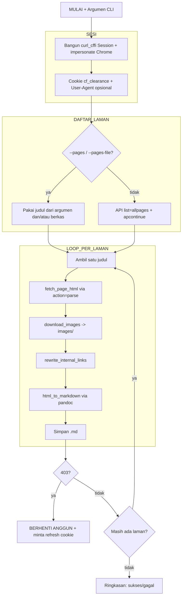

# Ekstraktor Dokumentasi Moodle (`method_claude.py`)

Dokumentasi untuk [[method_claude.py]] — skrip yang mengimplementasikan alur kerja dari [[SARAN_CLAUDE.md]] (penyempurnaan atas [[RINGKASAN.md]]) untuk mengekstraksi dokumentasi Moodle 502 menjadi berkas Markdown.

## Ringkasan

Skrip ini mengunduh laman-laman [docs.moodle.org](https://docs.moodle.org/502/en/Main_page) melalui **MediaWiki API** (bukan scrape DOM penuh), mengunduh gambar dan menautkannya secara lokal, menulis ulang tautan antar-halaman, lalu mengonversi HTML menjadi Markdown dengan `pandoc`. Kunci pendekatannya: proteksi Cloudflare cukup ditembus **sekali** lewat browser asli untuk memperoleh cookie `cf_clearance`, lalu cookie itu dipakai ulang oleh skrip. Karena cookie bisa kedaluwarsa, loop dirancang **berhenti anggun** begitu menerima 403.

> [!IMPORTANT]- Bagaimana melolosi tantangan Cloudflare
>  Cloudflare mengikat `cf_clearance` pada fingerprint sesi yang melolosi *challenge* — bukan cuma IP + User-Agent, tapi juga **TLS/JA3 fingerprint** (lihat [[2026-07-07-result.md]] dan poin #6). Karena itu skrip memakai `curl_cffi` (bukan `requests` biasa) dengan `impersonate` Chrome supaya jabat tangan TLS-nya tampak seperti browser asli. Argumen `--user-agent` (poin #5) tetap tersedia untuk menyamakan header User-Agent kalau perlu persis dengan browser yang memperoleh `cf_clearance`.

Enam penyempurnaan dari [[SARAN_CLAUDE.md]] yang diwujudkan (poin #6 ditambahkan belakangan setelah UA saja terbukti tidak cukup, lihat [[_log.md]] 2026-07-08):

1. **Cookie kedaluwarsa** → deteksi 403 sebagai `ChallengeError` dan hentikan loop dengan pesan minta refresh.
2. **Gambar** → diunduh ke `images/` dan `src`-nya ditulis ulang jadi lokal.
3. **Tautan internal** → `/502/en/Nama_Halaman` ditulis ulang menjadi `Nama_Halaman.md`.
4. **Daftar laman** → via API `list=allpages` + `apcontinue`, bukan scrape `Special:AllPages`.
5. **Sopan-santun** → `delay` antar-request + `User-Agent` yang bisa disinkronkan lewat `--user-agent` (opsional, untuk menyamakan UA skrip dengan UA browser yang memperoleh `cf_clearance`).
6. **TLS/JA3 fingerprint (Opsi A)** → sesi HTTP dibangun dengan `curl_cffi.requests.Session(impersonate=...)`, bukan `requests.Session()` bawaan, supaya jabat tangan TLS meniru Chrome asli. Profil peniruan diatur lewat `--impersonate` (default `"chrome"`, bisa dispesifikkan mis. `"chrome124"`).



## Baris-per-Baris

### KONFIGURASI

- `BASE_URL`, `API_URL`, `LANG_PATH`: alamat dasar situs, endpoint `api.php`, dan ruang nama versi+bahasa (`502/en`).
- `IMPERSONATE_TARGET`: profil `curl_cffi` yang ditiru di lapisan TLS/JA3 (default `"chrome"`, otomatis memilih versi Chrome terbaru yang didukung versi `curl_cffi` yang terpasang) — memenuhi poin #6. Bisa dioverride lewat `--impersonate`. UA identifikatif ala poin #5 sengaja tidak lagi jadi header bawaan, karena harus konsisten dengan fingerprint Chrome yang ditiru; dibiarkan mengikuti default `impersonate` kecuali `--user-agent` diberikan eksplisit.
- `DEFAULT_DELAY`, `REQUEST_TIMEOUT`: jeda antar-request dan batas waktu tiap request.
- `SCRIPT_DIR`, `OUTPUT_DIR`, `IMAGES_DIR`: direktori keluaran relatif terhadap lokasi skrip (`moodle_docs/` dan `moodle_docs/images/`).

### KELAS PENGECUALIAN

- `class ChallengeError(Exception)`: pengecualian khusus yang diangkat saat server membalas 403, penanda cookie `cf_clearance` batal/kedaluwarsa (poin #1).

### SESI HTTP

- `build_session(cookie, user_agent=None, impersonate=IMPERSONATE_TARGET)`: membuat `curl_cffi.requests.Session(impersonate=impersonate)` (poin #6) sehingga jabat tangan TLS/JA3 tampak seperti Chrome asli, bukan `python-requests`. User-Agent dibiarkan mengikuti bawaan `impersonate` supaya konsisten dengan fingerprint-nya, hanya di-override lewat header eksplisit kalau `user_agent` diberikan (mis. UA persis browser yang memperoleh `cf_clearance`). Lalu memecah string cookie (`nama=nilai; ...`) dan menyetel tiap pasangan untuk domain `docs.moodle.org`.
- `api_get(session, params)`: memanggil MediaWiki API dengan `format=json`; jika status `403` → mengangkat `ChallengeError`, selain itu `raise_for_status()` lalu kembalikan JSON.

### DAFTAR LAMAN

- `list_all_pages(session)`: memenuhi poin #4. Melakukan loop `action=query&list=allpages&aplimit=500` di ruang nama utama (`apnamespace=0`), mengumpulkan judul, dan melanjutkan paginasi lewat `continue.apcontinue` sampai habis, dengan jeda `DEFAULT_DELAY` tiap halaman.

### UNDUH ISI LAMAN

- `fetch_page_html(session, title)`: mengambil HTML isi laman (tanpa navbar/sidebar) via `action=parse&prop=text&redirects=1`; memeriksa `error` dari API lalu mengembalikan `parse.text["*"]`.

### PENGOLAHAN GAMBAR

- `safe_filename(name)`: meng-*unquote* URL lalu mengganti karakter tak aman jadi `_` supaya nama berkas valid lintas-OS.
- `download_images(session, soup)`: memenuhi poin #2. Untuk tiap ``, mengubah `src` relatif jadi URL absolut, mengunduh ke `images/` (lewati jika sudah ada), menangani 403 sebagai `ChallengeError`, lalu menulis ulang `img["src"]` menjadi `images/<berkas>`. Gambar yang gagal (bukan 403) di-*skip* agar tak menggagalkan seluruh laman.

### PENGOLAHAN TAUTAN INTERNAL

- `rewrite_internal_links(soup)`: memenuhi poin #3. Mengubah `href` yang berawalan `/502/en/` menjadi `<Nama_Halaman>.md`, mempertahankan *anchor* (`#bagian`) bila ada.

### KONVERSI HTML → MARKDOWN

- `html_to_markdown(html)`: menjalankan `pandoc --from=html --to=gfm --wrap=none` lewat `subprocess`, mengirim HTML via *stdin* dan mengembalikan Markdown; melempar galat bila `pandoc` gagal.

### PIPA PER-LAMAN

- `process_page(session, title)`: merangkai satu laman utuh — unduh HTML → `BeautifulSoup` → `download_images` → `rewrite_internal_links` → `html_to_markdown` → simpan `.md` dengan *header* judul + tautan sumber.

### MAIN

- `parse_args()`: mendefinisikan argumen CLI (`--cookie`, `--cookie-file`, `--pages`, `--pages-file`, `--limit`, `--delay`, `--user-agent`, `--impersonate`).
- `main()`: memuat cookie (dari argumen atau berkas), memperingatkan bila kosong, membangun sesi dengan `build_session(cookie, user_agent=args.user_agent, impersonate=args.impersonate)` (poin #5 dan #6), menentukan daftar laman — menggabungkan judul dari `--pages` dan/atau `--pages-file` (baris kosong dan berawalan `#` di berkas diabaikan) bila salah satunya diisi, kalau tidak keduanya baru ambil daftar penuh via API — menerapkan `--limit`, lalu melooping `process_page`. Jika `ChallengeError` muncul → **berhenti anggun** (poin #1) dan mengembalikan kode keluar `2`; galat lain dihitung sebagai gagal tanpa menghentikan loop. Diakhiri ringkasan sukses/gagal.
- `if __name__ == "__main__"`: menjalankan `main()` dan meneruskan kode keluarnya lewat `SystemExit`.

## Cara Menjalankan

### 0. Prasyarat

- **Python 3.10+** dengan paket `curl_cffi` dan `beautifulsoup4` terpasang (skrip memakai `curl_cffi`, bukan `requests` biasa, supaya jabat tangan TLS bisa meniru Chrome — lihat poin #6):
  ```bash
  pip install curl_cffi beautifulsoup4
  ```
- **`pandoc`** terpasang dan bisa dipanggil dari terminal (dicek dengan `pandoc --version`). Skrip memanggilnya via `subprocess`, jadi kalau belum ada, instal dulu (mis. `winget install --id JohnMacFarlane.Pandoc` di Windows, atau `sudo apt install pandoc` di Linux).

### 1. Ambil cookie `cf_clearance` + User-Agent lewat browser asli

1. Buka `https://docs.moodle.org/502/en/Main_page` di browser biasa (Chrome/Edge/Firefox) dan tunggu sampai halaman Cloudflare ("Checking your browser...") selesai dan laman aslinya tampil.
2. Buka **DevTools** (`F12` atau `Ctrl+Shift+I`), lalu:
   - Tab **Application** (Chrome/Edge) atau **Storage** (Firefox) → **Cookies** → `https://docs.moodle.org` → cari baris `cf_clearance` → salin isi kolom **Value**.
   - Tab **Console** → ketik `navigator.userAgent` lalu Enter → salin hasilnya (termasuk semua teks di antara tanda kutip).
3. Simpan cookie ke berkas teks, mis. `cookie.txt`, isinya cukup satu baris:
   ```
   cf_clearance=<value_yang_disalin>
   ```

> [!NOTE] Cookie ini bisa kedaluwarsa (biasanya dalam hitungan jam-hari). Kalau skrip tiba-tiba berhenti dengan pesan `BERHENTI ANGGUN` / kode keluar `2`, ulangi langkah 1-3 untuk mendapat cookie baru.

### 2. Uji coba dulu (satu laman)

Jalankan dari dalam direktori `Code/`, sertakan `--user-agent` dengan nilai `navigator.userAgent` dari langkah 1 (lihat [[#Mengapa `--user-agent` penting|penjelasan di bawah]]):

```bash
python method_claude.py --pages Teacher_quick_guide --cookie-file cookie.txt --user-agent "Mozilla/5.0 (...) Chrome/... Safari/..."
```

Cek keluarannya di `Code/moodle_docs/Teacher_quick_guide.md` — pastikan isi, gambar (`images/`), dan tautan internal sudah benar sebelum lanjut ke skala penuh.

### 3. Uji loop dengan laman terbatas

```bash
python method_claude.py --cookie-file cookie.txt --user-agent "<UA yang sama>" --limit 5
```

Ini menjalankan alur lengkap (ambil daftar laman via API → loop 5 laman pertama) tanpa menunggu ekstraksi ratusan laman.

### 4. Ekstraksi penuh

```bash
python method_claude.py --cookie-file cookie.txt --user-agent "<UA yang sama>"
```

Semua laman ruang nama utama akan diunduh ke `Code/moodle_docs/`. Proses berhenti otomatis (kode keluar `2`) begitu menerima 403 — kalau itu terjadi di tengah jalan, refresh cookie (langkah 1) lalu jalankan ulang perintah yang sama; laman yang sudah berhasil tidak perlu diunduh ulang secara manual (skrip akan menimpa/ulang laman yang belum sempat diproses).

### Argumen CLI lengkap

| Argumen                          | Wajib?                                        | Kegunaan                                                                                                                                                                                             |
| -------------------------------- | --------------------------------------------- | ---------------------------------------------------------------------------------------------------------------------------------------------------------------------------------------------------- |
| `--cookie "cf_clearance=XXXX"` | salah satu dari`--cookie`/`--cookie-file` | Nilai cookie langsung sebagai string                                                                                                                                                                 |
| `--cookie-file cookie.txt`     | idem                                          | Baca cookie dari berkas (lebih aman dari terlihat di history terminal)                                                                                                                               |
| `--user-agent "..."`           | opsional, sangat disarankan                   | Samakan UA skrip dengan UA browser yang memperoleh cookie (lihat catatan di bawah)                                                                                                                   |
| `--pages Judul1 Judul2`        | opsional                                      | Ekstrak laman tertentu saja (langsung di CLI), lewati pengambilan daftar via API                                                                                                                     |
| `--pages-file daftar.txt`      | opsional                                      | Sama seperti`--pages`, tapi judul dibaca satu per baris dari berkas teks (baris kosong dan berawalan `#` diabaikan); bisa dipakai bersamaan dengan `--pages` — keduanya digabung              |
| `--limit N`                    | opsional                                      | Batasi jumlah laman yang diproses (untuk uji coba)                                                                                                                                                   |
| `--delay 1.5`                  | opsional                                      | Ubah jeda antar-request dalam detik (default`1.5`)                                                                                                                                                 |
| `--impersonate chrome124`      | opsional                                      | Profil browser yang ditiru`curl_cffi` di lapisan TLS/JA3 (default `"chrome"` = versi Chrome terbaru yang didukung `curl_cffi` terpasang; bisa dispesifikkan mis. `chrome124`, `chrome131`) |

### Mengapa `--user-agent` penting

Cloudflare mengeluarkan `cf_clearance` dan mengikatnya pada fingerprint sesi yang melolosi *challenge* — minimal kombinasi **IP + User-Agent**. Kalau skrip mengirim cookie itu memakai UA identifikatif bawaan (`MoodleDocsExtractor/1.0 ...`) padahal cookie diperoleh dari UA browser (mis. Chrome), Cloudflare bisa mendeteksi ketidakcocokan itu dan tetap membalas 403 walau cookie belum kedaluwarsa. Karena itu, selalu sertakan `--user-agent` dengan nilai persis dari `navigator.userAgent` browser yang dipakai pada langkah 1.

### Kalau tetap kena 403

1. Pastikan cookie belum kedaluwarsa (ulangi langkah 1 untuk dapat cookie segar).
2. Pastikan `--user-agent` yang dipakai **persis sama** dengan UA browser yang memperoleh cookie tersebut (bukan diketik ulang manual, salin-tempel langsung dari Console).
3. Kurangi kecepatan (`--delay` lebih besar, mis. `3`) — request beruntun terlalu cepat bisa memicu proteksi tambahan.
4. Jika masih gagal walau cookie segar dan UA sudah cocok, cek juga profil `--impersonate` — pastikan versi Chrome yang ditiru masih didukung `curl_cffi` yang terpasang (`pip show curl_cffi`, coba naikkan/ganti mis. `chrome124` → `chrome131`) dan idealnya cocok dengan versi Chrome browser asli yang memperoleh `cf_clearance`, karena inilah yang membedakan TLS/JA3 fingerprint skrip dari `python-requests` biasa.
