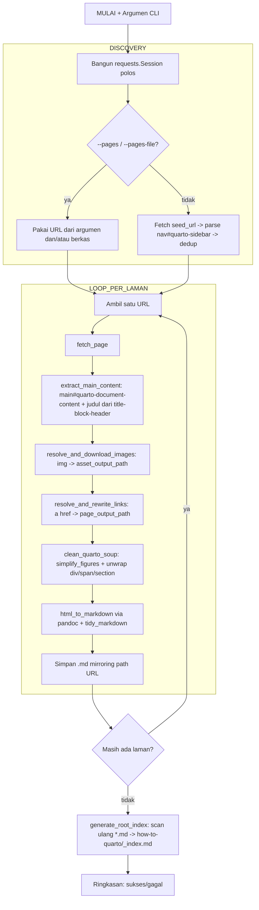

# Ekstraktor Dokumentasi Quarto (`method_claude_quarto.py`)

Dokumentasi untuk [[method_claude_quarto.py]] — skrip yang mengekstraksi dokumentasi Quarto ([quarto.org/docs/guide/](https://quarto.org/docs/guide/index.html)) menjadi berkas Markdown, ditulis langsung ke direktori [`how-to-quarto/`](../how-to-quarto/_index.md) di root repo — **menggantikan sepenuhnya** dokumentasi manual versi lama yang kini diarsipkan di `how-to-quarto/_arsip-manual-lama/`.

## Ringkasan

Berbeda mendasar dari [[method_claude.py]] (ekstraktor Moodle):

1. **Tidak ada Cloudflare.** quarto.org bukan MediaWiki dan tidak memakai proteksi Cloudflare (terverifikasi: `curl` polos dengan User-Agent generik langsung dapat HTTP 200). Skrip ini memakai `requests` biasa — tidak ada cookie/`curl_cffi`/`impersonate` sama sekali.
2. **Tidak ada API daftar laman.** Sumber discovery adalah elemen `<nav id="quarto-sidebar">` di laman seed (`docs/guide/index.html`), yang memuat seluruh ±153 tautan bagian Guide. Situs quarto.org total punya ~435 laman (`sitemap.xml`), tapi discovery sengaja dibatasi ke sidebar Guide saja — laman di luar cakupan ini (Reference, blog, dll.) tidak diunduh, tautan ke sana dibiarkan sebagai URL absolut.
3. **Struktur keluaran mirror path URL asli** (`docs/authoring/x.html` → `authoring/x.md`), bukan flat `safe_filename()` ala Moodle, karena banyak `index.html` di folder berbeda (`tools/positron/index.html`, `dashboards/index.html`, dst.) yang akan bertabrakan nama kalau di-flatten.
4. **Satu `_index.md` di root**, bukan `_index.md` per subdirektori — pengecualian sengaja dari konvensi baku `AGENTS.md`, dikonfirmasi Abdul karena skala ~150+ laman tidak realistis diindeks manual per folder.

> [!IMPORTANT] Batasan yang perlu diketahui: callout Quarto (`.callout-note`/`.callout-tip`/dst.) dan panel-tabset (dipakai luas di `tools/`, pola yang sama seperti yang sudah terlihat di arsip `03-tools/vs-*.md` versi lama) **collapse jadi paragraf/teks polos berurutan** setelah HTML-nya di-unwrap dan dikonversi pandoc — pandoc `gfm` tidak punya padanan Markdown native untuk container semacam itu. Laman yang memakainya kemungkinan perlu dipecah manual saat ditulis ulang jadi dokumentasi naratif.



## Baris-per-Baris

### KONFIGURASI

- `BASE_URL`, `DEFAULT_SEED_URL`: domain quarto.org dan laman seed default (`docs/guide/index.html`) untuk discovery sidebar.
- `DEFAULT_USER_AGENT`, `DEFAULT_DELAY`, `REQUEST_TIMEOUT`: identitas etiket dan jeda antar-request (sekadar sopan-santun, bukan menghindari blokir — tidak ada proteksi bot di quarto.org).
- `SCRIPT_DIR`, `DEFAULT_OUTPUT_DIR`: keluaran default adalah `how-to-quarto/` di root repo (sibling dari `Code/`), bukan subfolder di dalam `Code/`.
- `ASSETS_FALLBACK_DIRNAME`: nama folder (`_assets`) untuk aset yang path relatifnya kabur keluar dari `/docs/` (mis. logo situs).
- `SIDEBAR_SELECTOR`, `SIDEBAR_LINK_SELECTOR`, `MAIN_CONTENT_SELECTOR`, `TITLE_HEADER_SELECTOR`: selektor CSS kunci yang bergantung pada markup quarto.org saat ini — kalau situs berubah struktur, ini titik pertama yang perlu disesuaikan.

### SESI HTTP

- `build_session(user_agent)`: `requests.Session()` polos + header User-Agent. Tidak ada cookie/impersonate.
- `fetch_page(session, url)`: GET biasa + `raise_for_status()`; kegagalan dilempar sebagai `requests.RequestException` biasa (bukan exception khusus seperti `ChallengeError` di Moodle, karena tidak ada skenario "cookie kedaluwarsa" di sini).

### PEMETAAN URL → PATH LOKAL

- `safe_filename(name)`: sanitasi satu segmen nama (bukan seluruh path) supaya aman lintas-OS, dipakai per-segmen supaya `/` tetap jadi pemisah folder.
- `page_output_path(abs_url, output_dir)`: hanya menerima URL quarto.org di bawah `/docs/` yang berakhiran `.html`; delegasi ke `asset_output_path()` lalu mengganti ekstensi jadi `.md`. Sengaja menolak aset non-HTML (mis. `docs/authoring/elephant.png` yang dirujuk lewat tautan lightbox) supaya tidak salah dikira laman.
- `asset_output_path(abs_url, output_dir)`: pemetaan generik URL → path lokal (tanpa syarat `.html`), membuang prefix `/docs/` dan mirroring sisa strukturnya. Dipakai baik oleh `page_output_path()` maupun `resolve_and_download_images()` — **kuncinya dihitung dari URL absolut, bukan aritmetika `../` terhadap folder keluaran**, karena folder keluaran sudah kehilangan satu level (`docs/`) dibanding struktur URL asli; kalau dihitung relatif terhadap folder keluaran, path yang menuju folder gambar bersama lintas-subfolder (mis. `docs/tools/images/` dipakai bareng oleh `docs/tools/positron/` dan `docs/tools/vscode/`) akan salah hitung dan gagal ditemukan.

### DISCOVERY SIDEBAR

- `discover_guide_pages(session, seed_url, output_dir)`: fetch `seed_url` → `soup.select_one("nav#quarto-sidebar")` → ambil semua `<a class="sidebar-link">` → `urljoin` resolusi relatif → filter lewat `page_output_path()` (otomatis membuang tautan eksternal seperti github.com/shinyapps.io) → dedup urutan-pertama-muncul (beberapa href tampil dua kali: judul section sekaligus item pertama di bawahnya).

### EKSTRAKSI KONTEN

- `extract_main_content(soup)`: ambil `main#quarto-document-content`; ekstrak judul dari `h1.title` di dalam `header#title-block-header` (yang juga memuat breadcrumb di sebagian laman) sebelum header itu di-`decompose()`, supaya tidak ada duplikasi H1 antara header berkas buatan sendiri dan isi hasil pandoc.
- `simplify_figures(soup, main)`: sederhanakan `<figure><figcaption>` jadi `` + `<em>` polos, reuse ide dari `clean_soup()` Moodle. **Catatan teknis penting**: tag baru harus dibuat lewat `soup.new_tag()` (objek parse tree utuh), bukan `main.new_tag()` — di bs4 4.12, `Tag.new_tag` adalah `None`, bukan method, sehingga akan melempar `TypeError: 'NoneType' object is not callable` kalau dipanggil dari objek `Tag` biasa.
- `clean_quarto_soup(soup, main)`: panggil `simplify_figures()` lalu unwrap semua `<div>`, `<span>`, **dan `<section>`**. `<section>` wajib diikutkan: pandoc membaca elemen HTML5 `<section>` sebagai blok Div (`class="section level-N"`) dan menuliskannya sebagai `<div>` mentah di gfm karena gfm tak punya padanan container generik — kalau tidak diunwrap di sini, tiap section heading bocor jadi HTML mentah di Markdown hasil.

### PENGOLAHAN GAMBAR

- `resolve_and_download_images(session, main, page_url, page_out_path, output_dir)`: untuk tiap ``, resolusi `src` jadi URL absolut lewat `urljoin`, petakan ke path lokal lewat `asset_output_path()` (fallback ke `_assets/` kalau di luar `/docs/`), tulis ulang `src` jadi path relatif dari lokasi berkas `.md`-nya, lalu unduh kalau belum ada.

### PENGOLAHAN TAUTAN INTERNAL

- `resolve_and_rewrite_links(main, page_url, page_out_path, output_dir)`: untuk tiap `<a href>`, resolusi jadi URL absolut, petakan lewat `page_output_path()`; kalau valid (laman docs dalam cakupan Guide) tulis ulang jadi path relatif lokal + fragment; kalau di luar cakupan (Reference, aset non-HTML, eksternal) dibiarkan apa adanya.

### KONVERSI HTML → MARKDOWN

- `html_to_markdown(html)`, `tidy_markdown(markdown)`: reuse persis dari [[method_claude.py]] — generik, tidak spesifik Moodle.

### PIPA PER-LAMAN

- `process_page(session, url, output_dir)`: rangkai satu laman utuh — `fetch_page` → `extract_main_content` → `resolve_and_download_images` → `resolve_and_rewrite_links` → `clean_quarto_soup` → `html_to_markdown(main.decode_contents())` (**bukan** `str(main)` — kalau tag `<main>` itu sendiri ikut dikirim ke pandoc, ia akan dibungkus jadi `<div role="main">` mentah di gfm dengan alasan yang sama seperti `<section>` di atas) → `tidy_markdown` → simpan dengan header `# judul` + `> Sumber: url`.

### INDEKS ROOT

- `generate_root_index(output_dir)`: memindai ulang **seluruh** `*.md` di `output_dir` (bukan cuma laman yang diproses di run saat ini — supaya index tetap benar walau dipanggil setelah run parsial `--limit`/`--pages`), mengelompokkan per folder top-level, membaca judul dari baris H1 pertama tiap berkas, lalu menulis satu `_index.md` di root yang mengindeks turun sampai level subdirektori. Folder `_arsip-manual-lama/` dan `_assets/` dikecualikan dari index.

### MAIN

- `parse_args()`: `--seed-url`, `--limit`, `--delay`, `--pages`/`--pages-file`, `--output-dir` (default `how-to-quarto/`), `--user-agent`. **Tidak ada** `--cookie`/`--cookie-file`/`--impersonate`.
- `main()`: bangun sesi → tentukan daftar URL (dari argumen atau `discover_guide_pages()`) → terapkan `--limit` → loop `process_page` (satu laman gagal dihitung sebagai gagal, tidak menghentikan loop — tidak ada skenario "berhenti anggun" ala Moodle karena tidak ada proteksi bot yang bisa tiba-tiba memblokir) → `generate_root_index()` di akhir → ringkasan sukses/gagal.

## Cara Menjalankan

### 0. Prasyarat

Sama seperti [[method_claude.py]] tapi lebih ringan — **tidak perlu `curl_cffi`**:
```bash
pip install requests beautifulsoup4
```
`pandoc` harus terpasang dan bisa dipanggil dari terminal (`pandoc --version`).

### 1. Uji coba kecil dulu

```bash
cd Code
python method_claude_quarto.py --limit 5
```

Cek keluarannya di `how-to-quarto/guide/index.md` dan `how-to-quarto/authoring/*.md` — pastikan isi, gambar, dan tautan internal sudah benar.

### 2. Uji sedang (sentuh subfolder bersarang)

```bash
python method_claude_quarto.py --limit 30
```

### 3. Ekstraksi penuh

```bash
python method_claude_quarto.py
```

Semua laman di sidebar Guide (±153 laman) diunduh ke `how-to-quarto/`, lalu `how-to-quarto/_index.md` di-generate ulang otomatis.

> [!NOTE] Untuk run pertama kali terhadap `how-to-quarto/` yang sudah berisi dokumentasi manual lama, arsipkan dulu folder lama (`01-authoring`, `02-computations`, dst.) ke `how-to-quarto/_arsip-manual-lama/` sebelum menjalankan skrip, supaya tulisan manual itu tidak hilang (repo ini bukan git repository, jadi tidak ada riwayat commit sebagai jaring pengaman).

### Argumen CLI lengkap

| Argumen | Wajib? | Kegunaan |
|---|---|---|
| `--seed-url` | tidak, default `https://quarto.org/docs/guide/index.html` | Laman sumber sidebar untuk discovery |
| `--limit N` | tidak | Batasi jumlah laman (uji coba) |
| `--delay 0.5` | tidak, default `0.5` | Jeda antar-request (etiket dasar, bukan menghindari blokir) |
| `--pages URL1 URL2 ...` | tidak | Ekstrak URL tertentu saja, lewati discovery sidebar |
| `--pages-file daftar.txt` | tidak | Sama seperti `--pages`, URL dibaca satu per baris (baris kosong/`#` diabaikan), digabung dengan `--pages` |
| `--output-dir` | tidak, default `how-to-quarto/` | Override lokasi keluaran |
| `--user-agent` | tidak, default deskriptif | Override User-Agent (murni etiket, bukan untuk lolos proteksi apa pun) |

### Kalau selektor CSS berubah (situs quarto.org update markup)

Skrip melempar `RuntimeError` yang jelas kalau `nav#quarto-sidebar` atau `main#quarto-document-content` tidak ditemukan — itu tandanya markup situs berubah dan konstanta `SIDEBAR_SELECTOR`/`MAIN_CONTENT_SELECTOR`/`TITLE_HEADER_SELECTOR` di bagian KONFIGURASI perlu disesuaikan ulang.
