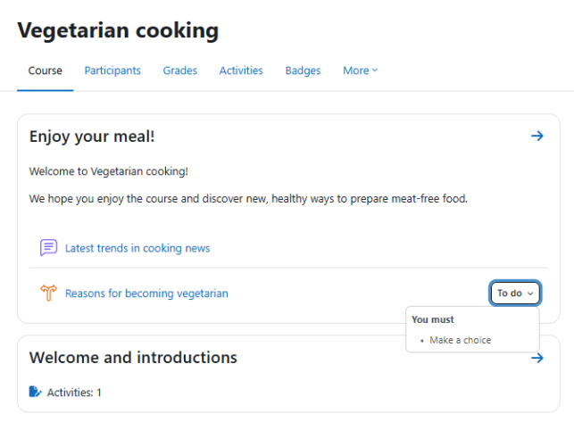
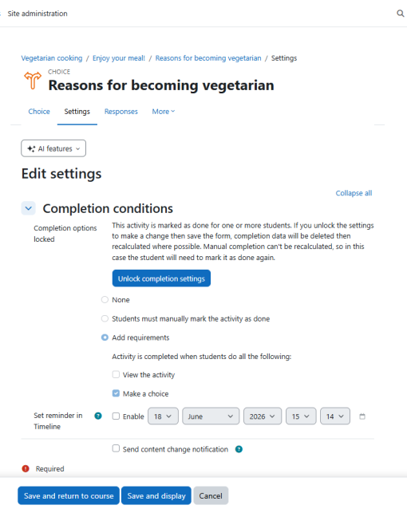

# Activity_completion

> Sumber: https://docs.moodle.org/502/en/Activity_completion

**Activity completion** allows the teacher to set completion criteria in a specific activity's settings. The criterion might be viewing, receiving a certain score or a student marking it as complete.

[New feature  
in **Moodle 5.2**!](Category_New_features.md "Category:New features")

Students see a 'To do' dropdown which displays a list of what they must do to complete an item:

 *To do - activity completion task(s) for students*

  
With edit mode enabled, teachers see a similar 'Completion' dropdown with an 'Edit conditions' link taking them directly to the Completion conditions section of the activity or resource.

 *Editing conditions for activity completion*

A teacher may mark an activity complete on behalf of a student from the [Activity completion report](Activity_completion_report.md "Activity completion report") if they have the capability Override activity completion (which is enabled by default.)

  

- [Activity completion settings](Activity_completion_settings.md "Activity completion settings")
- [Using Activity completion](Using_Activity_completion.md "Using Activity completion")
- [Activity completion FAQ](Activity_completion_FAQ.md "Activity completion FAQ")

**Note:** If you don't see an 'Activity completion' option when setting up course activities and sections, ensure it is enabled in your course settings and then check with the administrator that completion tracking is enabled in *Site administration \> Advanced features*.
