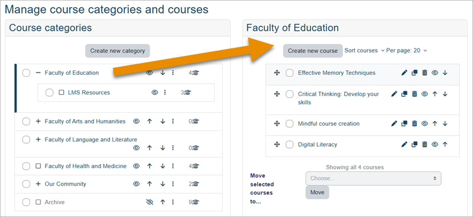
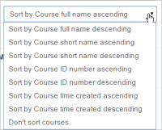
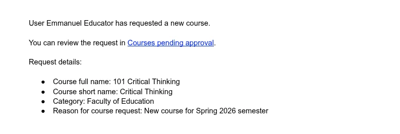
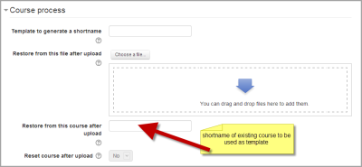
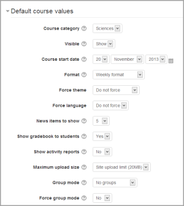
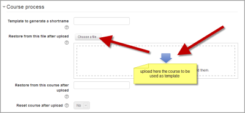

# Adding_a_new_course

> Sumber: https://docs.moodle.org/502/en/Adding_a_new_course

## Adding a course

By default a regular teacher can't add a new course. To add a new course to Moodle, you need to have either <a href="Administrator.md" class="mw-redirect" title="Administrator">Administrator</a>, <a href="Course_creator.md" class="mw-redirect" title="Course creator">Course Creator</a> or <a href="Manager.md" class="mw-redirect" title="Manager">Manager</a> rights.To add a course:

- From the Site administration link, click Courses\>Manage courses and categories

- Click on the category where you want your course to be. For more information see [Course categories](Course_categories.md "Course categories")

- Click "Create new course".

- Enter the <a href="course_settings.md" class="mw-redirect" title="course settings">course settings</a>, and then choose either to "Save and return" to go back to your course, or "Save and display" to go to the next screen.

- On the next screen,if you have chosen "Save and display", choose your students/teachers to assign to the course.

## Deleting a course

Teachers cannot delete courses. Managers (i.e. users with a role for which the capability [moodle/course:delete](Capabilities_moodle_course_delete.md "Capabilities/moodle/course:delete") is allowed) can delete courses and <a href="index.php.md" class="new" title="course creator (page does not exist)">course creators</a> can delete courses they have created themselves, but only within 24 hours of creating the course. This is so that courses created by mistake may be deleted without needing to ask an administrator.

Administrators can always delete courses.

To delete a course (as an admin or manager):

1.  From the Site administration link, click Courses \> Manage courses and categories

2.  Click the course's category and click the course in the screen on the right.

3.  Click the Delete link.

You can delete multiple courses by:

- Creating a new (temporary) category. You can name it "To be deleted".

- Select and **move** the "About to be deleted" courses to that category ("To be deleted").

- Delete the category ("To be deleted") and choose "Delete ALL - cannot be undone".

There is no user interface for course creators to delete courses they have created; however they can do so by editing the URL of the course from http://yourmoodlesite.net/course/view.php?id=N to http://yourmoodlesite.net/course/delete.php?id=N (replacing 'view' with 'delete').

### Course delete via CLI script

An administrator with command line access can delete courses by running a script. More information on the tracker issue <a href="https://tracker.moodle.org/browse/MDL-74991" class="external text" rel="nofollow">MDL-74991</a>

This is useful if:

- Course deletion fails on your production site and you are unable to troubleshoot why;

- You need to delete a very large course.

## Sorting courses

Courses may be sorted by an admin or manager from *Administration\>Site administration\>Courses\>Manage courses and categories.*

Courses may be sorted by ascending/descending and by time created.

 *Sorting courses*

## Course requests

You can enable course requests in *Site administration \> Courses \> Course request*.

You can set the default category for course requests, whether users can select a category when requesting a course, and who can receive notification of course requests (from a list of users with the capability [moodle/site:approvecourse](Capabilities_moodle_site_approvecourse.md "Capabilities/moodle/site:approvecourse")).

A user who is able to request a course can do this from the three dots on the My Courses page.

If course requests are enabled, by default all authenticated users can make course requests. See [Course requester role](Course_requester_role.md "Course requester role") for details of how to restrict users who can make course requests.

 *An example course request notification containing information such as the user's name and request details (course full name, short name, category and reason for course request).*

## Bulk course creation

For full details on how to bulk create courses and use course templates, see [Upload courses](Upload_courses.md "Upload courses").

1.  Go to *Administration \> Site Administration \> Courses \> Upload courses*.

2.  Upload a CSV file either by dragging and dropping or using the button to select from the File picker.

3.  Select your import options and click Preview. If the settings are acceptable, click Upload.

## Course templates

It is possible, from *Administration\>Site Administration\>Courses\>Upload courses* to specify a course and settings to use as template for future courses.

Default blocks for new courses can also be configured in config.php.

### Using an existing course as a template

First, create or locate on your Moodle the course you wish to use as a template and make a note of its shortname. A template course might for example have common headings or section summaries or policy agreements used throughout the site for consistency.

*Note that only the content of the course will be restored; not its settings. Settings are added separately.*

#### Method 1

- Create your csv file. See [Upload courses](Upload_courses.md "Upload courses") for accepted fields.

- From the Site administration link, click Courses\>Upload courses and add your file.

- Preview it and scroll down to 'Course process'. In the box 'Restore from this course after upload', add the shortname of your template course.

- If you are creating several courses using the same template and you wish them all to have the same settings, you can specify these in the Default course values.

- Upload your csv file.

|  |  |  |

|----|----|----|

|  *Adding shortname of template course* |  |  *Default course values* |

#### Method 2

- All the settings and the chosen template course can be specified in the csv file you create. Use *templatecourse* as the field for your chosen template course, and use the course shortname. See [Upload courses](Upload_courses.md "Upload courses") for full list of fields you can include.

- Here is an example of a csv file for restoring a course to be used as a template. It specifies for example the theme, language, enrolment method and alternative names for student and teacher.

` shortname,fullname,category,newsitems,theme,lang,format,enrolment_1,enrolment_1_role,role_student,role_teacher,templatecourse Knit,Knitting,2,0,afterburner,fr,topics,manual,student,NewKnitter,MasterKnitter,OMT `

- Go to Administration\>Site administration\>Courses\>Upload courses and add your csv file.

### Using a backup course as a template

It is possible during the process of creating courses with a csv file in *Site administration\>Administration\>Courses\>Upload courses* to specify and upload a backup file to be used as a template.

- Create your csv file. See [Upload courses](Upload_courses.md "Upload courses") for accepted fields.

- From *Site administration\>Administration\>Courses\>Upload courses*, add your file.

- Preview it and scroll down to 'Course process'. In the box 'Restore from this file after upload', add the backup file you wish to use as the template.

- If you are creating several courses using the same template and you wish them all to have the same settings, you can specify these in the 'Default course values' section.

- Alternatively, you can specify the course settings (such as format, enrolment methods, language) in the csv file. This method is useful if you wish different courses using the same template to have different settings.

- Upload your csv file.

|  |

|----|

|  *Uploading a template course* |

### Using the course templates plugin

With emeneo's course templates plugin you can very easily create template based courses. More information and the plugin package you can find here: <a href="https://moodle.org/plugins/local_course_templates" class="external text" rel="nofollow">https://moodle.org/plugins/local_course_templates</a>

## See also

### Screencasts

- <a href="https://youtu.be/8pIEW6ji4q8?si=VFMZwZGEteiSxVZD" class="external text" rel="nofollow">Bulk course creation</a>

### Forum discussions

- Using Moodle <a href="http://moodle.org/mod/forum/discuss.php?d=83830" class="external text" rel="nofollow">Hide Courses from some users or students</a> forum discussion

