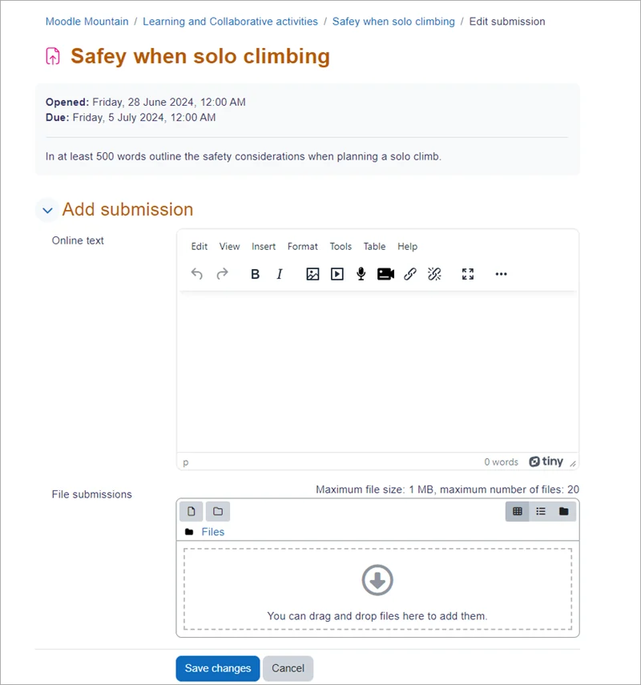
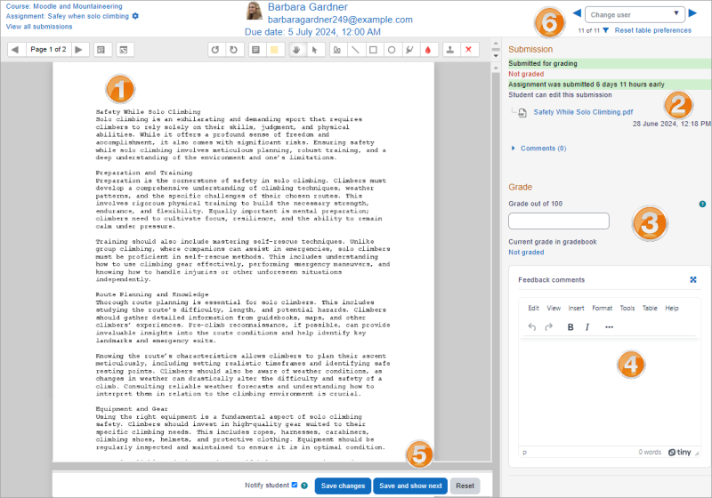

# Assignment

> Sumber: https://docs.moodle.org/502/en/Assignment

## What is the Assignment activity?

Assignments allow students to submit work to their teacher for grading. The work may be text typed online or uploaded files of any type the teacher's device can read. Grading may be by simple percentages or custom scales, or more complex rubrics may be used. Students may submit as individuals or in groups.

## How is it set up?

1.  In a course, with the editing turned on, choose 'Assignment' from the activity chooser.
2.  Give it a name and, in the description explain what the students must submit. You can upload a help or example document from the Additional files area.
3.  Expand the other settings to select, for example, availability times, how you want them to submit and how you plan to give them feedback. (Comment inline allows you to annotate directly on their submitted work.)
4.  If you want them to verify they are submitting their own work, or if you want to prevent them changing their submission once uploaded, explore the Submission settings. To have them submit in group, explore Group submission settings (ensuring your course has groups)
5.  To use a rubric instead of a single grade scale, change the Grading method to Rubric and, once the assignment is saved, create or locate the rubric from the Advanced grading link in the Assignment administration block on the side.

Note: Ask your administrator to check the assignment defaults if you are missing a particular setting.

## How does it work?

### Student view

Students click the assignment link and click “Add submission”. Depending on the assignment settings, they either have a text box into which to type their work or an upload area to submit their file.

They may be able to return to their work and redraft it, or they might have to click a submit button to send in a final version which cannot be changed. See [Assignment settings](Assignment_settings.md "Assignment settings") for more information.

### Teacher view

Once students have submitted work, click on the assignment and click “Grades”. The exact view depends on the teacher and admin settings. See [Assignment settings](Assignment_settings.md "Assignment settings") for more detail.

Here, the submission may be annotated *(1)* and/or downloaded *(2)*; a grade entered *(3)* and individual feedback given *(4).* The teacher saves the changes *(5)* and moves to the next student *(6)*

  
Assignment grader panels can be resized by dragging the dividing border, allowing more space for advanced grading methods.

When students download files from the Feedback files section, Moodle now records a log event (Feedback file downloaded). Teachers and administrators can view these entries in *Course \> More \> Reports \> Logs*, showing details such as the filename, file ID, user, and assignment. This improvement helps monitor which students have accessed their marked feedback.

## More information

- [Assignment settings](Assignment_settings.md "Assignment settings")
- [Using Assignment](Using_Assignment.md "Using Assignment")
- [Assignment FAQ](Assignment_FAQ.md "Assignment FAQ")
- <a href="https://moodle.academy/course/view.php?id=8" class="external text" rel="nofollow">Assessment: Exploring assignments</a> - An intermediate-level Moodle Academy course that explores how to use assignments for both formative and summative assessment.
