# Assignment_settings

> Sumber: https://docs.moodle.org/502/en/Assignment_settings

This page explores in more detail the settings for the [Assignment activity](Assignment_activity.md "Assignment activity") once you have added it to your course and also covers the Site administration settings.

Note that if you want to edit an existing assignment, click the Edit link to its right and choose the action you wish to take, e.g. 'Edit settings'.

## General

- In the Description, give a general explanation of the assignment. Check the box if you want this description to display on the course page.
- In Additional files, you can add files which may be of help to the students as they do their assignment, such as example submissions or answer templates.

<!-- -->

- In Activity instructions, explain in greater detail what students must do. This is displayed when they edit and submit their assignment.

## Availability

Allow submissions from  
This stops students from submitting before the shown date, but it doesn't hide the assignment and any included instructions or materials.

Due date  
Submissions are still allowed after this date but will be marked as late. Disable it by unticking the checkbox. Assignments without a due date will appear on the dashboard with 'No Due Date' displayed.

Cut-off date  
After this date, the submit button will be hidden, and students will not be able to submit.

Remind me to grade by.  
A date needs to be entered here for the assignment to display on the teacher's [Timeline block](Timeline_block.md "Timeline block") and in the [Calendar](Calendar.md "Calendar"). It will show when at least one student has submitted.

<!-- -->

Time limit  
An assignment may have a time limit, similar to a the Quiz activity. However, the time limit does not prevent learners from submitting after the time has passed. They can still submit but their submission is marked as submitted after the time limit. The time limit feature must be enabled by the admin from *Site administration \> Plugins \> Assignment settings \> Enable timed assignments.*

## Submission types

Here you can decide how you wish students to submit their work to you.

Note: If Submission comments are enabled in *Administration\>Plugins\>Activity modules\>Assignment\>Submission plugins*, students will be able to add a note to their teacher on submitting work. If Anonymous submissions are enabled, student comments display in the gradebook as from "Participant 01 etc" to avoid revealing identities.

Online text  
Students type their responses directly in Moodle using a text editor, which automatically saves text at regular intervals.

It's possible to set a word limit on an online text assignment. Students get a warning if they try to exceed the word limit. Numbers are counted as words and abbreviations such as *I'm* or *they're* are counted as single words.

File submissions  
Students can upload one or more files of any type the teacher can open. The teacher can annotate uploaded PDFs, docx and odt files within the browser, and on saving, the annotated file is made available to the student. (Check with your admin that <a href="https://en.wikipedia.org/wiki/Ghostscript" class="external text" rel="nofollow">Ghostscript</a> and a [document converter](Document_converters.md "Document converters") are enabled, if you can't annotate uploaded files.)

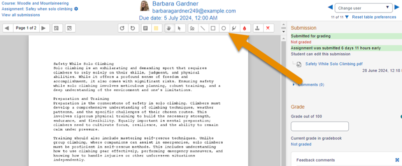

  

Comments may be collapsed to make it easier to read the original text:

<a href="File_collapsedcommentexample.png.md" class="mw-file-description">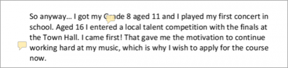</a>

Maximum submission size  
The maximum upload size refers to each file a student uploads. It cannot be larger than the limit in the Course settings.

Accepted file types  
The teacher can specify the types of file the students may upload to the assignment. A file type selector appears upon clicking 'Choose', offering a choice of different file types. (See the video <a href="https://youtu.be/vN1DlHeZkw4" class="external text" rel="nofollow">File type selection</a> for more information.) Leaving the field blank will allow all file types.

If the file types have been restricted, then when students attempt to submit the assignment, they will see a message telling them which files are accepted:

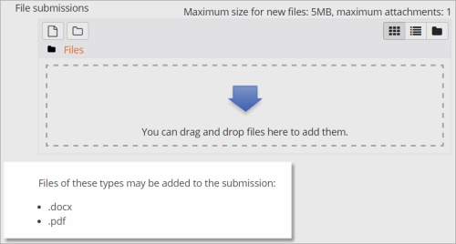 *Student view of specified files*

## Feedback types

Feedback comments  
With this enabled, markers can leave comments for each submission (which appear on the assignment grading screen.) Audio and video comments may also be left, using the icon in the text editor.

  
**Annotate PDF** appears if this setting is enabled by the Site administrator in the *Manage assignment feedback plugins* section of Site admin and will allow the teacher to annotate using comments, stamps and other features.

Offline grading worksheet  
This is useful if you wish to download the grading list and edit it in a program such as MS Excel.

|  |
|----|
| 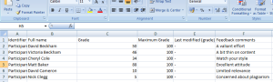 *Editing the grades offline* |

When the teacher has completed their grading offline, they can then upload the spreadsheet, confirm the changes and the grades and comments will be transferred over into Moodle's gradebook:

|  |  |
|----|----|
| 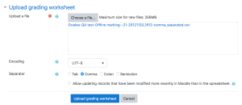 *Uploading the grading worksheet* | 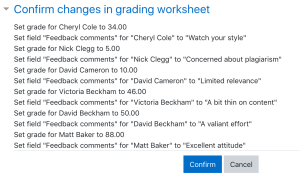 *Confirming the changes* |

  

Feedback files  
This allows markers to upload files with feedback when marking. These files may be the marked up student assignments, documents with comments, a completed marking guide, or spoken audio feedback. It enables the Feedback Files column in the assignment grading screen (accessed from the Submissions link in Assignment navigation). To upload feedback files, click the Grade button top right and then upload either with drag and drop or using the [File picker](File_picker.md "File picker"). Alternatively, click the three dots next to a specific student in the grading screen, click Grade and upload in the same way.

|  |
|----|
| 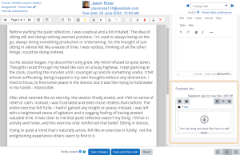 *Uploading feedback files* |

**Uploading multiple feedback files** is also possible:

1.  Download the students' assignments using the "Download all submissions" link.
2.  Extract the folder offline and add your comments to the student's submissions. Keep the names the same.
3.  Select the students' submissions and zip them into a new folder. Important: Don't just edit them inside their original folder and re-zip this; it will not work. The folder name does not matter as long as the feedback files have the same names as before.
4.  Upload this newly zipped folder.
5.  You will be presented with a confirmation screen displaying your feedback files. (If you zip files from a Mac, make sure to remove the folder \_MACOSX)

|  |  |
|----|----|
| 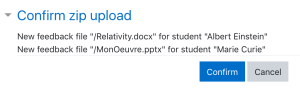 *Confirmation screen displaying the feedback files to be uploaded* | 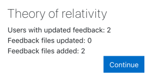 *Screen confirming uploaded feedback* |

Comment inline  
This usefully allows you to comment directly on an 'online text' type submission.

## Submission settings

Require students click submit button  
If this is set to 'No' students can make changes to their submission at any time. (If you want to stop them changing work once you are ready to grade, click the Submissions link; locate the student and From the Status column, click the the three dots icon and select 'Prevent submission changes'.)

If set to 'Yes', students can upload draft versions of the assignment until such time as they are ready to submit. Clicking the submit button tells the teacher they have finished drafting and want the work to be graded. They can no longer edit it and must ask the teacher to revert to draft status if they need to change it again. To do that, click the Submissions link, locate the student and from the Status column, click the three dots icon and select 'Revert the submission to draft'. To do this in bulk, select the relevant students and from the Status menu at the top of the grading screen, select your chosen action.

|  |  |
|----|----|
| 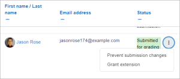 *Prevent submission changes* | 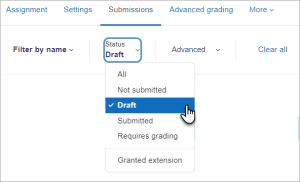 *Status at top of screen for bulk select* |

Require that students accept the Submission statement  
An administrator can define a "Submission statement" (see below) i.e. a statement where students promise the work is their own and which they must agree to before submitting their work. If the administrator has given teachers the option of using a submission statement or not, then it will be available in the assignment settings screen. If the administrator has forced the statement throughout the site, a teacher will not have this option in the settings but a student will see the statement when accessing their assignment. Note: The admin can set different submission statements for individual or group submissions.

<!-- -->

Allowed attempts  
The maximum number of attempts that a student can make. Once this number is reached, the submission can no longer be reopened.

<!-- -->

Grant attempts  
If 'Allowed attempts' is set to unlimited or more than 1, you can specify how to grant further attempts - Manually (via the Submissions page or Grader page), Automatically (after grading), or Automatically until pass (after grading, until the student achieves the passing grade).

## Groups submission settings

These settings allow students to collaborate on a single assignment, e.g. working in the same online area or uploading, editing and reuploading an MS Powerpoint in the common assignment area.

When grading, the teacher may choose to give a common grade and feedback to all students in the group or to give individual grades and feedback to each member.

Require group to make submission  
Students not in a group can still submit assignments unless this is forced in *Site administration \> Plugins \> Assignment \> Assignment settings*. Moodle will then display a message *You're not a member of any group; please contact your teacher*, and the student will not be able to submit the assignment.

Require all group members submit  
This setting will only appear if the teacher has ticked the "Require students click submit button" earlier. The assignment will not be classed as "submitted" until all members of the group have made a contribution. When one student has submitted, the other members of the group will be able to see who still has to submit.

Grouping for student groups  
If a particular grouping is selected here, then the gradebook will display any other groups and non-grouped students in the "default group", while naming the group(s) that are in the chosen grouping. If "none" is selected, then the gradebook will display the names of all groups and put any non-grouped students in the "default group". See this <a href="https://moodle.org/mod/forum/discuss.php?d=216399#p942913" class="external text" rel="nofollow">forum post on grouping for student groups</a> for examples of how this might be used.

## Notifications

(Note that if you are using group mode then course teachers need to be members of the group in order to receive submission and late submission notifications.)

Learners receive the following assignment notifications (via their preferred notification format):

- Assignment due in 7 days
- Upcoming assignment due (48 hours before the due date)
- Assignment overdue.

These notifications can be switched on or off, site wide, by an administrator in the site [Notifications](Notifications.md "Notifications") configuration.

- Teachers can send notifications to students when an assignment is graded.
- Teachers can receive notifications when students submit an assignment.
- Teachers can receive notifications when students submissions are overdue

These notifications can be controlled by a teacher from the assignment settings page.

## Grade

- See [Grade points](Grade_points.md "Grade points") and [Advanced grading methods](Advanced_grading_methods.md "Advanced grading methods") for more information on the settings here.
- Setting a passing grade may be connected with [Activity completion](Activity_completion.md "Activity completion") and [Restrict access](Restrict_access.md "Restrict access") such that a student will not be able to access a follow up activity until they have passed this assignment.

### Anonymous submissions

This hides students' names when grading and instead shows randomly generated Participant numbers.

With Anonymous submissions, students cannot see the final grade until all of the students' names have been revealed. Rubrics will also be hidden from students' view until the names are revealed. To reveal student names after you are finished grading, look under *Assignment settings \> Reveal student identities*. Feedback comments will appear whether or not student names are hidden or revealed. Note that this level of anonymity might not suit the privacy requirements of your organisation. See <a href="https://tracker.moodle.org/browse/MDL-35390" class="external text" rel="nofollow">MDL-35390</a> for more details.

Users with the capability [View student identities when Anonymous submissions are enabled](Capabilities_mod_assign_viewblinddetails.md "Capabilities/mod/assign:viewblinddetails") (by default managers only) can view student identities and participant numbers.

Users with the capability [View anonymous events in reports](Capabilities_moodle_site_viewanonymousevents.md "Capabilities/moodle/site:viewanonymousevents") (by default managers only) can view student submissions to assignments with Anonymous submissions (in Moodle 3.9 onwards).

### Marking (grading) workflow

This lets you keep grades and feedback hidden until you are ready to release them to students. It is also useful if you want to show your progress in grading, or co-ordinate multiple markers/graders.

  

|  |  |
|----|----|
| 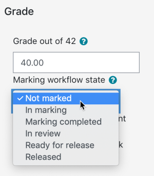 *Marking workflow state in the individual grading screen* | 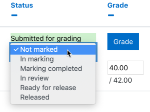 *Dropdown to select marking workflow state when quick grading* |

The phases are:

- Not marked (the marker has not yet started)
- In marking (the marker has started but not yet finished)
- Marking completed (the marker has finished but might need to go back for checking/corrections)
- In review (the marking is now with the teacher in charge for quality checking)
- Ready for release (the teacher in charge is satisfied with the marking but wait before giving students access to the marking)
- Released (the student can access the grades/feedback)

**Note:** If the student's grade is locked or overridden in the Gradebook, changing the Marking Workflow State has no effect (either on the grading form or as a bulk action on multiple submissions)

Marking allocation  
Marking allocation can be used if marking workflow is set to Yes. Teachers can then be selected to grade or review submitted work of specific students.

  

|  |
|----|
| 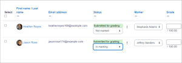 *Allocated markers on the grading screen* |

[New feature  
in **Moodle 5.2**!](Category_New_features.md "Category:New features")

Multiple markers can be assigned to a single assignment submission.

Markers  
When marking allocation is enabled, you can specify how many markers will grade each submission (1–10). Each allocated marker grades independently and their grade is called a **mark** (as distinct from the final **grade** recorded in the gradebook).

<!-- -->

Calculate grade  
When more than one marker is used, this setting determines how the final grade is derived from the individual marks:

- **Manual** – the teacher in charge sets the final grade manually
- **First** – the final grade is taken from the first marker's mark
- **Maximum** – the highest mark across all markers becomes the final grade
- **Average** – the mean of all markers' marks becomes the final grade

<!-- -->

Rounding  
Visible only when **Calculate grade** is set to **Average**. Determines how the averaged mark is rounded:

- Round up
- Round down
- Natural rounding
- No rounding

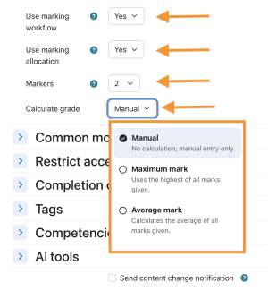 *Markers and Calculate grade settings are only visible when both Use marking workflow and Use marking allocation are enabled*

Note: Markers and Calculate grade are only available when both **Use marking workflow** and **Use marking allocation** are enabled.

For information on using these settings to assign markers to students and manage the grading process, see [Using multiple markers](Using_multiple_markers.md "Using multiple markers").

## Other settings

Depending on what is enabled for your site and course, you may also need to explore [Common module settings](Common_module_settings.md "Common module settings"), [Restrict access](Restrict_access.md "Restrict access"), [Activity completion](Activity_completion.md "Activity completion"), [Tags](Tags.md "Tags") and [Competencies](Competencies.md "Competencies")

## Assignment capabilities

- [Export own submission](Capabilities_mod_assign_exportownsubmission.md "Capabilities/mod/assign:exportownsubmission")
- [Grade assignment](Capabilities_mod_assign_grade.md "Capabilities/mod/assign:grade")
- [Submit assignment](Capabilities_mod_assign_submit.md "Capabilities/mod/assign:submit")
- [View assignment](Capabilities_mod_assign_view.md "Capabilities/mod/assign:view")

Role permissions for the activity can be changed from the gear icon Actions menu.

## Site administration settings

Administrators can access assignment configuration options by expanding *Administration \> Site administration \> Plugins \> Activity modules \> Assignment*.

### Assignment settings

Here, the administrator can set defaults for certain settings. They may also make certain settings 'Advanced' which means a course teacher has to click the 'Show more' link to see them, or they may 'lock' settings which means a course teacher cannot alter that setting.

If the site contains courses with over 100 participants, the number of assignments listed on the assignment grading page may be limited using the Maximum assignments per page (assign \| maxperpage) setting. This removes 'All' from the 'Assignments per page' setting.

Submission statement  
Here is where the administrator can enter text which will appear when students are about to submit an assignment. There are three options:

|  |  |
|----|----|
| 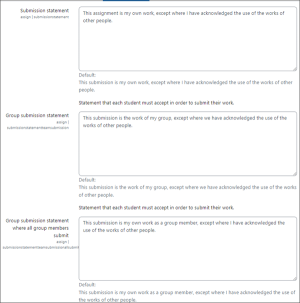 *Admin view of Submission statement set up screens - click to enlarge* | 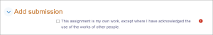 *Student view when about to submit - click to enlarge* |

  

If it is left as the default "No", then teachers will have the choice within their own assignments to force this or not.

The submission statement may be shown in different languages. See [Multi-language content filter](Multi-language_content_filter.md "Multi-language content filter") for how to do this.

Note for sites using languages other than English: There is currently a bug affecting the default assignment submission statement - it doesn't display in a user's language (<a href="https://tracker.moodle.org/browse/MDL-54731" class="external text" rel="nofollow">MDL-54731</a>). A workaround is to enter the submission statement in the required language (using the multi-lang filter if multiple languages are required) in the 'Submission statement' (submissionstatement) field then save the changes.

### Submission plugins

Here the administrator can enable, disable or change the order and default settings for any submission plugins.

Submission comments  
Note that if submission comments are enabled here AND comments enabled globally in *Site Administration \> Advanced features*) then students will be able to send a message to their teacher when submitting their assignment. If either of those settings is disabled, then the submission comments link will not appear.

### Feedback plugins

#### Manage assignment feedback plugins

Here the administrator can enable, disable or change the order and default settings for any feedback plugins.

Annotate PDF  
This is the place to upload stamps for teachers to use when annotating student PDFs.

##### Check Ghostscript

You can also check the ghostscript path from here:

|  |  |
|----|----|
| 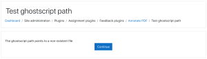 *Ghostscript not installed or incorrectly installed* | 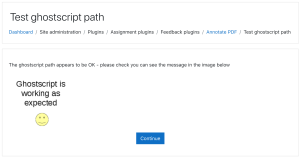 *Ghostscript correctly installed* |

If the default stamps are deleted by accident, they can be found in mod/assign/feedback/editpdf/pix and re-uploaded.
