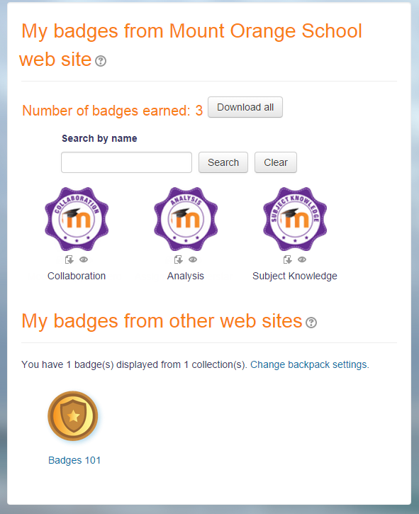

# Badges

> Sumber: https://docs.moodle.org/502/en/Badges

**Badges** are a good way of celebrating achievement and showing progress. Badges may be awarded based on a variety of chosen criteria and may be displayed on a user's profile or pushed to their <a href="https://badgr.io" class="external text" rel="nofollow">Badgr backpack</a> and public badge collections in their backpack will display in their Moodle profile.

There are two categories of badges:

- Site badges - available to users site-wide and related to the site wide activities, like finishing a set of courses.
- Course badges - available to users enrolled in the course and related to the activities that happen inside the course.

- [Managing badges](Managing_badges.md "Managing badges")
- [Badges settings](Badges_settings.md "Badges settings")
- [Using badges](Using_badges.md "Using badges")
- [Badges FAQ](Badges_FAQ.md "Badges FAQ")
