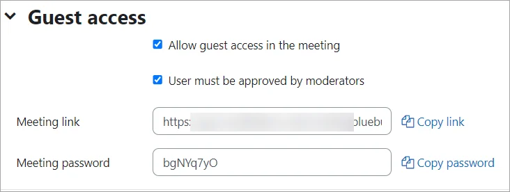
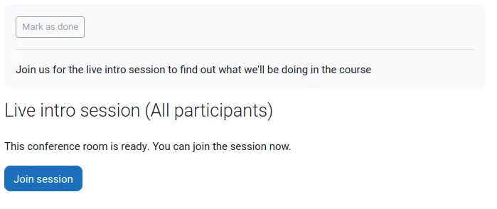
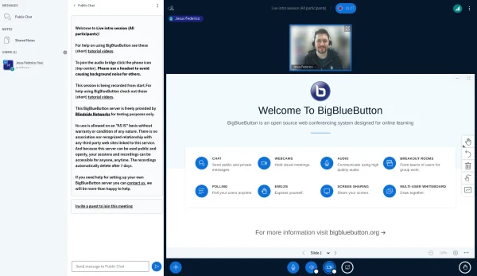

# BigBlueButton

> Sumber: https://docs.moodle.org/502/en/BigBlueButton

  

## What is the BigBlueButton activity?

BigBlueButton lets you create from within Moodle links to real-time on-line classrooms using BigBlueButton, an open source web conferencing system for distance education. You can specify conference times, which are then added to the calendar, and, if allowed in your installation, the sessions may be recorded for viewing later.

Note: For data protection reasons, BigBlueButton is disabled by default. Administrators must enable it from *Site administration \> Plugins \> Manage activities* and then check the box to accept the data processing agreement. They must then register on the BBB portal from the Settings page.

Free Tier Hosting is currently restricted as follows:

1.  The maximum length for each session is 60 minutes;
2.  The maximum number of concurrent users per session is 25;
3.  Recordings expire after seven (7) days and are not downloadable; and
4.  Viewers' (student) webcams are only visible to the moderator.

## How is it set up?

- In a course, with Edit mode enabled, choose, BigBlueButton from the activity chooser.
- Choose a name and description, and, if desired, a welcome message which will appear in the Chat box when participants join the session.
- If you tick "wait for moderator", students can only join once someone with the moderator role has entered the room.
- From the Participants list you can, if needed, give specific roles to specific people, such as a moderator role.

In the activity settings you can set a grade type (point or scale) and give students grades for the activity in the gradebook.

If enabled by the administrator from *Site administration \> Plugins \> Activity modules \> BigBlueButton \> Experimental settings*, a new section, Guest access, becomes available to course teachers.

**Note: Guest access to a BBB session is not possible if your site forces users to log in (i.e. if 'forcelogin' is enabled).**

- From Guest access, you can check the box to allow external users without accounts to join the room. When the box is checked, a meeting link and password become available.

- In the Schedule section you can set a start time and also a time after which student will not be able to enter the room.

## How does it work?

- Once set up, the activity appears with a link to join when the time is correct. (Before then, or if a moderator is required first, a message appears saying the conference has not yet started.)

- On entering the room, a message will appear asking if you want to use your microphone or just listen. If you choose microphone you will need to check your settings.
- The moderator can choose whether to allow participants to use webcams and microphones or not.
- The central area can display presentations, polls, screensharing or an interactive whiteboard.
- There is also a chat option with public and private chat.

## Admin settings

From *Site administration \> Plugins \> BigBlueButton*, administrators can set the defaults for BBB sessions and recordings in courses.

- From *BigBlueButton \> Extended capabilities*, admins can control whether or not participant profile photos are shown in sessions.
- From *BigBlueButton \> Recordings*, admins can specify which recording formats (such as presentations) may be viewed by everyone, and which (such as statistics) are restricted to those with the capability [mod/bigbluebuttonbn:viewallrecordingformats.](Capabilities_mod_bigbluebuttonbn_viewallrecordingformats.md "Capabilities/mod/bigbluebuttonbn:viewallrecordingformats")
- From *BigBlueButton \> Presentation file \> Show presentation file on activity page* admins can decide whether to allow teachers to let students see the presentation file before a webinar. Users with the capability [Always see presentation file on activity page](Capabilities_mod_bigbluebuttonbn_seepresentation.md "Capabilities/mod/bigbluebuttonbn:seepresentation") will be able to see the presentation regardless.
