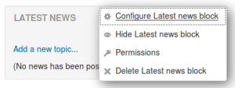
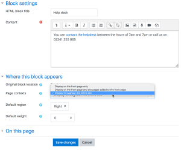
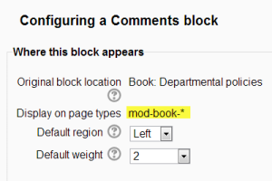

# Block_settings

> Sumber: https://docs.moodle.org/502/en/Block_settings

## Adding a block to a page

Blocks can be added to a page by turning editing on then using the 'Add a block' drop-down menu.

Please see [Blocks](Blocks.md "Blocks") for a list of all the blocks in a standard Moodle install. Your site may have added contributed blocks and or your site administrator has disabled specific blocks on your site.

Note: The ability to add a particular block to a page is controlled by an *addinstance* capability (e.g. [block/comments:addinstance](Capabilities_block_comments_addinstance.md "Capabilities/block/comments:addinstance")), which is allowed for the default role of teacher.

## Block actions

After adding a block, click the edit icon in the block header to configure it.

|                                                                  |
|------------------------------------------------------------------|
|  *Block actions* |

### Block settings

Certain blocks, such as the Text block, allow a block title and more to be set.

### Where this block appears

Depending upon the context and user permissions, this area determines where this block will appear. See this forum post <a href="https://moodle.org/mod/forum/discuss.php?d=270526#p1166400" class="external text" rel="nofollow">explaining block contexts</a> for more information.

- Original block location: provides information about where the block was initially created.
- Display on page types: allows the user to set the context that the block can appear in. These options will vary depending upon the permissions of the user. For example, a site administrator might see a setting that will allow the block to appear on Any page, or any type of course main page, while a teacher may only see the option to place it on every page in the course.
- Default region: Usually a right column or left column option
- Default weight: Where in the column do you want it to appear if there are other blocks in that column. -10 will put it at the top, 10 will put it at the bottom. A zero is neutral.

### On this page

- Visible - Yes or No.
- Region - Here you can override the column preference on this page.
- Weight - Here you can override the default setting on this page.

## 'Sticky blocks'

The term 'sticky' block was used in older versions of Moodle to mean blocks which the admin added either site-wide or to the [Dashboard](Dashboard.md "Dashboard") and which could not be deleted by regular users. Although the term is no longer used, it is still possible to make blocks 'sticky' and in a wider variety of locations.

If an admin deletes a "sticky" block in a course, they receive a warning of the site-wide consequences of this action before it is deleted.

Here are a few examples:

### Making a block sticky throughout the whole site

The Moodle administrator might wish for example to display support contact details site-wide using an <a href="HTML_block.md" class="mw-redirect" title="HTML block">HTML block</a> called 'Helpdesk':

1.  As an administrator, turn on the editing on the front page and add the block you wish to make sticky to the front page.
2.  For *Where this block appears \> Page contexts*, choose 'Display throughout the entire site'.
3.  Decide other settings according to your preference and save.
4.  The block will now appear on all pages of your Moodle.
5.  TIP: if you want the block to appear throughout the site but NOT on the front page, you can hide it from that page (using the settings in the section “On this page”).

|  |
|----|
|  *Making a block sticky throughout the site* |

### Making a block sticky throughout a course

A teacher might wish to display a block, such as the comments block, on the course page and all activity pages.

1.  As a teacher in the course, turn on the editing on the course main page and add the block you wish to make sticky.
2.  For *Display on page types*, choose 'Any page'.
3.  Decide other settings according to your preferences and save.
4.  The block will now appear on all pages of the course.

### Making a block sticky in a category

A user with category rights might for instance wish to display a [RSS feeds block](RSS_feeds_block.md "RSS feeds block") in all of the courses within a particular category, such as a Head of Science adding Science news feeds to the Physics, Biology and Chemistry courses.

### Making a block sticky in a resource or an activity

A teacher might wish to display a block in one particular resource or activity, for example a Head of Faculty might make create a <a href="Book.md" class="mw-redirect" title="Book">Book</a> for departmental policies and wish to add the comments block to every chapter/page of a book so colleagues can give quick feedback. (Note that such a comments block would be the *same* block on each chapter/page)

1.  As a teacher in the course, turn on the editing and click into the resource/activity -in this case a Book and add the block.
2.  For *Display on page types*, you will see (for example) 'mod-book\*'
3.  Decide other settings according to your preferences and save.
4.  The block will now appear on all related screens.

|  |
|----|
|  *Making a block sticky throughout a book* |

### Adding a block to all user profile pages

See [User profiles](User_profiles.md "User profiles").

### Adding a block to the dashboard for all users

See [Dashboard](Dashboard.md "Dashboard"). Note that such a block would not be truly 'sticky', in that users can customise their dashboard and could, if wished, delete the block.

## Block permissions

To change role permissions for a block

1.  Turn editing on in the course
2.  In the actions menu in the header of the block, click Permissions'.

See [Blocks FAQ](Blocks_FAQ.md "Blocks FAQ") for details of how to hide front page blocks from non-logged-in users.
