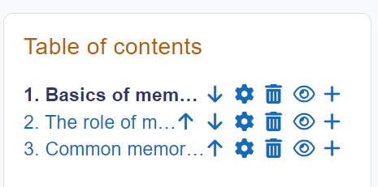
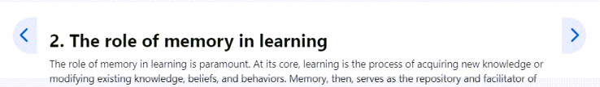
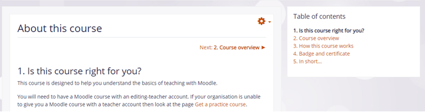
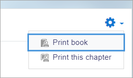

# Book_resource

> Sumber: https://docs.moodle.org/502/en/Book_resource

  

## What is the Book resource?

Books allow teachers to create multi-page resources with a book-like format and table of contents. Multimedia may be embedded and books may be printed entirely or by chapter.

## How is it set up?

1.  In a course, with the editing turned on, choose 'Book' from the activity chooser.
2.  Give it a name and, if required a description (which will appear on all chapters of the book), checking the box if you want the description displayed on the course page.
3.  In Appearance, decide on the chapter formatting, and whether you want custom titles. Use the help icon for more information.
4.  Expand the other settings to configure the resource as you wish, and then click Save and display.
5.  Add content to your first chapter and save the changes. (Note: Moodle 'chapters' are what some might prefer to call 'pages.'
6.  From the Table of Contents (at the side or underneath the chapter) click the + icon to add another chapter, and repeat the process.

For usability and accessibility, the navigation icons float when a page requires scrolling.

## How does it work?

### Student view

Students access the book by clicking the icon on the course page. They navigate through the pages either with an arrow, text link or simply via the Table of Contents.

Images, videos, sound and H5P content may be embedded into book chapters. (Note that embedded H5P content doesn't connect to the gradebook.)

 *Book with text navigation and numbered chapters*

Students can print books or chapters (as PDF) by clicking the gear icon top right of the book:

### Teacher view

Teachers can edit books from the Table of contents when the editing is turned on. If they hide a page, it is still visible to teachers but students do not see it.

## More information

- [Book settings](Book_settings.md "Book settings")
- [Using Book](Using_Book.md "Using Book")

## See also

- [Book FAQ](Book_FAQ.md "Book FAQ")
- <a href="http://moodle.org/mod/forum/view.php?id=2633" class="external text" rel="nofollow">Book forum</a> on moodle.org
- <a href="http://school.moodledemo.net/mod/book/view.php?id=261" class="external text" rel="nofollow">Mount Orange demo example of a book used for departmental policies.</a>
- <a href="http://moodle.org/mod/forum/discuss.php?d=76092" class="external text" rel="nofollow">Using a Lesson to simulate a Book</a> forum discussion
- <a href="http://moodle.org/mod/forum/discuss.php?d=207365&amp;parent=910023#p910107" class="external text" rel="nofollow">What's the difference between a Book and a Lesson?</a>
