# Building_Quiz

> Sumber: https://docs.moodle.org/502/en/Building_Quiz

  

## How a Moodle quiz works

**Note:** If you're new to quiz creation, try the <a href="Quiz_quick_guide.md" class="mw-redirect" title="Quiz quick guide">Quiz quick guide</a> first.

Once a quiz has been added to the course and the [Quiz settings](Quiz_settings.md "Quiz settings") established, the teacher can start to build the quiz. The teacher can access the quiz to edit the questions by clicking directly on the Quiz name on the course home page and clicking the Add question button (You can also make questions in the <a href="Question_bank.md" class="mw-redirect" title="Question bank">Question bank</a> without first creating a quiz. These questions may then be used later.)

## Adding questions

Once you have accessed the quiz editing screen as above, you can add questions from several locations:

1.  Click the 'Add' link as in the screenshot below. (*Note that in the US, the term 'marks' is replaced by 'points'.*)
2.  When it opens up, choose either to add a new question, select a question from the question bank, or add a random question.

  

|  |
|----|
| 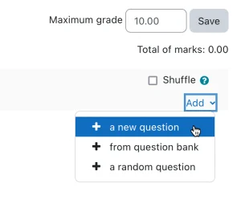 *Adding a question* |

  

### Creating a new question

1\. To make a brand new question, click 'Add' and then '+ a new question'.

2\. From the next screen, choose the question type you want to add and click "Next" ('When you click on a question type on the left, helpful information appears on the right*. )*

|  |
|----|
| 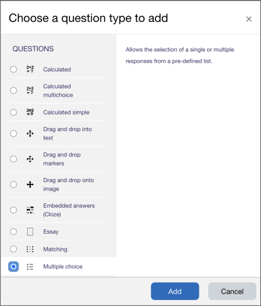 *Selecting a question type* |

3\. Fill in the question form, making sure to give a grade to the correct answer.

4\. Click "Save changes".

|  |
|----|
| 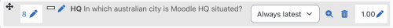 *A question when it has been created* |

**Note:** If you have a very complex question, and you want to check it as you go along, you can preview it and then click "Save changes and continue editing".

  
When a question has been created, an icon and words display its type (e.g. multiple choice). It can be modified by clicking the edit icon (e.g. ) and previewed by clicking the magnifying glass icon.

As well as deleting individual questions with the delete (bin/trash can) icon, it is possible to delete more than one question by pressing the 'Select multiple items' button and choosing the questions to be removed:

|  |
|----|
| 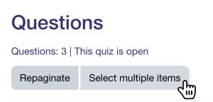 *Select multiple questions* |

#### Adding responses and feedback

5\. When you add responses and feedback, remember you can expand the toolbar to show more buttons.

6\. You can continue adding questions, clicking 'Add' and '+ a new question' each time.

### Choosing a pre-made question

- If other teachers in the course have made questions, or if a teacher made questions in an earlier quiz, these can be added to the current quiz by clicking 'Add' and '+ from question bank'.
- Click the + sign next to one question you want to add (1 in screenshot below)
- If you have several questions or want to add all the questions, tick the box of each question or the top box (2 in screenshot below) and then click 'Add selected questions to the quiz' (3 in the screenshot below).
- To sort the questions, click the column headings. The default sort order (T) is short for question type. (2 in the screenshot below)
- To ensure all previously made questions are available, tick the boxes "also show questions from sub-categories/old questions".

|  |
|----|
| 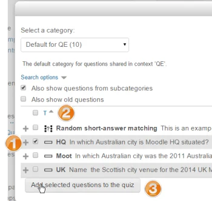 *Using a previously made question* |

**Note:** It is also possible to import pre-made questions into your quiz, from *Quiz administration\>Question bank\>Import.* See [Import questions](Import_questions.md "Import questions") for more information. Sample questions are available from the <a href="http://moodle.net/mod/data/view.php?d=1&amp;mode=list&amp;perpage=40&amp;search=&amp;sort=0&amp;order=DESC&amp;advanced=0&amp;filter=1&amp;advanced=1&amp;f_2=Quiz+questions&amp;f_11=&amp;f_13=&amp;f_12=&amp;f_9=&amp;f_8=" class="external text" rel="nofollow">Moodle.net content database.</a>

### Adding a random question

If you have questions in the question bank, you can add random questions to your quiz by clicking 'Add' and then '+ a random question'. This might be useful if you have students in a class taking a quiz at the same time because they are unlikely to get the same questions at the same time. The same question will never appear twice in a quiz. If you include several random questions, different questions will always be chosen for each. If you mix random questions with non-random questions, then the random questions will be selected so that they do not duplicate one of the non-random questions. This does imply that you need to provide enough questions in the category from which the random questions are chosen; otherwise, the student will be shown a friendly error message. The more questions you provide, the more likely students will get different questions on each attempt. When a quiz with random questions is retaken, the random questions will be different from the ones in previous attempts. For a discussion on the behaviour of random questions, see <a href="https://tracker.moodle.org/browse/MDL-6340" class="external text" rel="nofollow">MDL-6340</a>.

The grade for the randomly chosen question will be rescaled so that the maximum grade is what you have chosen as the grade for the random question.

You can add one or more random questions by choosing the number and category in the question bank. Note the die icon to highlight random question selection. Random questions may be filtered by tag and

|  |  |
|----|----|
| 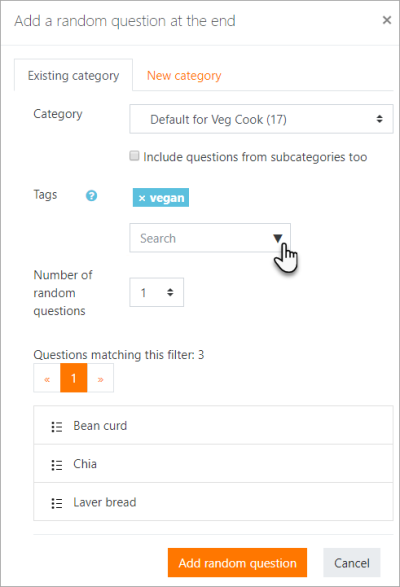 *Adding a random question. Note tag and filtered list* | 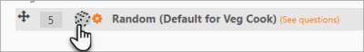 *Random question selected for quiz* |

  

#### Quiz question tags

Questions may be tagged as they are created (as well as from the <a href="Question_bank.md" class="mw-redirect" title="Question bank">Question bank</a>). Questions may be searched and filtered by tag in the Question bank and when adding random questions, as above.

### Question categories

Questions can be stored and retrieved from categories in the Question bank. When you make a new question, it defaults to the category with the course name. So if you make a quiz in the Senior Physics course, questions will automatically be added to "Default for Senior Physics". You can opt to have your quiz questions in a category of their own ("Quizname") or to add a sub-category.

To add a sub-category, go to *Administration\>Quiz administration\>Question bank\>Categories* For more information on question contexts and categories, see <a href="Question_bank.md" class="mw-redirect" title="Question bank">Question bank</a>

Users will have access to different categories according to their permissions. For example, a regular teacher might only have access to question categories in his Physics course. In contrast, his Faculty Head of Science, with permissions in all science courses, might also have access to question categories in Biology and Chemistry.

## Quiz layout

- You can choose in the Layout section of the quiz settings whether to have a new page for every question or after a certain number of questions.
- You can add a page break between questions by clicking the arrow icon (where the arrows point away from each other) (1 in the screenshot below). A new page will be created. (2 in the screenshot below)
- You can remove pages by clicking the arrow icon (where the arrows point towards each other). (3 in the screenshot below)

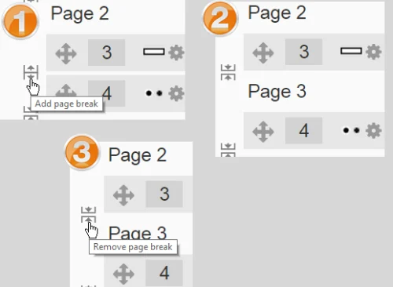

- You can also change the layout of the whole quiz by clicking the 'Repaginate' button:

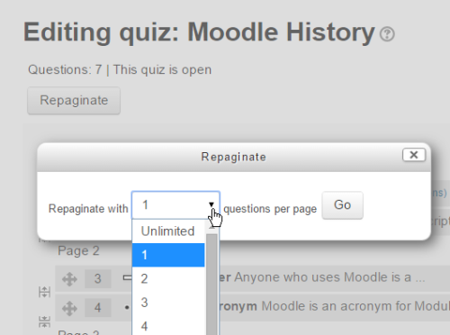

- Questions may be moved by dragging and dropping using the crosshairs icon: 

### Section headings

- Section headings may be added to each new page.
- For the first page, click the 'pencil' icon at the top (1) and add your heading.
- To add a new page and then a section heading, click between questions and then click the dropdown on the right, selecting +new section heading (2)

<a href="File_sectionheadings.png.md" class="mw-file-description">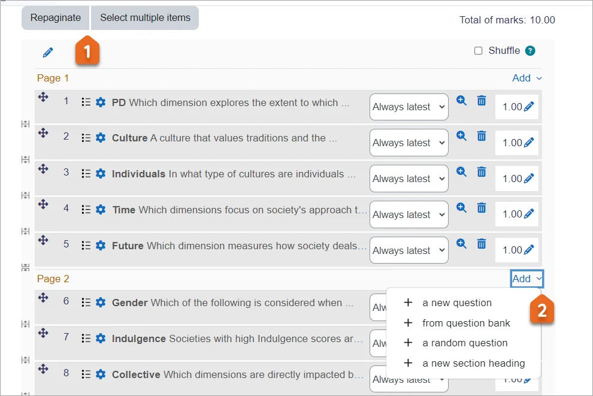</a>

  

- The section headings are displayed in the Quiz navigation block:

<a href="File_quiznavsectionheadings.png.md" class="mw-file-description">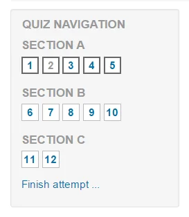</a>

### Randomising the order questions appear

- The order in which questions appear to the student may be randomised or 'shuffled' by ticking the 'Shuffle' box at the top of the screen:

<a href="File_shuffle1.png.md" class="mw-file-description">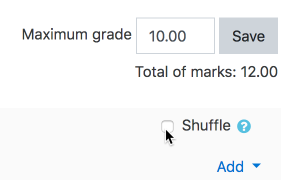</a>

- Where questions are in different sections (see *Section headings* above), each section has its own 'Shuffle' box to tick. This means that you can mix up questions in one section, but in another section, where their order is important, you can keep them in the order you need them to display:

<a href="File_shuffle2.png.md" class="mw-file-description">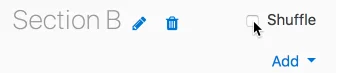</a>

## Making questions conditional upon other questions

- If using the *Interactive with multiple tries* or *Immediate Feedback* behaviour and with the navigation method set to 'Free', it is possible to make the display of a question dependent on a previous question being answered first.
- The question editing page will display padlock icons to the right of each question:

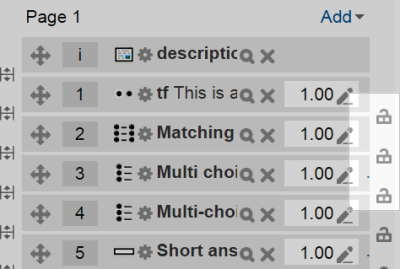 *Padlocks - all unlocked*

- If you want to make a question, for example, Q2, conditional upon answering Q1, then click the padlock just above Q2:

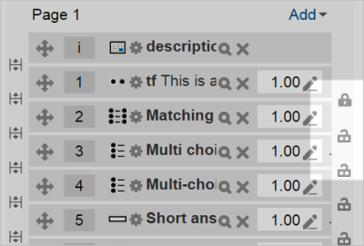 *Padlocks - Q2 locked*

- When a student accesses the quiz, they will see a message that Q2 is not available until they give a response to Q1:

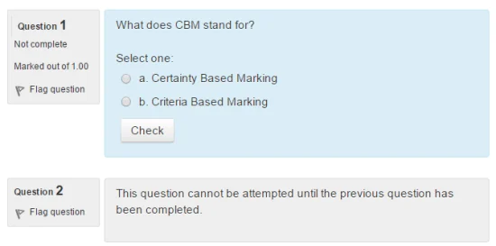 *What students see*

- In the Quiz navigation block, Q2 will be greyed out:

<a href="File_locksnav.png.md" class="mw-file-description">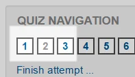</a>

- In the following example, note that Q1 follows a description, and a description 'questions' cannot be finished. Therefore, Q1 cannot depend on the previous question. Similarly, Q4 follows an Essay question. The Essay cannot be finished during the attempt, so the following question cannot depend on it. Note the lack of padlocks in the following screenshot because of the description and Essay question:

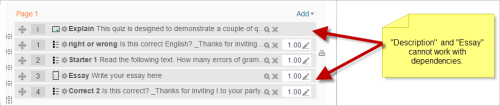

## Assigning points to questions

Click on the Quiz, and from Quiz navigation, click the Questions link.

You can set how many points each question is worth by changing the number in the box to the right of each question, and you can change the maximum grade by changing the number in the box top right at the top of the quiz. The default is one point per question and a 100.00 maximum grade.

|  |  |
|----|----|
| 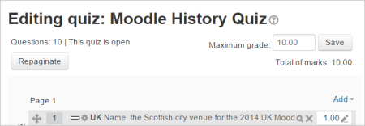 *Points per question and max grade* | 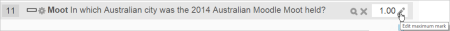 *Edit individual marks* |

The quiz module will do any maths; for example, a 2-point question will be worth 2 times more when the Quiz module determines how many points out of 10 to award the student.

## Quiz section grades

When a quiz is created, optionally a teacher can assign grade items to specific questions, for example in separate sections of the quiz. This will then display not only the overall final grade of the quiz but grades for individual groups of questions. The section grades do not appear in the gradebook. Watch the video <a href="https://youtu.be/AmM5WvEUNy0?feature=shared" class="external text" rel="nofollow">Quiz improvements in Moodle 4.4</a> to see how this is done.

<a href="File_Examen_con_puntuaciones_de_cada_seccion.png.md" class="mw-file-description">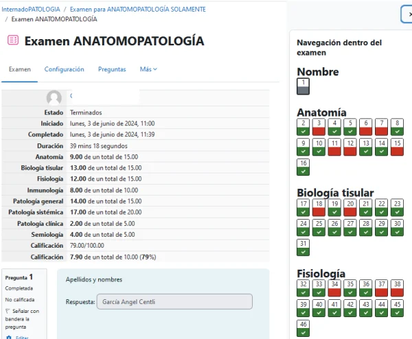</a>

### Quiz with no sections

1.From the created quiz, click *Questions*

2\. select *Grade item setup* from the dropdown.

<a href="File_gradeitemssetup.png.md" class="mw-file-description">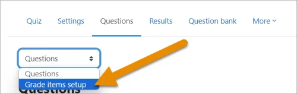</a>

3\. Click *Add grade item*; and rename it to your required topic.

4\. From the dropdown next to a question, select that grade item.

<a href="File_powerdistance.png.md" class="mw-file-description" title="Adding grade item">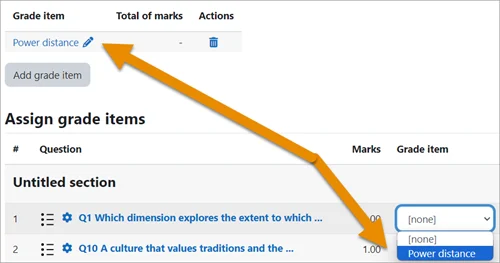</a>

### Quiz with questions in sections

1.From the created quiz, click *Questions*

2\. Click the Set up a grade for each section button.

<a href="File_addgradeitemsetupagrade.png.md" class="mw-file-description">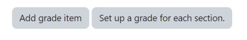</a>

3\. Sit back and let Moodle automatically create the grade items with each section name and add them to each question.

## Customising question numbers

You can customise question numbers if you want to match the setup of an external test.

|  |
|----|
| 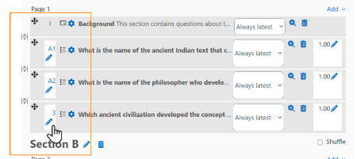 *Customise question numbers* |

## Previewing the quiz

- You can preview individual questions by clicking the magnifying glass icon.
- You can preview the whole quiz by clicking the "Preview" button when accessing the quiz.
- Note: If you edit a question during the preview, you will have to start a new preview in order to see the change.
- The quiz works like a real quiz, so you can see your grades and any feedback for correct/incorrect answers just as a student would see them.

**NOTE**: *To get a more accurate view of how a student would view your quiz, it is advised to log in with a "dummy" student account created by the admin for testing activities. This is more reliable than the 'switch role to student' feature.*

- See also the question: 'How can a teacher '-dry run a quiz..?' in [Quiz FAQ](Quiz_FAQ.md "Quiz FAQ").

|  |  |  |
|----|----|----|
|  *Previewing a single question* | 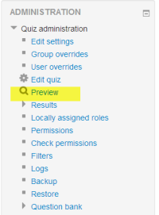 *Click to preview the whole quiz* | 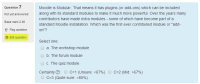 *Quiz in preview mode* |

## After quiz has been attempted

If one or more students have taken the quiz, you will see a list of all the questions in the quiz and a notice saying that you cannot add or remove questions.

You can change the grade for a question (the scores for all students will recalculate immediately), preview a particular question and click on a question edit link that will allow you to directly edit the question stored in the question bank.

Be very careful about editing questions! It is OK to make small changes (e.g. fix a spelling mistake or change the grade for a partially correct response), but if you make a major change (for example, deleting a choice from a multiple choice question), then you may break the existing quiz attempts. After editing questions that affect the grading, you will need to regrade the quiz.

Note: You can delete all student quiz attempts and then edit the quiz as if no students had attempted it. To do this, click the quiz name and then the Results link in the Administration block. This will present a list of students and their scores. Click "Select all" and then "Delete selected attempts".

### Dealing with faulty questions

There are several ways to deal with "bad" questions in a quiz.

- Change the grade for the bad question to 0 in the quiz.
- Edit the question, changing what you will accept as a correct answer, then regrading the exam. Remember when changing a question that the next time it is used, it will be as it was in the last edit. Also, regrading will only affect one quiz at a time.
- You can edit the question to explain the situation to the student, and then you can set the grade for the question to zero. After you make such changes, you should regrade the quiz by clicking on the **Results** tab and then the **Regrade** tab. This will change the grade for all students who have taken the quiz so far. Remember, if another quiz uses the question, your "explanation" will appear as part of that quiz.
- You can change the grade for the bad question and then move or delete the question from your question category. The question will still appear on the quiz. Some places do not like to delete any question but will move them to a "dead" or "bad" question category.
- When you discover a bad question in your quiz, it may affect the question bank. Remember that a final might be made up of a certain number of random questions drawn from different question categories, the same categories used in a smaller subject quiz. It can be very important to do something about bad or invalid questions in a question category when the categories are used in other places.

## See also

- [Question types](Question_types.md "Question types")
- [Effective quiz practices](Effective_quiz_practices.md "Effective quiz practices")
