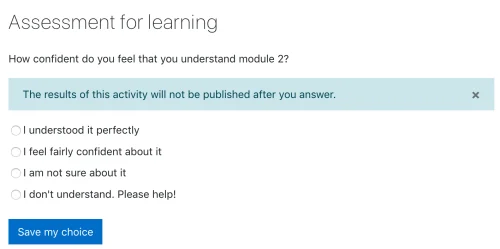
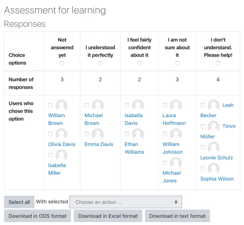

# Choice_activity

> Sumber: https://docs.moodle.org/502/en/Choice_activity

  

## What is the Choice activity?

The Choice activity allows you to ask a question and set up radio buttons which learners can click to make a selection from a number of possible responses. They can choose one or more option and they can update their selection if you allow them. Choices can be useful as quick poll to stimulate thinking about a topic; to allow the class to vote on a direction for the course, or to gauge progress.

## How is it set up?

1.  In a course, with the editing turned on, choose 'Choice' from the activity chooser.
2.  Give it a name and, if needed, a description.
3.  Expand Options to add the options you want learners to select from. They may change their mind (update their selection) and make more than one selection if you wish. If you change Limit the number of responses allowed to Yes, then you must add limits for each option, or the options will all be shown as full.
4.  In Results, decide how you want results to be displayed. See Teacher view below.
5.  Expand the other settings to configure the activity as you wish, and then save it.

## How does it work?

### Student view

Learners click on the Choice icon on the course page and make one or more selections according to the teacher's settings.

 *Student view of choice*

How (and if) the results are displayed depends on the teacher's settings.

### Teacher view

As a teacher, you can always see the results, but you can also choose whether or not to allow learners to see each other's choices and whether or not to allow them to see the names or merely the percentage of votes.

You can download their responses in a variety of formats. Responses may be 'published', i.e. made visible once the learner has made a selection, or visible once the choice is closed.

Choice options may be restricted so only a certain number may make a particular selection, and you can also opt to display a column showing who have not made their selection.

You can make a selection on behalf of a student if necessary, for example if they are absent from class or else unable to get online.

 *Teacher view of choice results*

## More information

- [Choice settings](Choice_settings.md "Choice settings")
- [Using Choice](Using_Choice.md "Using Choice")
- [Choice FAQ](Choice_FAQ.md "Choice FAQ")
