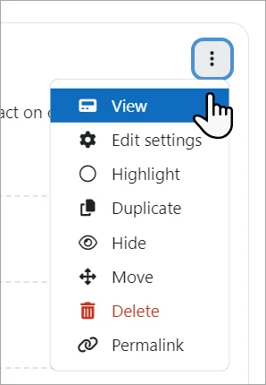
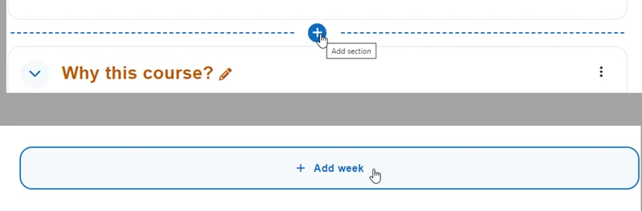
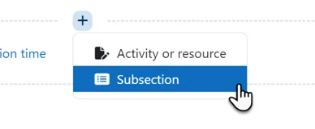
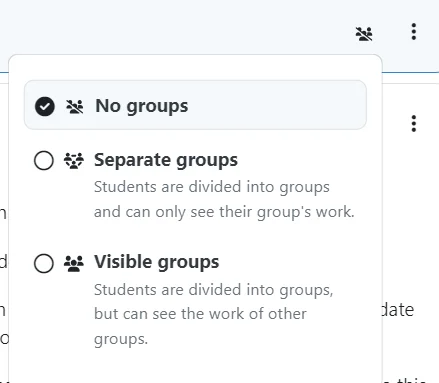
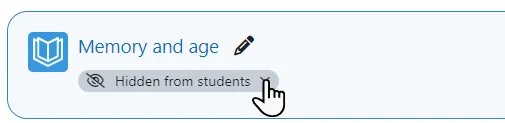

# Course_homepage

> Sumber: https://docs.moodle.org/502/en/Course_homepage

A Moodle course can look very different depending on the theme and course format (layout). Standard themes are the [Boost theme](Boost_theme.md "Boost theme") and the Classic theme.

  

#### Parts of a course

1\. Course navigation. These provide a quick way for the teacher to access important aspects of the course. The More link takes you to, for example, the Content and Question banks and Course reuse which incorporates Backup, Restore, Import, Reset and Copy.

2\. Course index. This is a scrollable, collapsible drawer that displays course sections and elements. As you move up and down the central course area, your location is highlighted in the Course index. Clicking on an item in the Course index will open it up directly in the course central area. Sections in the course index can be collapsed or expanded in bulk from the kebab menu.

3\. Edit mode toggle. An easy way to toggle edit mode on and off.

4\. Block drawer. This is not visible until you have enabled edit mode and added a block. The block drawer can be collapsed and expanded as a user preference.

  
5. [Course sections](Course_formats.md "Course formats")

Here is where the learning materials are displayed. This element may be arranged in one or multiple weeks, topics, forums or other (non-standard) layouts.

6\. Collapse all. Sections can be collapsed and expanded individually or you can use the Collapse all link to collapse them all at once.

#### Classic theme

1.[Navigation block](Navigation_block.md "Navigation block")

Normally visible on all pages, this block helps you find your way around the course and site.

2.[Administration block](Administration_block.md "Administration block")

Again, normally visible on all pages, this block gives different levels of access to teachers and students.

3\. Turn editing on A clearly visible button allows you to turn editing on and off.

4\. [Course sections](Course_formats.md "Course formats")

Here is where the learning materials are displayed. This element may be arranged in one or multiple weeks, topics, forums or other (non-standard) layouts.

5\. Collapse all. Sections can be collapsed and expanded individually or you can use the Collapse all link to collapse them all at once.

6.[Side blocks](Blocks.md "Blocks")

Side blocks can be added when the editing is turned on. Which blocks you see depend on what the administrator has selected and what you as teacher choose to add.

  

### View a single course section

- With edit mode off, all users can click a section heading to access one particular section in its own page.
- With edit mode on, teachers can click View from the three dots on the right to access just that section.

### Edit a course section

1.  Enable Edit mode/turn editing on
2.  Quickly rename sections from the pencil icon.

### Duplicate a course section

1.  Enable Edit mode/turn editing on.
2.  From the three dots to the right of the section name, click Duplicate.

### Get a permalink to a course section

1.  Enable Edit mode/turn editing on.
2.  From the three dots to the right of the section name, click Permalink.

### Move a course section

**Note:**The ability to move course sections is controlled by the capability [moodle/course:movesections](Capabilities_moodle_course_movesections.md "Capabilities/moodle/course:movesections"), which is allowed for the default role of teacher. See also the section below on Bulk editing.

1.  Enable edit mode/turn editing on
2.  Drag and drop the section either from the course central area or the Course index to your chosen location.

If your course is long you can also drag from the central area to a location in the Course index, and/or you can click the three dots next to a section, select Move and choose the location to move it to.

### Add course sections

1.  Enable edit mode/turn editing on.
2.  For weekly format, scroll to the bottom of the course page and click Add week
3.  For other format such as custom sections, you can add sections between other sections on the course page by pressing the plus + sign.

## Add a subsection

 *add subsection*

With editing mode on you can add an activity or resource directly to the course page or add a subsection.

A subsection behaves in exactly the same way as a normal section but can be placed anywhere within sections. Note that it is not possible to add subsections to subsections, and that adding subsections counts as part of the maximum number of sections in your course. This means that, for example, if the maximum number of sections allowed is 5 and you have 3 sections and 2 subsections, you will no longer be able to add any more sections.

Subsections are enabled by default in Moodle 5.0 onwards. If required, subsections can be disabled by an admin in *Site administration \> Plugins \> Activity modules \> Manage activities*.

**Note:** From Moodle 5.2, subsections no longer have a description field. Any existing subsection descriptions were automatically converted to a Text and media area within the subsection during upgrade.

### To delete a course section

With the editing turned on, click the 'Edit' link to the right of the course section you wish to delete and then, from the menu that displays, click 'X Delete'. You will be prompted to confirm your wish to delete the section and its contents. Note that all activities inside the section and their user data will also be deleted. Use the [Recycle bin](Recycle_bin.md "Recycle bin") to reverse this if you do it by mistake.

## Add activities and resources

To add an activity or resource to the course, first enable edit mode and then

Either...

- Click on the course page wherever you want to add your activity. This will open up the [Activity chooser](Activity_chooser.md "Activity chooser"), allowing you to select your activity or resource.

<!-- -->

- Click 'Add an activity or resource' to open the activity chooser. Double-click to add an activity or resource; click the i for more information and click the star icon to add it to a separate, starred tab.

Alternatively, certain resources and activities may be added using drag and drop:

- To add a <a href="File.md" class="mw-redirect" title="File">file</a>, simply drag and drop it onto the course section where you'd like it to appear
- To add a <a href="Folder.md" class="mw-redirect" title="Folder">folder of files</a>, simply zip the folder then drag and drop it onto the course section where you'd like it to appear, answer 'Unzip files and create folder' to the popup dialogue, then click the upload button
- To add a <a href="SCORM_module.md" class="mw-redirect" title="SCORM module">SCORM package</a>, simply drag and drop it onto the course section where you'd like it to appear, answer 'Add a SCORM package' to the popup dialogue, then click the upload button.

## Group mode

With edit mode on, when you hover over an activity or resource supporting groups, a group mode icon appears. Click on it and a modal window will display allowing you to select visible/separate or no groups. You can also access Group mode options from the activity actions submenu (three dots to the right).

Students do not see these icons.

## Indent activities or resources

If allowed by admin (see [Course formats](Course_formats.md "Course formats")) teachers can move an activity or resource once to the right. This indentation is also reflected in the course index.

### Move activities or resources

1.  Enable edit mode/turn editing on
2.  Drag and drop the item either from the course central area or the Course index to your chosen location.

If your course is long you can also drag from the central area to a location in the Course index, and/or you can click the three dots next to a item, select Move and choose the location to move it to. See also the section on Bulk editing.

With edit mode on, from the actions submenu (three dots) to the right of an activity, the setting 'Availability' displays when clicked a modal window allowing a teacher to:

- - show on the course page.
  - hide on the course page.
  - make available but don't show (if stealth mode is enabled).

Once a choice has been made, as a teacher you can then edit it directly from under the item:

## Bulk edit activities, resources or sections

- With edit mode enabled, click the link Bulk actions near the top right of the screen.
- Checkboxes will appear next to sections, resources and activities.
- Click the ones you want to edit and from the footer at the bottom, choose the action you want to take: Change availability, Duplicate, Move or Delete.
- **Note:** For sections, the option to duplicate is not present as you duplicate sections individually from the action menu (three dots) to the right of its name.

## Blocks

The Boost and Classic themes only only displays blocks on the right, although contributed themes might display them on the left.

To add a block to the course page

1.  Enable Edit mode top right.
2.  Expand the block drawer and click Add block. Select your block.

To move a block

1.  With Edit mode on, click the crosshair icon on a block.
2.  While keeping the block selected, drag it to where you want to position it and let go.

## Course homepage capabilities

- [Control section visibility](Capabilities_moodle_course_sectionvisibility.md "Capabilities/moodle/course:sectionvisibility")
- [Set current section](Capabilities_moodle_course_setcurrentsection.md "Capabilities/moodle/course:setcurrentsection")
- [Add subsection](Capabilities_mod_subsection_addinstance.md "Capabilities/mod/subsection:addinstance")

## See also

- [Course settings](Course_settings.md "Course settings")
