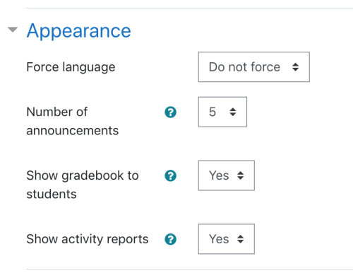
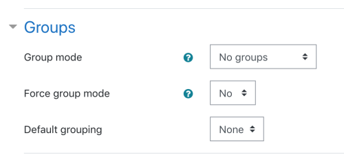

# Course_settings

> Sumber: https://docs.moodle.org/502/en/Course_settings

A teacher, or other user with the [update course settings capability](Capabilities_moodle_course_update.md "Capabilities/moodle/course:update"), can change course settings from *Course navigation \> Settings*.

## General

### Course full name

This is the name of the course. It is displayed as a link on course lists on the <a href="Front_page.md" class="mw-redirect" title="Front page">Front page</a> and on the [Dashboard](Dashboard.md "Dashboard") and in reports. It is also used in the browser title bar when the course is viewed.

The capability [moodle/course:changefullname](Capabilities_moodle_course_changefullname.md "Capabilities/moodle/course:changefullname") controls whether a user can edit the course full name.

### Short name

Many institutions have a shorthand way of referring to a course, such as BP102 or COMMS. Even if you do not already have such a name for your course, make one up here. It will be used in several places where the long name is not appropriate, such as the Navigation block.

The capability [moodle/course:changeshortname](Capabilities_moodle_course_changeshortname.md "Capabilities/moodle/course:changeshortname") controls whether a user can edit the short name field.

By default, only course full names are displayed in the list of courses. However an administrator can enable short names to be displayed too if required by ticking the checkbox in *Administration \> Site administration \> Appearance \> Courses*.

### Course category

The site administrator may have created course categories to help teachers and students find their courses easily. Course categories may be reflected in the [Navigation block](Navigation_block.md "Navigation block").

The capability [moodle/course:changecategory](Capabilities_moodle_course_changecategory.md "Capabilities/moodle/course:changecategory") controls whether a user can edit the course category.

### Course visibility

Here you can "hide" your course completely. It will not appear in the list of courses, except for managers, course creators, teachers and any other users with the [view hidden courses capability](Capabilities_moodle_course_viewhiddencourses.md "Capabilities/moodle/course:viewhiddencourses"). Even if students try to access the course URL directly, they will not be allowed to enter.

The [hide/show courses capability](Capabilities_moodle_course_visibility.md "Capabilities/moodle/course:visibility") controls whether a user can hide a course.

#### Hiding course until start date/Hiding course upon end date

If your administrator enables the scheduled tasks Show courses on start date (\core\task\show_started_courses_task) and Hide courses on end date (\core\task\hide_ended_courses_task) then the course will become visible to students only after the Course start date and/or the course will be hidden from students on the end date. See the tooltips for clarification.

### Course start date

This setting affects the display of logs and the weekly format topic dates.

If you use the "Weekly" course format, the start date will appear in the first section of the course. For example selecting 27 July, will display "27 July - 2 August" in the first section (when default display is selected for that section).

This setting will have an effect on the display of logs. This will be the earliest possible date the log activity will display.

This setting will **not** affect courses using the 'social' or 'topics' formats.

*TIP:* If your institution runs on a weekly schedule, you may want to consider setting the start date for courses on the first day of the week, like a Monday. Please note that the 'first day of the week' is set by the <a href="https://docs.moodle.org/dev/Translation_langconfig" class="external text" rel="nofollow">langconfig file</a> of your [Language](Language.md "Language"), and might be different from the default Monday of the English language pack.

*TIP:* In general, if your course does not have a real starting date then set the date to yesterday and use the availability setting to reveal the course to students.

*TIP:* See self enrolment course settings to prevent students from entering the course before a certain date/time.

### Course end date

The course end date is used for determining whether a course is listed as past in [My courses](My_courses.md "My courses").

The course end date is also used for calculating the retention period before data is deleted. It may also be used by a custom report e.g. reporting activity for the duration of a course.

Users can still enter the course after the end date; in other words the date does not restrict access.

### Calculate the end date from the number of sections

For courses in weekly format only, the course end date may be calculated automatically based on the course start date and the number of sections. If course sections (weeks) are added or removed, the course date is changed automatically. If 'Calculate the end date from the number of sections' is ticked, the course end date can not be set manually.

### Course ID number

The ID number is an alphanumeric field. It has several potential uses. Generally, it is not displayed to students. However, it can be used to match this course against an external system's ID, as your course catalogue ID or can be used in the certificate module as a printed field.

The capability [moodle/course:changeidnumber](Capabilities_moodle_course_changeidnumber.md "Capabilities/moodle/course:changeidnumber") controls whether a user can edit the ID number.

## Description

### Course summary

The summary appears on the course listings page. This field is searched when searching for a course and also appears in the Course/Site description block.

The capability [moodle/course:changesummary](Capabilities_moodle_course_changesummary.md "Capabilities/moodle/course:changesummary") controls whether a user can edit the course summary.

### Course image

An image (and if allowed by the administrator, other file types) may be attached to the course summary. They will be accessible by anyone from outside of the course just like the course name and/or summary. Only users with [moodle/course:changesummary capability](Capabilities_moodle_course_changesummary.md "Capabilities/moodle/course:changesummary") are able to upload/change course summary files. *Note that if this is not allowed by the administrator, then no box will appear to upload course summary files*.

By default, only jpg, gif and png file types are allowed as course summary files. An administrator can change the allowed file types in *Administration \> Site administration \> Appearance \> Courses*.

## Course format

### Format

See [Course formats](Course_formats.md "Course formats")

### Hidden sections

Course sections can be hidden completely or shown with section names only.

### Course layout

The Course layout setting determines whether the whole course is displayed on one page or split over several pages. The setting currently applies to the custom sections and weekly core course formats and contributed collapsed topics course format only.

Teachers choose from the dropdown whether they wish to "show all sections on one page" in the familiar scrolling format, or "show one section per page".

If one section per page is selected, the course page is abbreviated to a list of links to individual sections. Users click the title of a section to access it on its own page.

## Appearance

(These settings are collapsed by default.)

|  |
|----|
|  *Appearance settings expanded* |

### Force theme

If the site administrator has allowed the teacher to set a course [theme](Themes.md "Themes"), this pull down menu will appear with a list of themes on the site. Teachers can use this to choose a different look for the course from the rest of the Moodle site.

### Force language

If you force a language in a course, the interface of Moodle in this course will be in this particular language, even if a student has selected a different preferred language in his/her personal profile.

By default editing teachers and managers have the capability moodle/course:forcelanguage and can select and force a language for their students. Admins can remove this capability if they do not wish course teachers/managers to do this.

### Number of announcements

How many recent announcements from the [Announcements forum](Announcements_forum.md "Announcements forum") should show in the [Latest announcements block](Latest_announcements_block.md "Latest announcements block").

If an announcements forum is not required in the course, this setting should be set to zero.

### Show gradebook to students

Here you can decide whether to allow students to see the link to [grades](Grades.md "Grades") in the Administration block. If your course doesn't use graded activities, it makes sense to disable this. If grades are used and this link is disabled, students can still see their grade from the actual activity itself, such as an <a href="Assignment.md" class="mw-redirect" title="Assignment">assignment</a>

### Show activity reports

Here you can decide whether to show students their [activity reports](Activity_report.md#Individual_Activity_Report "Activity report"). Doing so places a load on the server however, which is why the setting is disabled by default.

## Files and uploads

(These settings are collapsed by default.)

### Maximum upload size

Here you can decide the largest size of file that students can upload to a course. The site administrator can determine <a href="Site_policies.md#Maximum_uploaded_file_sizefile" class="mw-redirect" title="Site policies">sizes available</a> for the teacher to select.

Editing teachers or other users may be allowed to upload files larger than the maximum size by giving them the capability [moodle/course:ignorefilesizelimits](Capabilities_moodle_course_ignorefilesizelimits.md "Capabilities/moodle/course:ignorefilesizelimits")

### PDF font

If the text in your language (such as Chinese, Japanese, Korean, Hebrew or Arabic) displays as ???? in downloaded PDF files e.g. assignment submissions or reports, you can select your language to use for the PDF font.

Note that this setting is only available if the site admin enables PDF fonts in *Site administration \> General \> Language settings* and specifies fonts for the languages used on your site in \$CFG-\>pdfexportfont in config.php.

## Completion tracking

(These settings are collapsed by default.)

Completion tracking must be enabled for [Activity completion](Activity_completion.md "Activity completion"). [Course completion](Course_completion.md "Course completion") criteria may also be based upon Activity completion values found in the activity's settings.

## Groups

(These settings are collapsed by default.)

|  |
|----|
|  *Groups settings expanded* |

### Group mode

Here you can define the [group mode](Groups.md "Groups") at the course level by a pull down menu. "[No groups](Groups.md#No_groups "Groups")", "[Separate groups](Groups.md#Separate_groups "Groups")" and "[Visible groups](Groups.md#Visible_groups "Groups")" are the choices. The selected setting will be the default group mode for all activities defined within that course. The group setting can affect what users see in the participants list and who they can interact with in activities.

### Force

If the group mode is "forced" at a course-level, then this particular group mode will be applied to every activity in that course. This will override any activities that may have a special group setting.

### Default grouping

If [groupings](Groupings.md "Groupings") are enabled, a default grouping for course activities and resources may be set.

## Tags

Teachers can add course tags here, either new tags or official tags. See [Using tags](Using_tags.md "Using tags") for more information.

## Course custom fields

A site admin can create course [custom fields](Custom_fields.md "Custom fields") in *Site administration \> Courses \> Course custom fields*.

'Number' is available as an option when creating a course custom field. This could be used for course credits, for example. There are two options from the dropdown:

1.  Generic field for any numeric data - this allows you to manually add a number of your choice.
2.  Number of activities in the course - if you select this, you will then be prompted to select one or more activity or resource. In a course, this field will display the combined number of activities or resources you selected.

Teachers can then select options for the course custom fields in the course settings.

Users with the capability 'Change locked course custom fields' (by default only users with the role of manager) can change locked course custom fields.

## Site administration settings

An administrator can set course default settings from *Site administration \> Courses \> Course default settings*.

## Preventing teachers from editing course settings

Any/all of the following fields - course full name, short name, ID number and category, summary - may be locked to prevent teachers from editing them. To do so:

1.  Access *Site Administration \> Users \> Permissions \> Define roles*.
2.  Click the edit icon opposite the teacher role.
3.  Change any/all of the capabilities [moodle/course:changefullname](Capabilities_moodle_course_changefullname.md "Capabilities/moodle/course:changefullname"), [moodle/course:changeshortname](Capabilities_moodle_course_changeshortname.md "Capabilities/moodle/course:changeshortname"), [moodle/course:changeidnumber](Capabilities_moodle_course_changeidnumber.md "Capabilities/moodle/course:changeidnumber"), [moodle/course:changecategory](Capabilities_moodle_course_changecategory.md "Capabilities/moodle/course:changecategory"), [moodle/course:changesummary](Capabilities_moodle_course_changesummary.md "Capabilities/moodle/course:changesummary") from allow to not set.
4.  Click the "Save changes" button at the bottom of the page.
