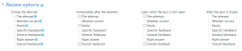

# E-examination_quick_guide

> Sumber: https://docs.moodle.org/502/en/E-examination_quick_guide

INTERMEDIARY WORK IN PROGRESS

The Quiz is a very powerful activity that can meet many teaching needs, from simple, multiple-choice knowledge tests to complex, self-assessment tasks with detailed feedback. E-assessments can be done by using the quiz module in combination with the [Safe Exam Browser](Safe_Exam_Browser.md "Safe Exam Browser"). This quick guide gets you started, but if you really want to make the most of everything a Moodle/Safe Exam Browser-E-assessment can do, make sure you study the full **[Quiz activity](Quiz_activity.md "Quiz activity")** as well as the **[Safe Exam Browser](Safe_Exam_Browser.md "Safe Exam Browser")** documentation.

## Set up the quiz for a summative test

### Quiz settings

Quiz settings define the circumstances of your examination, e.g. when it starts, how long it takes, and address organizational matters, e.g. examination may be taken only using Safe Exam Browser. They assure the safety of your quiz, e.g. that no participant can see its content beforehand and no second attempt is allowed. These settings can be predefined site-wide to help teachers set them up more easily.

**Timing \| Open the quiz**

This is the time by which a student may first start the quiz. When activated it prevents students from starting the examination earlier than one wants them to start.

**Timing \| Close the quiz**

This is the time by which a student may last write a quiz. Once this point in time is reached, all quiz attempts are closed regardless if certain students had still some time left because they started late or were granted additional time due to technical problems or a compensation for disadvantages. In case such compensations are needed during an examination, "close the quiz" may be updated during an examination. But we would recommend to set the quiz end time a quarter of an hour later than the actual end of the examination in order to reduce stress during the examination.

**Timing \| Time Limit**

When enabled this is the maximum time students may take for the examination. They will see the time left in the quiz navigation. During the last minute the time left turns from a light pink into a deep red. Once the time is expired, students may no longer edit their answers. Students are always able to hand in ahead of time.

**Timing \| When time expires**

This setting may only be used when "time limit" is enabled. For summative examinations it is recommended to chose "Open attempts are submitted automatically". This way the students last (partial) answer is saved and the results are handed in automatically.

**Grade \| Attempts allowed**

As one usually does not want students to retake a summative examination, this setting has to be set to 1. Once students hand in their examination (or once it is handed in automatically) students can no longer access the quiz. Depending on how review options are set, they may now see feedback on their examination.

**Question behaviour \| How questions behave: Deferred Feedback**

Choose "Deferred Feedback" since you do not want the students to see any feedback during the examination.

**Review options**

Deselect all review options as shown in the picture beside this text. You may have manually graded questions in your examination and/or you want to check if the automatic grading is correct before your students are able to see the grades or the correct answers. Only show the grading by the time you are sure that it is fully correct.

**Require password**

Fill in a password that a student must enter to access the quiz. This allows you to give some last minute information before the start of the examination. Once you've told the password, your students are able to access the examination. A password also increases the security since it prevents unauthorised persons from accessing the examination.

### Extra things

(This is probably not needed. But I state those here because I don't believe they should be mentioned in the standard description but deserve explanation nevertheless)

**Layout \| Navigation method**

**Appearance \| Show blocks during quiz attempts**

### The Safe Exam Browser section quiz settings

## Prepare the participants for an E-assessment

### Pre-Test, SEB Installation (BYOD)

### Procedure when starting, conducting and submitting the real exam
