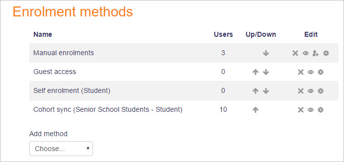

# Enrolment_methods

> Sumber: https://docs.moodle.org/502/en/Enrolment_methods

## Enrolment methods

Depending upon which enrolment methods are enabled for the site (by an administrator in *Site administration \> Plugins \> Enrolments \> [Manage enrol plugins](Enrolment_plugins.md "Enrolment plugins")*), some or all of the following are available within a course:

### Manual enrolment

- This enables users to be enrolled manually in *Course administration \> Users \> Enrolled users*.
- It allows the teacher of the course to manage individual or collective enrolment to their course themselves - for example: if a new student arrives to class unexpectedly with just a login to the site, they may be enrolled by the teacher into their course without any input from an administrator.
- See [Manual enrolment](Manual_enrolment.md "Manual enrolment") for full details of how this can work in your course.

### Self enrolment

- This allows users to enrol themselves into a course, either directly or via an enrolment key ("course password") The teacher does not then have to manually add students.
- More than one instance of the self enrolment method can be used so that when users enrol themselves they are assigned different roles e.g. certain users can be assigned the role of student and other users can be assigned the role of non-editing teacher
- The self-enrolment method also allows for users to enrol themselves into groups by using a group enrolment key.
- See [Self enrolment](Self_enrolment.md "Self enrolment") for full details of how this can work in your course.

### Guest access

- This allows those with the guest role to view the contents of a course.
- Users with the "guest role" may be visitors who do not have an account on your Moodle, or users who do have an account ("authenticated users") but who would just like to explore your course.
- It is possible to add an enrolment key so that only those guest users you wish to grant access can enter the course
- Entering a course with guest access doesn't allow a user to participate in any activities; they can only view information.
- See [Guest access](Guest_access.md "Guest access") for full details of how this can work in your course.

### Cohort sync

- A cohort is a set of users which has been added either to the site as a whole or to a particular category and which can then be made available in a course through the cohort-sync enrolment plugin.
- Only an administrator or a manager can use this plugin.
- See [Cohort sync](Cohort_sync.md "Cohort sync") for full details of how this can work in your course.

### Course meta link

- This allows users who are in another course to be automatically enrolled into your course as well. An example might be if a Moodle site has a course for "Staff Only" and a course for "Moodle Help". If the "Staff Only" course is added to the "Moodle Help" course with the course meta link plugin, then every time a new member of staff joins the "Staff Only" course, they will automatically be enrolled in the "Moodle Help" course as well.
- Teachers can only select from courses in which they are teachers when using this method.
- See <a href="Course_meta_link.md" class="mw-redirect" title="Course meta link">Course meta link</a> for full details of how this can work in your course.

### PayPal

- This allows users to pay for a course. The PayPal enrolment plugin needs to be enabled sitewide by the administrator and the plugin needs to be added to a course by the administrator or a manager.
- The course teacher can select a cost(and currency for their course) along with other course-specific requirements.
- See <a href="Paypal_enrolment.md" class="mw-redirect" title="Paypal enrolment">PayPal enrolment</a> for full details of how this can work in your course.

## Managing enrolment methods

Managers and teachers (and any other users with the capability [moodle/course:enrolconfig](Capabilities_moodle_course_enrolconfig.md "Capabilities/moodle/course:enrolconfig")) can manage enrolment methods via the Participants link then selecting 'Enrolment methods' from the dropdown menu.

- To add a new method, select it from the dropdown menu.
- To remove any unused enrolment method, click the delete icon (X) opposite it.
- To temporarily disable an enrolment method, click the show/hide icon (an eye) opposite it. (This ensures that the settings are remembered if the enrolment method is later re-enabled.)
- If several self-enrolment methods are enabled, the order in which they are listed for users wanting to enrol can be changed with the up/down arrows.

## See also

- [Enrolment plugins](Enrolment_plugins.md "Enrolment plugins")
