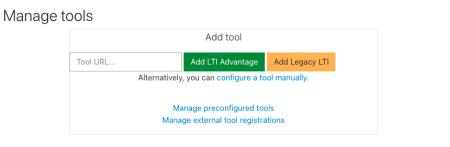
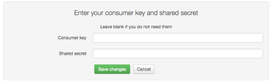
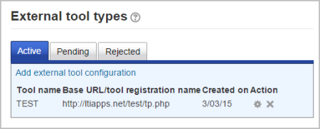
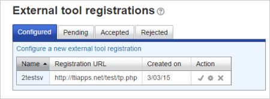
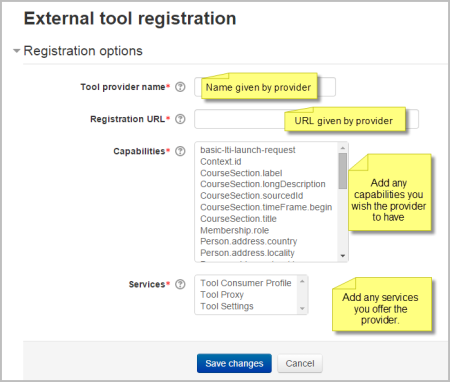
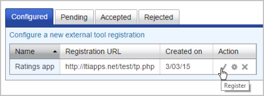
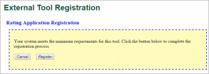
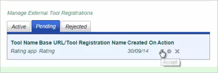

# External_tool

> Sumber: https://docs.moodle.org/502/en/External_tool

## What are LTI External tools?

LTI External tools are add-on apps you can integrate into your course, such as interactive content, activities, or assessments. Teachers can link to these activities from within their Moodle course page, and students can access them without leaving their Moodle course or having to log in to a different system. Where available, and depending on each tool, teachers can also have grades sent back into Moodle.

The link between Moodle and these tools is made through the Learning Tools Interoperability (LTI) standard, which integrates learning platforms with learning tools to create a richer, seamless learning experience. Essentially, the LTI standard enables a secure, bi-directional exchange of information between Moodle and external learning tools.

LTI External tools can be used in Moodle as activities.

This page explores the LTI External Tools page, which allows you to see which LTI External tools are available in your course. It also covers how to add new LTI tools to your course, and how administrators can add LTI tools to their site.

## Viewing and managing LTI External tools

To view the LTI External tools that are available in your course, go to Course navigation \> More \> LTI External tools.

If your administrator or another teacher have already configured tools for your course, they will be shown on this page.

The table on the page contains information about the available LTI tools in the course:

- **Name**
- **Description**
- **Usage count**: How many times the tool is being used in the course
- **Show in Activity chooser**: Whether the tool is displayed in the activity chooser so it can be used as an activity in the course.
- The **context menu** (···) contains actions you can perform on the tool, such as Edit its settings, Delete it, or see its registration details (for LTI 1.3 tools only). The actions you can perform depend on the permissions your administrator has given you.
- If instead of the three dots menu there is a **lock icon**, it means that the tool has been configured by your administrator for the whole site, and you can’t edit it.

## Adding LTI External tools at course level

If your administrator has given you permission to manage LTI External tools, you can add new tools to your courses using the ‘Add tool’ button on the LTI External tools page.

Tools that you add at course level will appear in your activity chooser by default. You can remove them from the activity chooser by going to Course page \> More \> LTI External Tools and toggling them off in the column ‘Show in activity chooser’.

#### Tool settings

In Tool settings, give your tool a name (and, optionally, a description). To fill in the rest of the fields in this section, including the LTI version, follow the instructions from your tool provider. If the tool doesn’t provide information about some of these settings, it’s ok to leave them blank.

- **Tool URL** - This is the URL for connecting to site. If your moodle site uses <a href="https://en.wikipedia.org/wiki/Transport_Layer_Security" class="external text" rel="nofollow">SSL</a> (is on <a href="HTTPS.md" class="mw-redirect" title="HTTPS">HTTPS</a>) you will only be able to use a tool that also uses <a href="https://en.wikipedia.org/wiki/Transport_Layer_Security" class="external text" rel="nofollow">SSL</a>. Make sure the tool URL has <a href="HTTPS.md" class="mw-redirect" title="HTTPS">HTTPS</a> before attempting to use it or you may get a blank page.
- **LTI version** - The LTI version of the tool you're adding.
- **Consumer key** -this tells the connecting LTI compliant site that your Moodle is allowed to connect. The "tool provider", i.e. the manger of the connecting LTI compliant site will issue you with this key. If you are merely linking to a tool with no secure access or gradebook sharing then you won't need a consumer key. If you are linking to a course or activity from another Moodle site, then you can add any consumer key.
- **Shared secret** - this is the "password" to connect to the tool - the LTI compliant site.
- **Custom parameters** - most times, you can leave this blank. The tool provider might use this to allow you to display a specific resource.
- **Default launch container** - this is how the external tool will be displayed.
  - Embed - The content will appear within the activity page where the tool is used, not moving users away from the page, but hiding any blocks your course may have.
  - Embed without blocks - The content will be displayed in the existing tab or window. Users will have to navigate back to the course using the ‘Back’ button once they’re done.
  - Existing window - The content will be displayed in the existing tab or window. Users will have to navigate back to the course using the ‘Back’ button once they’re done.
  - New Window - the external tool will open in a new window. (A new window or tab will open with the External tool and the old browser window containing the course page will not change.)
- **Content selection URL** - The Content Selection URL will be used to launch the content selection page from the tool provider. If it is empty, the Tool URL will be used.

*The following settings are available by clicking ""Show more":*

- **Icon URL** - you can display a different icon from the default External Tool icon by entering its URL here
- **Secure Icon URL** - enter the URL of a different icon here if your students are accessing Moodle securely via <a href="https://en.wikipedia.org/wiki/Transport_Layer_Security" class="external text" rel="nofollow">SSL</a>.

### Services

Choose which of the services you want to use with the tool.

### Privacy

- **Share launcher's name with the tool** - this means that the student's name will be displayed on the connected site <a href="images_en_1_13_demoexternaltool.png.md" class="internal" title="demoexternaltool.png">as in this example</a>
- **Share launcher's email with the tool** - this means that the student's email will be displayed on the connected site <a href="images_en_2_27_externaltoolfrontpage.png.md" class="internal" title="externaltoolfrontpage.png">as in this example</a>
- **Accept grades from the tool** - if this is checked, the connecting site will send back grades to Moodle's gradebook. See <a href="Using_External_tool.md" class="mw-redirect" title="Using External tool">Using External tool</a> for more information on this.

Once you Save changes, the tool will be added to the list of tools in Course page \> More \> LTI External tools.

- 

## Site administration settings

### Adding a tool site-wide

An administrator can manually configure external tools in *Site administration \> Plugins \> Activity modules \> External tool\> Manage tools* so that they are available across the site.

 *Adding an external tool*

A tool may be configured by an administrator so that it is shown in the activity chooser (in addition to the external tool activity) for a teacher to select to add to a course. Its description, if one is present, will appear in the activity chooser.

#### Making a tool available to specific course categories

When configuring an LTI External tool, administrators have the option to limit its availability to specific course categories by selecting the desired categories in the 'Restrict to category' section during the tool configuration process.

### Registering an LTI Advantage tool

Moodle allows a simple way to deploy an LTI Advantage tool. If the tool provider supports that flow, you should have received a registration URL. Simply enter that url to a tool in the 'Tool URL' and press 'Add LTI Advantage'.

The tool registration UI will open and guide you to the steps for registration. Once completed, the registration panel will close and the list of tools will refresh. If the registration was successful, the newly added tool should be visible in a pending state.

The pending state allows you to review the tool configuration, the privacy and services granted, apply possible modifications (for example how the tool appears in the activity chooser), then activate the tool to make it available.

In case of errors when trying to start the registration, validate the registration URL with the tool's vendor the registration URL is for an LTI Advantage registration and not for the deprecated LTI 2 registration.

|  |
|----|
| For Tool Developers looking to support the automated registration of LTI Advantage tool, there is an <a href="https://moodlelti.theedtech.dev/dynreg/" class="external text" rel="nofollow">implementation guide</a> available. The registration process is also being standardized by <a href="https://imsglobal.org/" class="external text" rel="nofollow">IMS Global</a> LTI Working Group. There is also a <a href="https://youtu.be/6tcEwiOs5qU" class="external text" rel="nofollow">Youtube video</a> demo-ing and explaining the flow. |

### Registering an LTI 1.1 tool using a cartridge

You can register an LTI 1.1 tool type using a cartridge. A cartridge will configure all the information such as launch url, tool name & description and icons for you.

To do this, simply enter the url to a tool's cartridge in the 'Tool URL' and press 'Add Legacy LTI'. You will be asked to enter a key and secret. If you don't have them, you can leave them blank and press save changes.

 *Entering a consumer key and secret*

### Registering an external LTI 2.0 external tool

The LTI 2 specifications have been deprecated by <a href="https://www.imsglobal.org/lti-security-announcement-and-deprecation-schedule" class="external text" rel="nofollow">IMS Global</a> and are no more the preferred way to integrate an external tool in Moodle.

### Viewing more details

On the 'Manage tools' page you can also visit 'Manage preconfigured tools' to view the preconfigured tools in a tabular format.

There are tabs to add an external tool, to view those which are pending and to view those which have been rejected:

|  |
|----|
|  *Setting up a new external tool* |

You can also visit 'Manage external tool registrations' to view the tool registrations in a tabular format, or to add an external registration with limited capabilities. To add a tool with limited capabilities. 1. Click 'Configure a new external tool registration'

 *Registering an external tool*

2\. Configure the details on the settings page:

 *Registration settings page*

'Memberships', allow the external tool to request a list of users with a certain role in a specified context e.g. users enrolled in a course. 3. Click the tick/checkmark to register:

 *Activating*

4\. After obtaining a success message, click to complete the process:

 *Completing the registration*

5\. If all requirements are met then you will be able to register automatically.

6\. Now go to *Site administration \> Plugins \> Activity modules \> External tool \> Manage external tool types* and click the 'Pending tab'

7\. Click the tick/checkmark to activate it:

 *Activating from the Pending tab*

## External tool capabilities

- [Add course-specific tool configurations](Capabilities_mod_lti_addcoursetool.md "Capabilities/mod/lti:addcoursetool")
- [Add a new external tool](Capabilities_mod_lti_addinstance.md "Capabilities/mod/lti:addinstance")
- [Add a preconfigured tool](Capabilities_mod_lti_addpreconfiguredinstance.md "Capabilities/mod/lti:addpreconfiguredinstance")
- [Submit a tool to admins for configuration](Capabilities_mod_lti_requesttooladd.md "Capabilities/mod/lti:requesttooladd")
- [Be an admin when the tool is launched](Capabilities_mod_lti_admin.md "Capabilities/mod/lti:admin")
- [Edit external tool activities](Capabilities_mod_lti_manage.md "Capabilities/mod/lti:manage") i.e. be an Instructor when the tool is launched
- [View external tool activities](Capabilities_mod_lti_view.md "Capabilities/mod/lti:view") i.e. launch external tool activities

## See also

- [LTI External tool FAQ](LTI_External_tool_FAQ.md "LTI External tool FAQ")
- Forum discussion <a href="https://moodle.org/mod/forum/discuss.php?d=450974" class="external text" rel="nofollow">LTI configs when add external tool is switched off</a>
