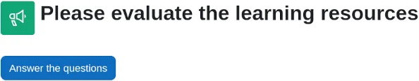
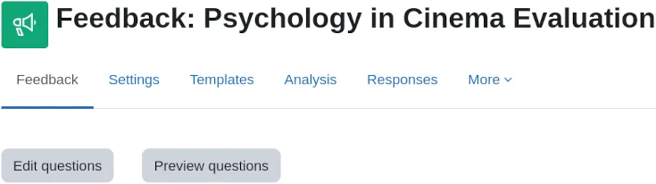

# Feedback_activity

> Sumber: https://docs.moodle.org/502/en/Feedback_activity

  

## What is the Feedback activity?

The Feedback activity allows you to create and conduct surveys to collect feedback. The Feedback activity is ideal for course or teacher evaluations.

## How is it set up?

1.  In a course, with the editing turned on, choose 'Feedback' from the activity chooser.
2.  Give it a name and if required, a description
3.  Expand the other sections to define the settings you want, in particular Question and Submission settings and what to display After submission.
4.  Click Save and display and from the Edit questions tab, Add question drop down, add the questions you want.

## How does it work?

### Student view

Students click on the feedback icon in the course to access the activity and then must click the button *Answer the questions*.

### Teacher view

Teachers see the *Settings* tab as well as an *Analysis* tab and *Responses* tab. Results may be exported to a spreadsheet program.

From the *Analysis* tab they see a report of the aggregate of responses, including a graphical display of answers to multiple choice questions.

From the *Responses* tab they see individual responses in detail.

## More information

- [Feedback settings](Feedback_settings.md "Feedback settings")
- [Building Feedback](Building_Feedback.md "Building Feedback")
- [Using Feedback](Using_Feedback.md "Using Feedback")
- [Feedback FAQ](Feedback_FAQ.md "Feedback FAQ")
- [Feedback Import](Feedback_Import.md "Feedback Import") (XML Format)
- [Feedback block](Feedback_block.md "Feedback block")

**Note:** If you don't see the Feedback activity, ask the admin to check it has been enabled.
