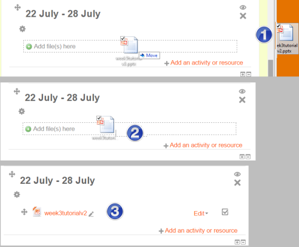
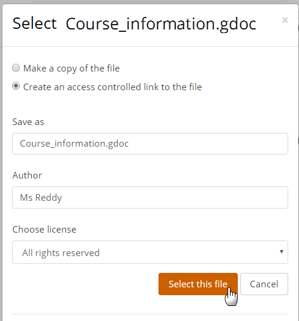

# File_resource

> Sumber: https://docs.moodle.org/502/en/File_resource

  

## What is a File resource?

Files are not just materials such as word-processed documents or slideshow presentations. All types of files can be uploaded and accessed through Moodle, but the student needs to have the correct software to be able to open them.Different file types are shown with different icons. Files may be added in two ways: They may dragged and dropped directly onto the course page:

Alternatively they may be added by clicking File from the activity chooser.

## How is it set up?

To drag and drop a file, with the editing turned on in a course, click and hold the file (*1 below*), drag it to your chosen section (*2*), and release. The file will upload and display (3):

 *File drag and drop*

1.  Alternatively, with the editing turned on in a course, choose 'File' from the activity chooser.

2.  Give it a name and, if required, a description, checking the box if you want the description displayed on the course page

3.  Expand the other settings to select, for example, whether to show students its size, type and date uploaded and how you want the file to display. Find out more about display settings in the documentation [File resource settings](File_resource_settings.md "File resource settings"). (Note for example that an uploaded slideshow presentation will not play as it would on a whiteboard, even if saved as a 'show'. Students will be prompted to download it. A workaround is to upload the presentation to a slidesharing site and embed it.)

4.  Save the file.

### Files from Google Drive and OneDrive

If your admin has enabled the feature in the [Google Drive repository](Google_Drive_repository.md "Google Drive repository") and/or the [OneDrive repository](OneDrive_repository.md "OneDrive repository") then you can select a file from their Google Drive or OneDrive and display it as an 'access controlled link'. Students can only view the file while teachers will be able to edit the file if required. This method is a useful way of displaying files which need updating frequently. However, note that files from OneDrive will not display correctly if they are embedded.

## How does it work?

### Student view

How students access the file depends on the display settiings and the type of file, and also often the browser the student is using.

### Teacher view

Teachers view the files in a similar way to students. They can edit the file settings by clicking the Edit drop down to the right of the file when the editing is turned on.

## More information

- [File resource settings](File_resource_settings.md "File resource settings")

- [File resource FAQ](File_resource_FAQ.md "File resource FAQ")

