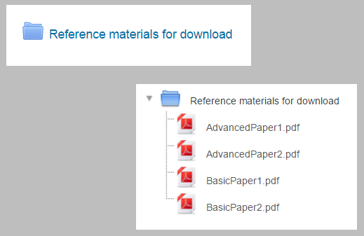
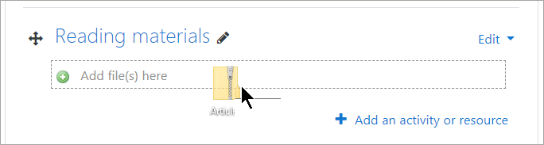
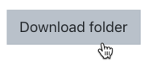
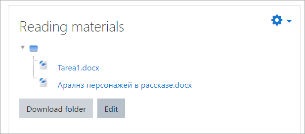

# Folder_resource

> Sumber: https://docs.moodle.org/502/en/Folder_resource

  

## What is a Folder resource?

- The folder allows a teacher to display several course files together. The files may be of different types and they may be uploaded in one go, as a zipped folder which is then unzipped, or they may be added one at a time to an empty folder on the course page.
- *Note that in the Moodle LMS, a folder can only be used for gathering and displaying files, not other resources or activities, unlike the use of the term 'folder' in other learning platforms.*

## How is it set up?

To drag and drop a folder, first zip (compress) it and then with the editing turned on in a course, click and hold the zipped folder, drag it to your chosen section and release.

From the screen that appears next, make sure that the button Unzip files and create folder is selected, and click Upload.

1.  Alternatively, with the editing turned on in a course, choose 'Folder from the activity chooser.
2.  Give it a name and, if required, a description, checking the box if you want the description displayed on the course page.
3.  In Content, upload the files you want to display in the folder.
4.  Decide how you want the folder contents to display, and whether you want to include a Download button so so students may download the files as a zipped folder for viewing offline.
5.  Save the folder.

## How does it work?

### Student view

Depending on how the teacher configured the folder, students will either click the folder to see the files or they will be displayed on the course page. If the teacher included a Download button, students will see the button as in the screenshot:

  

Images and HTML files may now be displayed directly in the browser if the teacher does not select the Download button;

### Teacher view

Teachers see an Edit button when accessing the folder, to allow them to upload, edit or remove files.

## More information

- [Folder resource settings](Folder_resource_settings.md "Folder resource settings")
- [Folder resource FAQ](Folder_resource_FAQ.md "Folder resource FAQ")
