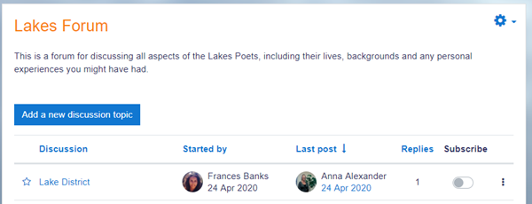
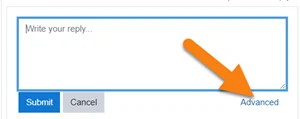
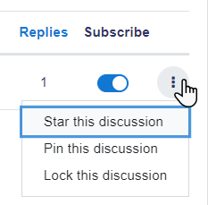
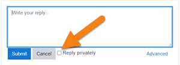

# Forum

> Sumber: https://docs.moodle.org/502/en/Forum

  

## What is the Forum activity?

The Forum activity allows students and teachers to exchange ideas by posting comments as part of a 'thread'. Files such as images and media maybe included in forum posts. The teacher can choose to grade and/or rate forum posts and it is also possible to give students permission to rate each other's posts.

## How is it set up?

1.  In a course, with the editing turned on, choose 'Forum' from the activity chooser.
2.  Give it a name and, if needed, a description.
3.  Choose your Forum type, clicking the question mark (?) icon for descriptions of each type. If you're unsure, use the default Standard forum for general use.
4.  Expand the other sections to define the settings you want. For more help, see [Forum settings](Forum_settings.md "Forum settings")
5.  Click Save and display and, optionally, add a post to get started.

## How does it work?

### Student view

Students access the forum by clicking the icon on the course page and depending on the forum type selecting, will typically be see a button to start a new discussion topic. They can sort discussions, subscribe to discussions from the toggle button, and favourite/bookmark discussions from the star icon on the left. This moves the discussion to the top of the list, under any discussions pinned by the teacher.

When starting a new discussion or replying If they click into a discussion, they have a link to reply and a 'Permalink'.

When replying, a basic text editor is available. Clicking the link Advanced displays the full editor and options such as uploading attachments.

Posts can be edited for a limited time,usually 30 minutes, dependent on the administrator's settings.

### Teacher view

Teachers additionally have three dots to the right of the Subscribe option, allowing them to pin, star or lock discussions.

When replying to a forum post, teachers also optionally can send a Private reply which is only seen by that particular student. Students cannot reply to this private reply.

### Q&A forums in live situations

In a Q&A forum, students must post their own reply before they can see other students' posts. By default, this restriction remains in place until the maximum edit time expires, which can be disruptive in a live classroom setting.

[New feature  
in **Moodle 5.2**!](Category_New_features.md "Category:New features") Teachers can enable the **Show replies immediately after posting** option when setting up a Q&A forum. When enabled, students can see each other's posts immediately after submitting their own, regardless of the edit time limit.

### Automatic discussion locking

Forum discussions can be set to lock automatically after a period of inactivity. [New feature  
in **Moodle 5.2**!](Category_New_features.md "Category:New features") The lock period is set by entering a number and choosing a time unit (seconds, minutes, hours, days, or weeks), allowing for flexible inactivity periods. This setting is found in the [Discussion locking section of the forum settings](Forum_settings.md#Discussion_locking "Forum settings").

## More help

- [Forum settings](Forum_settings.md "Forum settings")
- [Using Forum](Using_Forum.md "Using Forum")
- [Forum FAQ](Forum_FAQ.md "Forum FAQ")
