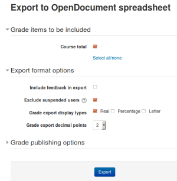
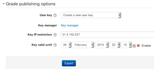

# Grade_export

> Sumber: https://docs.moodle.org/502/en/Grade_export

Grades can be exported to Excel spreadsheet, OpenDocument spreadsheet, plain text file or XML file, or published via a URL.

*Grade export is NOT intended for students.*

## How to export grades

 *Grade export*

To export grades from the gradebook:

1.  Select Export from the Grades dropdown menu.
2.  Choose an export format.
3.  Set options as required.
4.  If the course uses groups, select whether to export grades for all participants or for a particular group.
5.  Select the grade items to be included. Note that ID numbers are required for all activities for XML file export. An ID number field can be found in the common module settings for each activity.
6.  Click the export button.

## XML file export

To export grades to XML file, you need to ensure that:

- Users have ID numbers (an optional field in the user profile)
- Activities have ID numbers (an optional field in the common module settings)

## Export new or updated grades only

To export only new or updated grades you need to enable **XML File** in *Grades \> General settings \> Primary grade export methods (gradeexport)*.

After this setting has been enabled, the XML File option will then set and use a "last exported" field for every grade. The result will export the records with the \<state\> tag being identified as new or regraded.

This means the report will track the last exported date. If you export and then try again, it will not show any results because there are no new or updated grades since the last export.

## Default grade export settings

The grade export display type, grade export decimal points and grade export method site-wide defaults may be set by an administrator in *Site administration \> Grades \> <a href="General_grade_settings.md" class="mw-redirect" title="General grade settings">General settings</a>*.

## User profile fields export

An administrator can specify user profile fields and custom profile fields to be included in the grade export in *Site administration \> Grades \> General settings*.

## Grade publishing

 *Grade publishing options*

Grade publishing is a way of importing and exporting grades via a URL without being logged in to Moodle. Grade publishing is intended for administrators only, due to the security implications.

Grade publishing is disabled by default. It can be enabled by an administrator by checking the gradepublishing box in *Administration \> Site administration \> Grades \> <a href="General_grade_settings.md" class="mw-redirect" title="General grade settings">General settings</a>*. Users with grade publishing capabilities (normally managers only) will then be able to access the grade publishing options.

To publish grades from the gradebook:

1.  Follow the first four steps above for 'How to export grades'.
2.  In the grade publishing options, choose 'Create a new user key' or select a key generated previously.
3.  Click the export button. A download URL will then be displayed.

## Grade export capabilities

- [Publish ODS grade export](Capabilities_gradeexport_ods_publish.md "Capabilities/gradeexport/ods:publish")
- [Use OpenDocument grade export](Capabilities_gradeexport_ods_view.md "Capabilities/gradeexport/ods:view")
- [Publish text file grade export](Capabilities_gradeexport_txt_publish.md "Capabilities/gradeexport/txt:publish")
- [Use text file grade export](Capabilities_gradeexport_txt_view.md "Capabilities/gradeexport/txt:view")
- [Publish XLS grade export](Capabilities_gradeexport_xls_publish.md "Capabilities/gradeexport/xls:publish")
- [Use Excel grade export](Capabilities_gradeexport_xls_view.md "Capabilities/gradeexport/xls:view")
- [Publish XML grade export](Capabilities_gradeexport_xml_publish.md "Capabilities/gradeexport/xml:publish")
- [Use XML grade export](Capabilities_gradeexport_xml_view.md "Capabilities/gradeexport/xml:view")

## Tips and tricks

- Export grades in a spreadsheet format. Then copy and paste that information into another file that has worksheet ("raw grades"). Create other worksheets which are custom reports which take their data from "raw grades". This works if graded activities are **not** moved around to different positions in the course. This allows you to create a standard printed report(s). For example, a compact landscape report of all students and all grades for each activity, a report of just quizzes, another of lessons, another of assignments. A pivot table of students by scores, generated from a report worksheet, which gets its data from the raw data.
- Mailmerge exported grades into custom documents. For example, a document that is given to a department to file as a proof of training, with scores for every subject quiz.

## See also

- <a href="http://docs.moodle.org/dev/Gradebook_export" class="extiw" title="dev:Gradebook export">Gradebook export</a> developer documentation
- <a href="https://tracker.moodle.org/browse/MDL-44923" class="external text" rel="nofollow">MDL-44923</a> for background information about the setting 'Export new or updated grades only'
