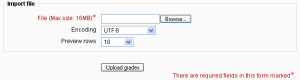
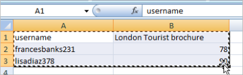
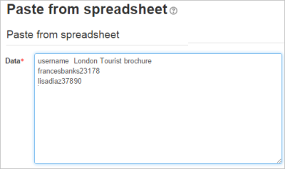
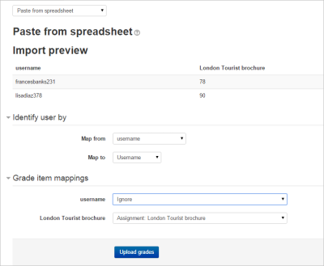
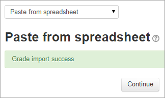
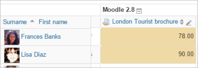

# Grade_import

> Sumber: https://docs.moodle.org/502/en/Grade_import

## Importing grades

Grades may be imported as a CSV or XML file, or by pasting from a spreadsheet.

The import file format is the same as the corresponding export format.

**Note 1:** Grade import is equivalent to manual grading in the <a href="grader_report.md" class="mw-redirect" title="grader report">grader report</a>. Thus, if grades for a particular Moodle activity such as an assignment are imported, they can no longer be edited via the assignment submission page.

**Note 2:** To import grades above 100% you need to check the 'unlimitedgrades' and 'gradepointmax' settings in *Site administration\>Administration\>Grades\>General settings*.

**Note 3:** Importing feedback will also overwrite any grades that are linked to that assessment. Please include both feedback and grades for the activity when mapping and importing grades via CSV. If both columns are not included then all grades for that activity will be lost.

 *CSV grade import*

To import grades into the gradebook:

1.  Decide on an import format - CSV or XML file, or paste from spreadsheet (see below) - then [export some grades](Grade_export.md "Grade export") using the corresponding export format.
2.  Edit the export file as appropriate and save it.
3.  Tip: If you opened your exported file in Excel, don't add columns there because Moodle will reject the import if there are new columns that didn't exist in the exported file. If you need to add columns, do that in Moodle BEFORE you export your gradebook.
4.  Select your chosen import format from the gradebook dropdown menu.
5.  Browse and upload your previously saved file.
6.  Set options as required.
7.  Click the "Upload grades" button.
8.  CSV import only: Preview the grade import and choose the column mapping then click the "Upload grades" button to complete the grade import.
    1.  Tip: By default "Map from" is set to First Name, and "Map to" to userid. Change both dropdowns to: "Email Address" to "useremail", or to "Id Number" to "useridnumber" (assuming that your users have ID number fields filled in in their profiles).
    2.  Tip: Unlike in most email programs, email addresses are case sensitive in grade import files. (This should eventually be fixed as per <a href="https://tracker.moodle.org/browse/MDL-29315" class="external text" rel="nofollow">MDL-29315</a>.)

You need two permissions to import grades: (1) general permission to import grades and (2) permission to import grades in a particular format. For example, to import CSV grades you need moodle/grade:import ("Import grades") = Allow and gradeimport/csv:view ("Import grades from CSV") = Allow

## CSV import

CSV import is more flexible than XML import, as you may choose the column mapping.

### Grade Mapping

After selecting your CSV for import you'll be prompted to map user fields and grade items to the new column headers to ensure that there is a match. More than one item can be mapped to the same grade item in your destination course so be mindful of the mapping to ensure that grade data is imported properly, any collisions (i.e. if two or more fields are mapped to the same but duplicate data exists) will cause an error. User grade data for users not yet enrolled to the destination course will be noted (and once enrolled their grade data will display).

### Encoding

If you are unsure of the encoding of your CSV file, try selecting the second option in the encoding dropdown menu. If you've used Excel to produce the CSV file the second option WINDOWS-xxx encoding is probably the correct one. The grade import preview will tell you if you guessed the encoding correctly.

### Verbose scales

Scales can be either specified as a raw id - e.g. 0, 1, 2, 3, etc. or as a string, e.g. "good", "bad", "not very bad". The later format is called "verbose".

### Force import

This prevents grade overriding during the grade importing in a scenario where more than one teacher exports the course grades and then re-imports them. If a second teacher exports the grades and tries to import them, the following error message will be displayed and the grade importing procedure will be aborted:

    (''Student name'') grades have not been imported because the grades in the import file are older than in the grader report. To proceed with the grade import anyway, use the force import option.

It will not be possible to import a file that had been exported file longer than a year ago, one with dates in the future. However, in cases where a teacher needs to import the grades regardless, they should use the **Force import**. option. This will then import the grades irrespective of the dates.

## Paste from spreadsheet

Grades may be pasted directly from a spreadsheet such as Excel or Libre Office:

1\) Ensure you have the correct column names for your grades (e.g. the assignment title or manual grade) It might help to download and edit the relevant students and graded information by using the [Grade export](Grade_export.md "Grade export") feature.

2\) For the students you need either their username, their ID or their email address. Add the grades you need and copy the relevant section:

3\) In your course, go to *Grade administration\>Import\>Paste from spreadsheet* and paste:

4\) In the preview, ensure you match up the identifier you used for the students -so if you used 'username', ensure it maps to 'username'. Do the same for your graded activities:

5\) If everything has been correctly mapped (See grade mapping above), you should get a success message and the grades will have been added, displaying in a different colour to show they were imported directly into the gradebook:

|                              |                                    |
|------------------------------|------------------------------------|
|  |  |

Paste from a spreadsheet requires similar permissions to a csv file import: (1) general permission to import grades and (2) permission to import grades in a particular format i.e. moodle/grade:import ("Import grades") = Allow and gradeimport/direct:view ("Import grades from spreadsheet") = Allow

## XML import

Before importing an XML file you will need to ensure that all of the students that you want to alter grades for have their ID number field filled out. This is located in the "Optional" section of the user edit profile page. You will also need to set the ID number of the activity as well. You can find this under "Common module settings" when editing the activity.

The format for the XML should be as follows:

    <results>
        <result>
            <assignment>activityidnumber</assignment>
            <student>studentidnumber</student>
            <score>53.00</score>
        </result>
        <result>
            <assignment>differentactivityidnumber</assignment>
            <student>studentidnumber</student>
            <score>73.00</score>
        </result>
    </results>

For a working example try exporting the gradebook as an xml file and view the format.

### Remote file URL

The remote file URL field is for fetching data from a remote server, such as a student information system.

## Grade import capabilities

- [Import grades from CSV](Capabilities_gradeimport_csv_view.md "Capabilities/gradeimport/csv:view")
- [Import grades from spreadsheet](Capabilities_gradeimport_direct_view.md "Capabilities/gradeimport/direct:view")
- [Publish import grades from XML](Capabilities_gradeimport_xml_publish.md "Capabilities/gradeimport/xml:publish")
- [Import grades from XML](Capabilities_gradeimport_xml_view.md "Capabilities/gradeimport/xml:view")

## See also

Using Moodle forum discussions:

- <a href="http://moodle.org/mod/forum/discuss.php?d=85944" class="external text" rel="nofollow">Gradebook confusion</a>
- <a href="http://moodle.org/mod/forum/discuss.php?d=92081" class="external text" rel="nofollow">Can external software insert data into the gradebook?</a>
