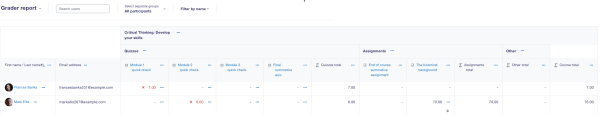
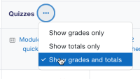
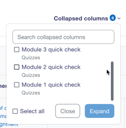
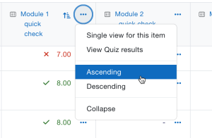
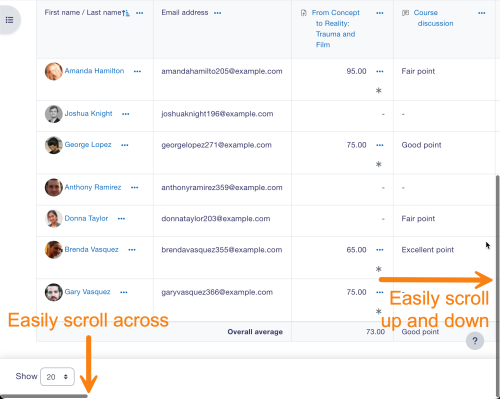
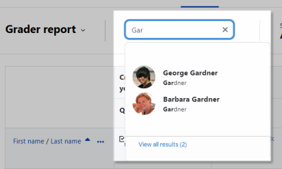
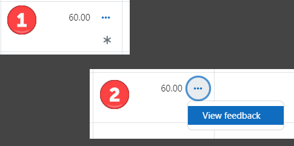

# Gradebook

> Sumber: https://docs.moodle.org/502/en/Gradebook

## Grader report: Introduction

All the grades for each student in a course can be found in the course gradebook, or 'Grader report', accessed from the Course navigation.

The following screencast gives a general overview of the Gradebook.

  
The **grader report** collects [items](Grade_items.md "Grade items") that have been graded from the various parts of Moodle that are assessed, and allows you to view and change them as well as sort them out into [categories](Grade_categories.md "Grade categories") and calculate totals in various ways. When you add an assessed item in a Moodle course, the gradebook automatically creates space for the grades it will produce and also adds the grades themselves as they are generated, either by the system or by you.

The grades displayed are initially displayed as the raw marks from the assessments themselves, so will depend on how you set those up e.g. an essay out of 36 will appear as however many raw marks that student got, not a percentage (although this can be changed later, see below).

Note that various default options for the gradebook are set at system level by the administrator in and can be marked as being overridable by you, or fixed. This means that the options will not always be set up the same way for every user when they see the grader report for the first time.

## Hiding settings globally

Admin settings hide parts of the user interface:

- *Site administration \> Grades \> General settings*: 'Show minimum grade'. If this setting is disabled, the minimum grade will default to zero and cannot be edited (the minimum grade can never be edited).
- *Site administration \> Grades \> Grade category settings*: 'Allow category grades to be manually overridden'. If this setting is disabled, users cannot override category grades.

## Display

Along the top of the grader report are several rows: first the course, then the category, then the columns for each graded activity (for example: Assignment, Quiz, Lesson). Any activities settings which were left "uncategorised" will appear in the general category which is named after the course by default (any category name can be changed).

From the three dots next to a category name you can select to

- show grades only
- show grade totals
- show grades and totals.

Collapse columns by clicking the three dots next to a grade item. Collapsed columns show with a + sign. Click the + to expand them again one at a time. From the Collapsed columns link on the right, quickly see and search how many columns are collapsed.

The three dots next to a grade item also allows you to:

- switch to Single view.
- change the order (ascending/descending).

  

### Scrolling through the gradebook

The gradebook allows for smooth and stable scrolling horizontally and vertically through grades. It uses the whole window, making it accessible on all platforms. (Note: horizontal scrolling is at the bottom of the browser window, and there is no horizontal scrollbar at the top.)

 *Scrolling in all directions*

### Searching and filtering the Grader report

- If you change the course settings Group mode to Visible groups or Separate groups a drop-down menu will appear in the gradebook to allow you to filter your students by groups.
- You can search easily by starting to type the first few letters of the name of the person (or email or ID number or other user identity item) or group you wish to find.

### Records per page

At the bottom of the Grader report, you can select to show 20, 100 or All students on the page.

If you change the setting, it is remembered and applied to the Grader report in all your other courses. If there are more than 5000 students, then All will show 5000, with pagination to show the rest.

## Viewing and editing grades

### Viewing Assignment feedback

- If you have a given feedback to a learner in an assignment, an asterisk icon will display. Click the three dots in that column to view the feedback in a modal window.

### Altering the grades

You can click "Turn editing on" at the top right to enter grades directly in the grader report. When you are done, click 'Save changes'. From the cell actions menu (...) you can also follow the link 'Edit grade' to set the grade, its written feedback and a number of other attributes.

Note: If you enter grades directly in the grader report, they are then shown with an overridden icon (box with pencil) to indicate grades which have been manually changed.

### Altering the grades using Single view

The single view interface allows you to enter grades in bulk for a specific grade item or a specific user. To change a specific grade or all grades, click on the Override checkbox by the specific grade row or use the Override All action to check every row. If you wish to override all grades with a set grade, select Bulk insert grades from the Actions menu and enter the grade that you wish to insert. You can select whether to fill the grade for just empty grades or for all grades from the dropdown list. Click on Save and you will now see in the Grader Report that all grades the specific item/user have been overridden with the grade/grades that you entered.

Tip: You can move between grades in Single view using Ctrl+arrow keys.

### Hiding columns or individual grades

Clicking the three dots next to a grade item will give you the option to hide or lock that item (along with options to edit it and view the grade analysis).

**Note that visibility of quiz grades is controlled by the quiz settings** (in the Review options section).

### Recalculating

If you change any part of an assessment e.g. alter the maximum grade for one of the questions in a quiz, you may find that the columns do not yet reflect the change you have made. Click **Turn editing on** twice to force the gradebook to re-check.

## Gradebook capabilities

There is just one gradebook capability, [View the grader report](Capabilities_gradereport_grader_view.md "Capabilities/gradereport/grader:view"), which is allowed for the default roles of manager, teacher and non-editing teacher.

## Extending the gradebook

The Gradebook can be extended in three main ways:

1.  <a href="https://moodle.org/plugins/browse.php?list=category&amp;id=9" class="external text" rel="nofollow">Grade reports</a>
2.  Grade import plugins
3.  <a href="https://moodle.org/plugins/browse.php?list=category&amp;id=10" class="external text" rel="nofollow">Grade export plugins</a>

## See also

- Join the discussions about gradebook plugins in the <a href="https://moodle.org/mod/forum/view.php?id=2122" class="external text" rel="nofollow">Gradebook forum</a>.
- <a href="https://moodle.academy/enrol/index.php?id=153" class="external text" rel="nofollow">Assessment: Exploring Gradebook</a> - An intermediate-level course in the Assessment program that helps you optimise your grading process and support learners better.
