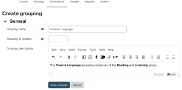
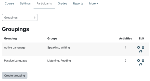
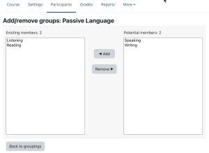
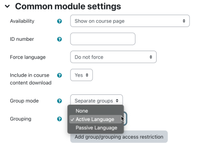
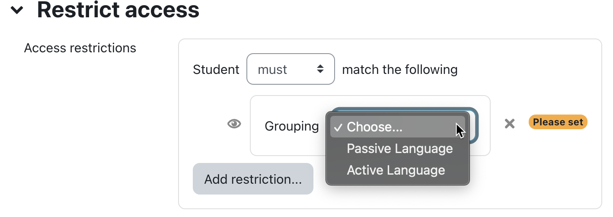

# Groupings

> Sumber: https://docs.moodle.org/502/en/Groupings

## What is a grouping?

A grouping is a collection of groups within a course. Using groupings allows you to direct tasks at one or more groups in your course, so that they can work together on the tasks.

### Grouping example

- You teach students in a course called 'The Art of Language'.
- Your students are divided into four groups, Listening, Reading, Speaking and Writing, and for much of the course they work in these groups.
- You wish the students to work on a project, exploring passive and active language. You create a grouping Passive Language and assign the Listening and Reading groups to this grouping. You create a grouping Active Language and assign the Speaking and Writing groups to this grouping.
- Using the Restrict access feature you set certain tasks only for the Passive Language grouping and other tasks only for the Active Language grouping.
- Now the groups can work together, within their grouping, on their respective focus areas.
- At the end of the project you can bring the groups together in an activity for all participants to share their learning.

## Creating groupings

 *Create grouping*

To add a new grouping, select the *Groupings* option in the *Participants* drop-down inside a course and select *Create grouping*.

Add a *Grouping name* and, optionally, a *Grouping ID number* to and *Grouping description*. The optional grouping ID number may be added for matching the grouping against external systems or when when [importing groups into groupings](Import_groups.md "Import groups"). Grouping ID numbers are not displayed anywhere on the site. Within a course, all grouping ID numbers must be unique.

### Grouping custom fields

A site administrator, or user with the configure grouping custom fields capability, can create grouping custom fields in *Site administration \> Courses \> Grouping custom fields*.

## Adding groups to a grouping

 *Groupings*

To add groups to a grouping:

1.  In your course, select the *Groups* option in the *Participants* drop-down.
2.  Click the "Show groups in grouping" people icon in the edit column.
3.  On the add/remove groups page, select the group(s) you want to add to the grouping from the "Potential members" list.
4.  Click the arrow button that points towards the "Existing members" list.
5.  Click the "Back to groupings" button. The group(s) you added to the grouping will now be listed in the table on the groupings page.

 *Adding groups to a grouping*

Existing groupings can be edited and/or deleted using the appropriate icons in the edit column of the table on the groupings page.

## Setting the default grouping

Once some groupings have been created, a default grouping for course activities and resources may be set.

1.  Follow the settings link in the course administration block.
2.  In the groups section in the course settings, select the default grouping.

The default grouping is used on the Participants page.

## Selecting a grouping for an activity

To use a particular grouping in an activity:

1.  Click the 'Edit settings' link for the activity
2.  In the Common module settings section, set a group mode
3.  Select the grouping from the grouping dropdown menu.
4.  Click the "Save changes" button at the bottom of the page.

If the group mode is set to separate groups, students will only see the activities they have been assigned to. Teachers will see the name of the grouping in brackets after the activity name on the course page. A count of activities assigned to each grouping is kept on the groupings page.

Please note that the grouping option appears by default only in activities that support group modes.

 *Add group/grouping access restriction' button*

If <a href="Conditional_activities.md" class="mw-redirect" title="Conditional activities">Conditional activities</a> are enabled, there is a button 'Add group/grouping access restriction'.

## Restricting an activity, resource or course topic to a grouping

To be able to restrict an activity, resource or course topic to a grouping, [Restrict access](Restrict_access.md "Restrict access") must be enabled. This will result in a 'Restrict access' section in the activity, resource or topic settings and a grouping restriction can then be added.

Ensure that the *Restriction by grouping* option is enabled in the [Restrict access settings](Restrict_access_settings.md "Restrict access settings"); otherwise the *Grouping* button is not shown in your list of available restrictions.

## See also

- [Importing users into groupings via CSV](Import_groups.md "Import groups")
- [Groupings FAQ](Groupings_FAQ.md "Groupings FAQ")
