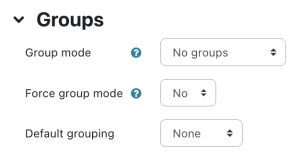
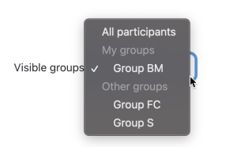
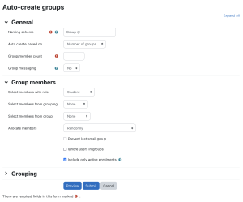
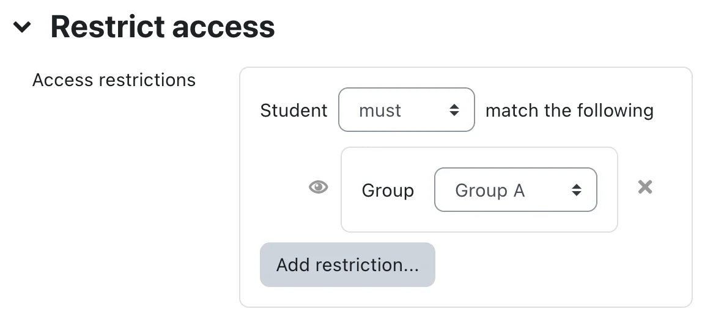

# Groups

> Sumber: https://docs.moodle.org/502/en/Groups

## Why use groups?

- You are a teacher in a course where you have several classes and you want to filter your activities and gradebook so you only see one class at a time.
- You are a teacher sharing a course with other teachers and you want to filter your activities and gradebook so you don't see the students from your colleagues’ classes.
- You want to allocate a particular activity, resource or topic section to just one class or set of users and you don't want others to see it.

<!-- -->

- This <a href="https://youtu.be/pKAFWItexUY" class="external text" rel="nofollow">screencast about using groups</a> also highlights the benefits of using groups.

## Group levels

 *Groups settings in course settings*

A group or grouping can be used on two levels:

- Course level - The group mode defined at the course level is the default mode for all activities defined within that course. To use groups you need first to set a group mode in *Administration \> Course administration \> Edit settings.*

<!-- -->

- Activity level - Each activity that supports groups can also have its own group mode defined. If the course setting "Force group mode" is set to "Yes" then the option to define the group mode for individual activities is not available. If it is set to "No", then the teacher may change the group mode:

### Group modes

There are three group modes

- No groups - There are no sub groups, everyone is part of one big community
- Separate groups - Each group can only see their own group, others are invisible.
- Visible groups - Each group works in their own group, but can also see other groups. (The other groups' work is read-only.)

For example, enabling either separate or visible groups on an assignment drop-box enables staff to filter the student submissions to see only those from a particular tutor group. With visible groups, students can see which other groups are doing the same activities as they are; with separate groups, they do not know which other groups are doing the same activities.

Using groups with discussion forums allow teachers to restrict interaction between students. Separate groups mean only students in the same group can see and participate in discussions within a particular forum. Visible groups allow students to see other group's discussions, but only participate in their own group's discussions.

**Note:** Where visible groups are used or the participant can access all groups, the user's own group is shown first, followed by other groups:

## Creating a group

1.  Click the *Create group* button:
    1.  (using the Boost theme) select *Participants* from Course navigation and from the dropdown select *Groups*.
    2.  (using the Classic theme) *Administration \> Course administration \> Users \> Groups*
2.  Add a group name and optional description (displayed above the list of group members on the participants page), <a href="enrolment_key.md" class="mw-redirect" title="enrolment key">enrolment key</a> and picture (displayed on the participants page and next to forum posts)
3.  Tick the box Enable group messaging if you wish to enage in group conversations. You will then be able to send group messages from the messaging drawer. Make sure you are in the group as well as your students. See [Messaging](Messaging.md "Messaging") for more information.
4.  Click the 'Save changes' button
5.  Select the group to which you want to add participants, then click the 'Add/remove users button
6.  In the "Potential members" list, select the users you want to add to the group. Multiple users may be selected using the Crtl key.
7.  Click the Add button to add the users to the group

An optional group ID number (an advanced setting) may be added for matching the group against external systems. Group ID numbers are not displayed anywhere on the site. Within a course, all group ID numbers must be unique. Thus it's not possible to create a group with a duplicate group ID number.

### Group membership visibility

While setting up your group, as in the section above *Creating a group*, you can decide who sees the group members from the Group membership visibility dropdown. By default, group members can see other members but you can change this so that:

- only group members see other members - or
- group members do not see other members - or
- only the teacher sees group members.

Note that once members are added to a group, the group membership visibility can no longer be changed.

Note that only groups with a membership visibility of "Visible" or "Only visible to members" can be used for access restrictions. If "Only see own membership" or "Hidden" is selected, then the group cannot be used to filter Activities.

### Bulk enable/disable group messaging

Group messaging may be enabled or disabled in bulk by selecting the desired groups and clicking the relevant button. This might be useful for example if many groups are auto-created.

### Group custom fields

A site administrator, or user with the configure group custom fields capability, can create group custom fields in *Site administration \> Courses \> Group custom fields*.

## Auto-create groups

 *Auto-create groups*

Groups may be created automatically via the 'Auto-create groups' button in *Administration \> Course administration \> Users \> Groups*. To see all the settings, click the *Expand all* link top right.

### General

A **naming scheme** can be created automatically. \# is replaced by sequential numbers, and @ by letters. For example:

- *Group @* will create group with a naming scheme Group A, Group B, Group C...
- *Group \#* will create group with a naming scheme Group 1, Group 2, Group 3...

You can specify if you would like to create

- x number of Groups or
- each group contain x number of students

### Prevent last small group

When selecting **Members per group**, depending on the number of users in the course, the last group can end up with significantly fewer members than expected. You can select **Prevent last small group** to avoid the situation. If the last group would be smaller than 70% of the expected size, it will not be created. Instead, Moodle will allocate additional members to existing groups rather than create a new group with few members.

Example 1:

You have a course with 80 students and you let auto-create groups with 30 members per group. There would be just 20 students in the third group which is 66% out of expected 30. Moodle will auto-create only two groups with 40 students in each.

Example 2:

You have a course with 81 students and you let auto-create groups with 30 members per group. Moodle will create three groups with 30, 30 and 21 members respectively because 21 is 70% out of expected 30.

Hint: If you need to customize the 70% ratio used in these calculations on your site, ask your administrator to set the constant \`AUTOGROUP_MIN_RATIO\` in the main config.php.

    define('AUTOGROUP_MIN_RATIO', 0.95); // Means the smallest group will have at least 95% of the expected size.

### Group members

*Select members from...* allows you to choose from roles assigned within the course, available cohorts, groups or groupings. **Specify** and **Group/Member count** work together.

The setting 'Select members from cohort' lists all cohorts which users enrolled on the current course are part of. The number in brackets is the number of users enrolled on the course in that cohort.

The 'Ignore users in groups' checkbox should be ticked to only select group members from users that are NOT already in a group in the course.

The 'Include only active enrolments' checkbox provides the option to choose whether to include suspended users in groups. The checkbox is only displayed to users with the [capability to view suspended users](Capabilities_moodle_course_viewsuspendedusers.md "Capabilities/moodle/course:viewsuspendedusers").

### Grouping

**Create in grouping** and **Grouping name** allows you to create a new grouping and allocate the new auto-created groups to be created to it.

Prior to creating the groups, you can view the groups.

## Restricting an activity, resource or course topic to a particular group

 *Restricting an activity to a particular group*

To be able to restrict an activity, resource or course topic to a group, [Restrict access](Restrict_access.md "Restrict access") must be enabled. This will result in a 'Restrict access' section in the activity, resource or topic settings and a group restriction can then be added.

## Groups and enrol plugins

Where groups are created automatically with enrol plugins such as IMS Enterprise, members cannot be unenrolled manually via the groups screen inside a course. This has to be done from the plugin. Additionally, when group members are owned by a plugin like this, there is information below their name on the groups screen.

## Groups overview

A overview of groups and groupings is available via the Overview tab in *Administration \> Course administration \> Users \> Groups*.

The table may be filtered to display particular <a href="groupings.md" class="mw-redirect" title="groupings">groupings</a> or groups and it will also display students who are not in a group.

## Groups capabilities

- [Manage groups](Capabilities_moodle_course_managegroups.md "Capabilities/moodle/course:managegroups")
- [Access all groups](Capabilities_moodle_site_accessallgroups.md "Capabilities/moodle/site:accessallgroups")
- [Manage group calendar entries](Capabilities_moodle_calendar_managegroupentries.md "Capabilities/moodle/calendar:managegroupentries")

## See also

- [Upload users](Upload_users.md "Upload users") - for importing users into groups
- [Enrolment key](Enrolment_key.md "Enrolment key")
- <a href="https://moodle.org/plugins/local_autogroup" class="external text" rel="nofollow">Autogroup additionalplugin</a> - A local plugin which automatically assigns enrolled users on a course into groups dependent upon information within their user profile. (Now with custom profile field support - called User Info Field in settings.) This plugin will create, update, and delete groups automatically to match the users on your course.
