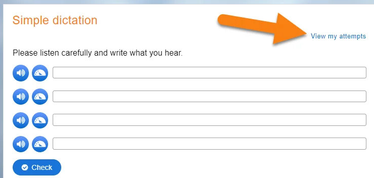
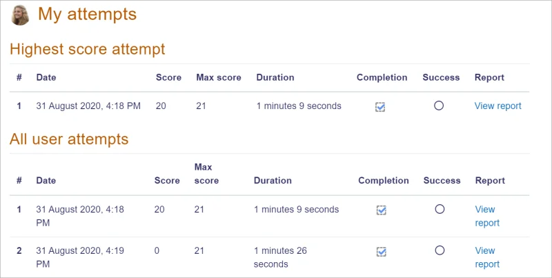
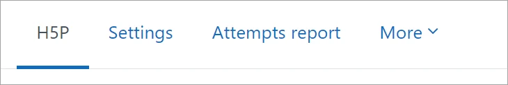

# H5P_activity

> Sumber: https://docs.moodle.org/502/en/H5P_activity

  

## What is the H5P activity?

The H5P activity enables H5P content created in the [Content bank](Content_bank.md "Content bank"), to be added to a course as an activity.

You can also create content on the <a href="https://h5p.com/" class="external text" rel="nofollow">h5p.com site</a>, or the <a href="https://next.lumi.education/" class="external text" rel="nofollow">LUMI</a>, download the file and then upload to your Moodle course content bank to later add as an activity.

  

If you are linking to H5P content on another site, such as <a href="https://h5p.com/" class="external text" rel="nofollow">h5p.com site</a>, then you need to enter it as an allowed source (Administration -\> Plugins -\> Filters -\> Display H5p -\> Allowed sources). Nothing needs to be entered if you are adding H5P content to your course from the content bank or by uploading an H5P package.

  

Note: You can also embed H5P content into any activity or resource, such as a <a href="Lesson.md" class="mw-redirect" title="Lesson">Lesson</a> or a <a href="Book.md" class="mw-redirect" title="Book">Book</a>, via the H5P button in the Tiny editor, as described in the [H5P overview](H5P.md "H5P").

## How is it set up?

1.  Ensure that you first have an existing H5P activity to upload, or that you have created one in the [Content bank](Content_bank.md "Content bank").

2.  In a course, with the editing turned on, choose 'H5P' from the activity chooser.

3.  Give it a name and, if needed, a description.

4.  From Package file \> File picker, add your H5P file from the Upload a file link or from the Content bank. **Note:** If you add the content as an alias, any modifications will be displayed here but if you add it as a copy, the modified version will not display. For more information see [Working with files](Working_with_files.md "Working with files")

5.  Expand the other sections to select the settings you want, and then click Save and return to course.

## How does it work?

### Student view

Students click on the H5P icon in the course to access it.

Depending on the H5P activity and teacher's settings, the activity may be gradeable. Students can see their attempts from the Attempts report link in the H5P settings.

In the attempts report, the success column reports when the student has obtained 100% in the activity. The completion column reports whether the student went through the H5P content to the end. (The attempts report only displays data from the H5P content - there is no connection with the 'Grade to pass' activity setting nor with activity completion settings.)

### Teacher view

Teachers can see all attempts by all users from the Attempts report link. Note the figure refers to the number of attempts, not to the number of students who have attempted the activity.

## Capabilities

There are 4 capabilities relating to the H5P activity:

- [Add a new H5P](Capabilities_mod_h5pactivity_addinstance.md "Capabilities/mod/h5pactivity:addinstance") activity to the course

- [Review H5P attempts](Capabilities_mod_h5pactivity_reviewattempts.md "Capabilities/mod/h5pactivity:reviewattempts")

- [Submit H5P attempts](Capabilities_mod_h5pactivity_submit.md "Capabilities/mod/h5pactivity:submit")

- [View H5P](Capabilities_mod_h5pactivity_view.md "Capabilities/mod/h5pactivity:view")

## More information

- <a href="https://moodle.org/mod/forum/discuss.php?d=446887#p1795902" class="external text" rel="nofollow">Add a timer to an H5P activity</a>

- [H5P](H5P.md "H5P") for more information on H5P in Moodle, including embedding H5P content.

- [H5P FAQ](H5P_FAQ.md "H5P FAQ")

- [H5P migration tool](H5P_migration_tool.md "H5P migration tool") for migrating content from the mod_hvp plugin to the H5P activity

- [H5P essay](H5P_essay.md "H5P essay") an auto-grading H5P essay question type

