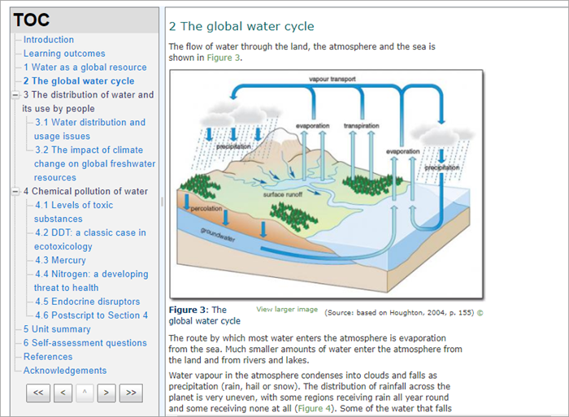

# IMS_content_package

> Sumber: https://docs.moodle.org/502/en/IMS_content_package

## What is an IMS content package?

IMS is a body which helps define technical standards for various things, including e-learning material. The <a href="http://www.imsglobal.org/content/packaging/index.html" class="external text" rel="nofollow">IMS Content Packaging specification</a> makes it possible to store chunks of material in a standard format which can be re-used in different systems, without having to convert the material into new formats.

The IMS content package in Moodle enables such content packages to be uploaded and included in Moodle courses. There are various options for displaying content with a navigation menu or buttons etc.

## How is it set up?

1.  With the editing turned on in a course, choose IMS Content package from the activity chooser.
2.  Give it a name and, if required, a description, checking the box if you want the description displayed on the course page.
3.  In Content, upload your package.
4.  Expand the other settings to specify the options you want and save and return to course.

## More information

- <a href="IMS_content_package_module_settings.md" class="mw-redirect" title="IMS content package module settings">IMS content package settings</a>
- [IMS content package FAQ](IMS_content_package_FAQ.md "IMS content package FAQ")
