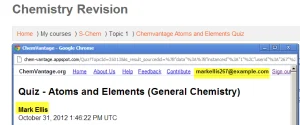
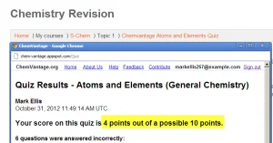
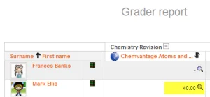

# LTI_External_tool_activity

> Sumber: https://docs.moodle.org/502/en/LTI_External_tool_activity

This page explores how to use [LTI External tools](LTI_External_tools.md "LTI External tools") in your course as activities.

## How is it set up?

To create an activity using an LTI External tool, go to the Course page and turn on Edit mode. Click either the link ‘Add an activity or resource’ at the bottom of each section, or click anywhere on the course page where you want to add your item. The Activity chooser will show; then, select the tool you want to create an activity with.

If the tool you want to use is not in the Activity chooser, you need to toggle the 'Show in activity chooser' option in the table in Course page \> More \> LTI External tools. This page is also where you can see all LTI External tools available in your course. For more information, see <a href="Managing_LTI_External_tools.md" class="mw-redirect" title="Managing LTI External tools">Managing LTI External tools</a>.

Once you select the tool in the Activity chooser, you can continue with activity creation and select the settings you'd like.

### General

##### Content

If you're using a tool that supports deep linking, you will see a 'Select content' button on top of the activity form. Use this button to select which specific content from the tool you want to use in your activity.

Once you select content, the Activity name and Activity description might be automatically populated by the tool.

If not, give your activity a name and, optionally, a description.

##### Display activity name when students access the tool

You will only see this setting if your site uses the Classic theme and, in the tool settings, the tool’s content display has been configured as ‘Embed’ or ‘Embed, without blocks’.

This setting determines whether the activity name is displayed on the screen once your students access it.

##### Display activity description when students access the tool

You will only see this setting if, in the tool settings, the tool’s content display has been configured as ‘Embed’ or ‘Embed, without blocks’.

This setting determines whether the activity description is displayed on the screen once your students access it.

#### Grade

Your activity will only have a Grade section if the tool it is using has been given permission to write grades in the gradebook.

In activities created using LTI External Tools, the grade will always be given by the tool. You might have the option to completely deactivate grading for your activity if the checkbox ‘Allow tool to add grades in the gradebook’ is displayed.

If you see the Grade section, but there is no checkbox  ‘Allow tool to add grades in the gradebook’, it means that your site administrator has configured the tool to always write grades in the gradebook.

#### Other settings

Depending on what is enabled for your site and course, you may also need to explore [Common module settings](Common_module_settings.md "Common module settings"), [Restrict access](Restrict_access.md "Restrict access"), [Activity completion](Activity_completion.md "Activity completion"), [Tags](Tags.md "Tags") and [Competencies](Competencies.md "Competencies").

## Using an LTI External tool as an activity

When students click the tool link they are automatically signed into the connecting site/tool provider (screenshot 1 below) and can take the quiz immediately.

When the student has completed the quiz, the tool provider displays their grade (screenshot 2 below) and when the student logs out of the tool provider, the grade is passed back into Moodle (screenshot 3 below).

|  |  |  |
|----|----|----|
|  *1.Student logged directly into tool provider* |  *2. Tool provider displays score* |  *3. Score passed to Moodle's gradebook* |

## See also

- Forum discussion <a href="https://moodle.org/mod/forum/discuss.php?d=460121" class="external text" rel="nofollow">1.3 External Tools adding to a course in Moodle version 4.3</a>
