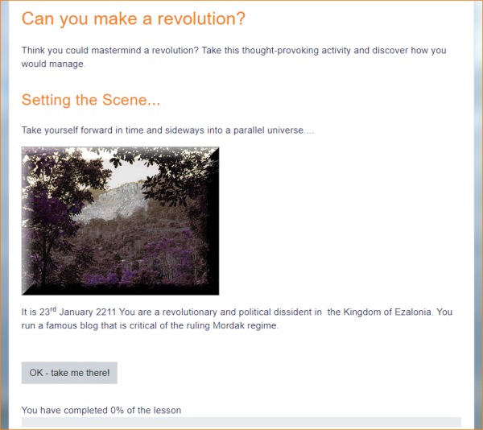
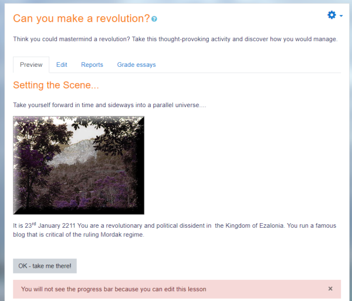

# Lesson

> Sumber: https://docs.moodle.org/502/en/Lesson

  

## What is the Lesson activity?

The Lesson activity allows teachers to create 'branching' exercises where students are presented with content and then, depending on their responses, are directed to specific pages. The content may be text or multimedia.

## How is it set up?

1.  In a course, with Edit mode enabled, choose 'Lesson' from the activity chooser.
2.  Give it a name and, if required, a description. (Remember this description will display on every page of the Lesson.)
3.  Expand the other sections to select the settings you want, including whether the Lesson is for practice or will be graded.
4.  Click Save and Display and add your first page. This will usually be a Content page (where you add information) or a Question page (where you can select a question type.)
5.  Make sure the 'Jumps' take you to the next page (if you want.) 'Jumps' direct the student to where they should go next. Once you have made all your pages, return and edit each Jump so it shows the correct page name
6.  When you have saved your first page, continue adding pages from the Collapsed tab \> Actions menu.

## How does it work?

### Student view

Students click on the Lesson icon in the course to access it and, depending on the teacher's settings see a page of information and are prompted to choose an option from a selection of possible responses.

 *Student view of a Lesson first page*

The Lesson may be timed, and it may display a progress bar. It may have a table of contents showing all pages, or the navigation may be hidden.

### Teacher view

Teachers see additional tabs when they access the Lesson. They can preview the flow, edit pages, view reports and grade essays (if Essay questions were used.)

 *Teacher view of Lesson*

## More information

- [Lesson settings](Lesson_settings.md "Lesson settings")
- [Building Lesson](Building_Lesson.md "Building Lesson")
- [Using Lesson](Using_Lesson.md "Using Lesson")
- [Lesson FAQ](Lesson_FAQ.md "Lesson FAQ")
