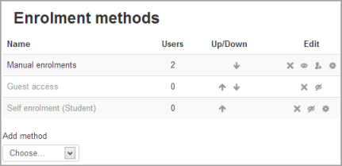

# Manual_enrolment

> Sumber: https://docs.moodle.org/502/en/Manual_enrolment

## Enrolment

The manual enrolments plugin allows users to be enrolled manually via a link in the course administration settings. The plugin has to be enabled by the site administrator (see [Enrolment plugins](Enrolment_plugins.md "Enrolment plugins")) and should normally be enabled as certain other enrolment plugins, such as self enrolment, require it.

## Course settings

### Checking you have manual enrolment in your course

1.  From Course navigation, click Participants and then select Enrolment methods from the dropdown.

2.  Make sure Manual enrolments has its "eye" opened.

 *Manual enrolments*

### Editing manual enrolment settings

Managers (and any other users with the capability [enrol/manual:config](Capabilities_enrol_manual_config.md "Capabilities/enrol/manual:config")) can edit the manual enrolment method in the course and set the default enrolment period and default role from the Enrolment methods link.

It is possible also for students and/or teachers to be notified when enrolments expire by selecting either "Enroller only" or "Enroller and enrolled user" from the dropdown "Notify before enrolment expires" and a time in "Notification threshold".

#### Custom welcome message

If enabled, users receive the following course welcome message via email when they are manually enrolled in the course:

*Hi {\$a-\>firstname}, you are enrolled in the course {\$a-\>coursename}.*

You can edit the text and change it as you wish. The following placeholders may be included in the message:

- Course name {\$a-\>coursename}

- Link to course page {\$a-\>courselink}

- Link to user's profile page {\$a-\>profileurl}

- User email {\$a-\>email}

- User fullname {\$a-\>fullname}

- User first name {\$a-\>firstname}

- User last name {\$a-\>lastname}

- User course role {\$a-\>courserole}

## Enrolling users

**Method 1**

1.  From Course navigation click Participants.

2.  Click the 'Enrol users' button at the top right or bottom right of the page.

3.  Use the 'Assign roles' dropdown if you wish to change the role.

4.  Click 'Show more' to expand the enrolment options and set them as appropriate.

5.  Browse or search for the user with the dropdown menu next to 'Select users'.

6.  Click the user to select them.

7.  When you have finished, click the 'Enrol selected users and cohorts' button.

The user(s) will then appear in the list of enrolled users.

Enrolment options include the option to add the user to a group and to choose a starting from date.

Note: The enrolment option 'Recover user's old grades if possible' is not ticked by default and is easy to miss. An admin can make it so that the checkbox is ticked for all courses on the site by enabling the setting 'Recover grades default' in the Site administration.

**Method 2**

1.  From Course navigation click the Participants link.

2.  From the dropdown Select 'Enrolment methods'.

3.  Click the 'Enrol users' icon in the edit column opposite manual enrolment.

4.  Select users from the not enrolled users list, using Ctrl + click to select multiple users.

5.  Click the add button to add the users to the enrolled users list.

Note: When searching for users, by default the user's email address is displayed in addition to their name. If preferred, an admin can set other user identity fields such as ID number to be displayed in 'Show user identity' in [User policies](User_policies.md "User policies") in the Site administration.

### Too many users to show... please use the search

By default, Moodle shows up to 100 participants in the list. If you have more than 100 users, it can be difficult to enrol multiple users quickly.

Go to *Site Administration \> Users \> Permissions \> User Policies* and change the value for “Maximum users per page”.

Warning! Significantly increasing this number may have an impact on your server's performance.

### Editing individual enrolment start and end dates

Enrolment start and end dates may be edited for individual students as follows:

1.  From Course navigation click the Participants link (or in *Course administration \> Users* in the Administration block if you are using a theme other than Boost)

2.  From the dropdown make sure Enrolled users is selected.

3.  Click the edit icon in the enrolment methods column for a particular user.

4.  Edit dates as required, then click the 'Save changes' button.

## Admin settings

The manual enrolment plugin may be enabled or disabled site-wide in 'Manage enrol plugins' in the Site administration.

Site-wide settings, including default settings for manual enrolment in new courses, may be set in 'Manual enrolments' in the Site administration.

- Enrolment expiration action - specifies what happens when user enrolments reach expiration date. Please note that option "Unenrol user from course" purges grades, group memberships, preferences and other user related data from the courses.

- Hour to send enrolment expiry notifications - specify hour for sending expiration notifications.

- Add instance to new courses- if this is enabled, then whenever a new course is created, manual enrolments will automatically added to new courses.

- Enable manual enrolments - this specifies if enrol instances are enabled by default in new courses, it is strongly recommended to keep this setting enabled.

- Default role - this sets the default role, which is normally student and may be altered by a teacher in a course.

- Default enrolment start - this feature sets the time for when students are enrolled in a course. The default is 'Now', but it can also be set to 'Today' and 'Course start'.

- Default enrolment duration - this sets the default length of enrolment in new courses.

- Notify before enrolment expires - specifies if teacher or optionally students should be notified before the expiration.

- Notification threshold - specify how many days should be users notified before the enrolment expiration.

- Send course welcome message - specify who the course welcome message should come from: the course contact (by default), the keyholder or a no-reply address.

Teachers can edit the course welcome message and specify who the message should come from. This is controlled by the capability [Edit course welcome message](Capabilities_moodle_course_editcoursewelcomemessage.md "Capabilities/moodle/course:editcoursewelcomemessage") allowed by default for teachers.

## Manual enrolment capabilities

- [Configure manual enrol instances](Capabilities_enrol_manual_config.md "Capabilities/enrol/manual:config")

- [Enrol users](Capabilities_enrol_manual_enrol.md "Capabilities/enrol/manual:enrol")

- [Manage user enrolments](Capabilities_enrol_manual_manage.md "Capabilities/enrol/manual:manage")

- [Unenrol users from the course](Capabilities_enrol_manual_unenrol.md "Capabilities/enrol/manual:unenrol")

- [Unenrol self from the course](Capabilities_enrol_manual_unenrolself.md "Capabilities/enrol/manual:unenrolself")

- [Edit course welcome message](Capabilities_moodle_course_editcoursewelcomemessage.md "Capabilities/moodle/course:editcoursewelcomemessage")

## See also

- [Participants](Participants.md "Participants")

