# Quiz_FAQ

> Sumber: https://docs.moodle.org/502/en/Quiz_FAQ

## General

### How can guests answer a Moodle quiz?

It is not possible for guests to use <a href="activities.md" class="mw-redirect" title="activities">activities</a> in Moodle.

But you can build a quiz on Google Forms and give a link from within Moodle.

### How can I try a quiz before it is released?

You have prepared a quiz exam for your students. It is currently in a hidden state. The exam opens on the day of the exam, at a time that the students know about. However, to satisfy yourself that it is doable in the time allotted, You wish to do a dry run yourself before that date. How can You accomplish this?

Method 1: Use the Preview feature available to you as a teacher as you are making the quiz.

Method 2:

1.  Make a dummy account with a name like "Test Student".
2.  Enrol that user in the course as a student.
3.  Add a "User override" to the quiz, so "Test Student" can attempt the quiz before it is open to everyone else.
4.  Log in as "Test student".
5.  Attempt the quiz.
6.  Log back in as teacher.
7.  Review the attempt.
8.  Go to Results -\> Grades and delete the test attempt.
9.  Un-enrol "Test Student" from your course.

Method 3: Set up a Moodle Playground course for your teachers. Add teachers with dual role (teacher and student). Teachers can later copy the quiz/assignment/whatever over to their live class.

### How can I enable notification of quiz submissions?

See <a href="Quiz_submission_notification.md" class="mw-redirect" title="Quiz submission notification">Quiz submission notification</a>.

### How do I send a bulk message to all students who haven't completed a quiz?

- Access *Course navigation \> Reports \> Course participation*
- From the drop down, choose your quiz.
- In *Show only*, choose "Student" and in *Actions*, choose "post"
- In the list that appears, tick/check the boxes next to those you wish to message.
- In the bottom dropdown *With selected users*, choose "send message"

<a href="File_quizemail.png.md" class="mw-file-description">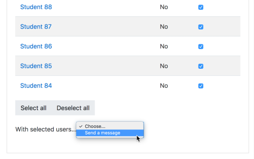</a>

### How can build a quiz that picks X questions randomly from a larger question bank?

See the section on adding random questions in [Building Quiz](Building_Quiz.md "Building Quiz").

### How can I print a copy of a quiz?

The <a href="https://moodle.org/plugins/qformat_printout" class="external text" rel="nofollow">Print out for review</a> plugin provides an additional export format for questions, which presents them in an easily readable, clear format, also suited for printout.

You can use your browser printer option (for example by right-clicking and selecting Print) When a student prints their finished quiz, responses and feedback will also be printed.

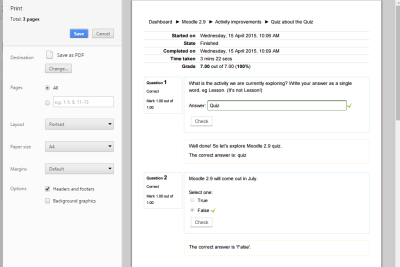 *Print preview of finished quiz - Click to enlarge*

- You can also export the question as Moodle XML, or GIFT format. If you open either of those files in a text-editor, you should be able to see most of the details of each question.

<!-- -->

- You can try <a href="https://moodle.org/mod/forum/discuss.php?d=449971#p1809041" class="external text" rel="nofollow">this CSS script</a> to print an "almost decent" version of a quiz.

### How can I print a quiz with all the quiz questions and answers?

As described by Jim Korose in <a href="https://moodle.org/mod/forum/discuss.php?d=456359#p1833171" class="external text" rel="nofollow">this thread</a>:

1\. **Make a copy of the quiz** that is already in Moodle and whose questions and answers you want to print. Locate the quiz, click on the three stacked dots to the right of the quiz. (You need to make a copy since you can't change pagination between questions once students have looked at or taken the quiz.)

2\. **Change the “settings” for the copy of the quiz** that you just made (which is just another Moodle quiz)

- In *quiz settings*, for the copy of the quiz, under the timing make sure the timing option is set so the quiz is not visible to students.
- In *quiz settings*, for the copy of the quiz, choose the layout option. Select “Never, all questions on one page.” And tick the “repaginate now”. Now there will be no new pages between questions, and your questions will all appear in a single webpage when you preview it (below).
- In the *quiz settings*, for the copy of the quiz, choose **review option**. Under “Immediately after the attempt” check/tick the “*right answer*” box. Youalso need to check/tick the *“The attempt”* box.
- Choose “Save settings and return to course” at bottom of the page.

3\. **Preview the exam**. Click on the quiz, which brings up a page like below for the quiz copy that you created. Click “preview quiz” at bottom of page

4\. **Submit the exam**. Go to bottom of preview page, you don't need to click on any answers. Click the “Finish attempt” button, which will bring you to another page letting you know that you've not yet answered each question. Click on “submit all and finish” button at the bottom of the page. You'll get a warning that you've not answer the questions. But that's OK since you're the prof. Click on this second “submit all and finish” button

5\. **Yay!** Now you've got all of the questions, with the correct answer for each question shown after the question. Collapse as many Moodle sidebars and menus as possible, so just the questions and the answers are visible. Print to PDF from the browser.

6\. **Delete the copy of the quiz**, as you've got the original.

### How can I print all the students' quiz questions and answers?

- Two options are available:
  - Install the <a href="https://moodle.org/plugins/quiz_archive" class="external text" rel="nofollow">quiz archive report</a> additional plugin - Moodle quiz report plugin to achieve archiving your test, by printing out all attempts at once.
  - Install the <a href="https://moodle.org/plugins/quiz_answersheets" class="external text" rel="nofollow">Export quiz attempts</a> additional plugin - This quiz report allows you to get view of a quiz attempt that is formatted for easy printing.

### How can I optimize a Moodle server for performing more concurrent quizzes?

See [Performance recommendations](Performance_recommendations.md "Performance recommendations"), also the forum discussion <a href="https://moodle.org/mod/forum/discuss.php?d=418615" class="external text" rel="nofollow">Quiz with 400+ concurrent users: what‘s best?</a>

### Can students hide the timer in a timed quiz?

A 'Hide' button will appear next to the timer for students who don't wish to see the remaining time. The time remaining will reappear when there is less than 100 seconds left.

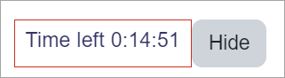

### Can I release the answers to students who did not attempt a quiz?

Yes. One way to handle this with standard Moodle would be to open the quiz after the deadline and add a time limit to the quiz of one second. Unless students are extremely quick they will not be able to gain any points, but would see the general feedback.

### How can I make Moodle quizzes if my school does not have enough computers / fast internet / a good Moodle server?

- Check the [Offline quiz activity](Offline_quiz_activity.md "Offline quiz activity") additional plugin.
- Check the <a href="https://moodle.org/plugins/mod_exam" class="external text" rel="nofollow">exam</a> additional plugin. It allows the teacher to build quizzes with multiple choice question based on Quiz module. Main purpose of Exam module is to improve performance of quiz and to reduce database overhead, so that a large number of users can attempt quiz simultaneously. Warning - Technically it is possible for students to manipulate their exam grades if they know right parameters or they could see correct answers if they could read JavaScript objects being transmitted in their browser. Use with Caution.
- Read about the use of Chromebooks and iPad in the <a href="https://docs.moodle.org/38/en/Safe_Exam_Browser" class="external text" rel="nofollow">Safe Exam Browser</a> Moodle documentation for version until 3.8.
- Visit the page for <a href="https://www.eventbrite.com.au/o/transforming-exams-e-exams-symposium-17431618115" class="external text" rel="nofollow">Transforming Exams</a> - Transforming Exams is an Australian Government funded research project looking at approaches to conducting authentic digital assessment in the exam rooms of Australian universities via the use of Bring-your-own laptops. The project involves 10 Australian university partners and is lead out of Monash University. See <a href="http://transformingexams.com/" class="external text" rel="nofollow">TransformingExams.com</a> for project information.

### Can I print the quiz results without the answers history?

If you want to print the results of all the student attempts, but omit the answers history, as it might take much space, you can do so by accessing the settings on Site admin -\> Appearance -\> Additional HTML. In the 'Within head' setting, put something like:

    

### Is it possible for a teacher to add a personal/private note to a student's quiz submission?

Not really, but as a workaround, you can use the built-in [Notes](Notes.md "Notes") feature.

### Copying a quiz

When you add questions to a quiz, you are not actually adding questions, but rather links or pointers to questions in the question bank. When you copy a quiz, two things can happen depending on where the questions are placed:

- If the questions are placed in a question category of the quiz, for example the "Default category for questions shared in the quiz context", the quiz is copied as well as the question category together with the questions it contains. See <a href="https://docs.moodle.org/502/en/Question_contexts#How_to_access_the_Quiz_activity_context" class="external text" rel="nofollow">How to access the Quiz activity context</a>.
- If the questions are not placed in a question category of the quiz, the quiz is copied but not the questions. However, the links to the original questions are copied. Therefore, when editing the quiz copy, you are also editing the questions of the original quiz, because the question links point to the same questions. Be careful!

### Can I know the marks per each section of a quiz?

See the section on Quiz section grades in [Building Quiz](Building_Quiz.md "Building Quiz"). For older Moodle versions, there is an additional plugin <a href="https://moodle.org/plugins/quiz_markspersection" class="external text" rel="nofollow">Marks per section</a> that does exactly that.

## Setup

### I don't want my question settings retained each time I create a new question!

The admin can turn this setting off for everyone on the site from From *Site administration \> Plugins\> Question types \> Question editing*. This setting is helpful if teachers are creating many questions with the same settings but if they create questions with a variety of settings it might be more useful to disable it.

### Why am I no longer allowed to add or remove questions?

Most likely it is because you have students that have already attempted the quiz. You will need to delete all of the attempts by selecting them and choosing to delete them if you need to add/remove questions from a quiz.

If you are developing a new quiz where the attempts have just been trials then deleting the previous attempts will have no consequences in the grade book.

There are several ways of getting to the “attempts \#” which you need to click on to delete the previous attempts. Use which ever works for you.

1.  Click on the quiz that you want to amend. It will take you to a page with “attempts \#" at the top.
2.  If you are on a page with this message “You cannot add or remove questions because the quiz has been attempted (attempts \#)” Click on "attempts \#".
3.  If you have navigated away from the page with the message go to the Settings block \> Quiz Administration \> Edit Quiz.

Whichever way you find “attempts \#” click on it and you will go to a page with a drop down menu at the top. Select “all users who have attempted the quiz”. There are several other click boxes select whatever applies to your situation. Click “Show Report” and then “select all”. Click “Delete selected attempts” and confirm selection.

Go back to Quiz Administration \> Edit Quiz and you will now be able to add or delete questions.

### How can I remove a problem question after the quiz has been taken?

You can not remove a question once a quiz has been taken by one student or more. However you can change the score and flag the question so you know it has problems.

Set the score for that question to 0.

- Caution: In some versions of Moodle if you use this question in an other quiz, this will potentially change the question in that quiz as well. A trick is to score the question as 0, then regrade the just completed quiz. This will establish the new grade for gradebook. Now go back and change the score to the original value.

Find the question in Question Bank. Maybe edit the title (e.g. 'Do not use in Bio101'). Or if you do not share the question category with other teachers, create a sub category, move the offending question there, and perhaps create a better question to replace the one you just moved. Create a new quiz and if necessary hide the old one.

- Caution: if other departments or teachers use a question category it might be wise to check with the team before moving or changing any question. This is one reason importing questions in a course is a good best practice in some situations.

### How can I turn off glossary auto-linking in a quiz?

- In the Quiz administration settings block there will be a link "filter".
- Click the link and you will have the option to disable filters just for that particular quiz:

### Can I make a second quiz start right away after a first quiz is finished?

By using a hack (See <a href="https://moodle.org/mod/forum/discuss.php?d=377382" class="external text" rel="nofollow">this forum thread</a>).

In the 'Overall feedback' for the first quiz, add some code which redirects to the second quiz. Make a big button to make that obvious:

    

      <a href="https://--your domain--/mod/quiz/view.php?id=--quiz 2 no--" target="_blank">
        <button type="button" style="height:100px;font-size:24px;">Click here to access Quiz 2</button>
      </a>
    

It would look like this:

<a href="File_Click_here_to_access_Quiz_2.png.md" class="mw-file-description">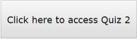</a>

Notes:

- The button will not appear in the gradebook.
- In the quiz settings and under Review options, select 'Overall feedback' under 'Immediately after the attempt'. Deselect 'Overall feedback' under 'Later, while the quiz is still open' and 'After the quiz is closed'.

### Prevent entry to a quiz some time after its start

Suppose a quiz is set to open at 13:00 and the time limit is set to 45 minutes or some other value. Students have to enter the quiz from 13:00 to 13:15, otherwise they should not be able to do so. Proceed as follows to prevent students from entering the quiz after 13:15.

Create another quiz, let's call it an 'entry' quiz, containing a simple multiple choice, true or false, or short answer question, such as "Do you want to take the quiz? Y or N" or any other similar question. Tell students that they must answer and "Submit all and finish" in order to access the main quiz. In the settings of this entry quiz, set "Open the quiz" to 13:00 and "Close the quiz" to 13:15, that is, it is only open for the first 15 minutes.

In the main quiz settings and under "Restrict access", add a "Grade" restriction and select the entry quiz. If you do not specify a grade, the restriction is satisfied regardless of the grade obtained in the entry quiz.

You can also add "Date" restrictions to both the entry quiz and the main quiz to control their display.

Thus, punctual students will have access to the entry quiz from 13:00 to 13:15 and therefore to the main quiz throughout its 45 minutes duration. Latecomers will not have access to the entry quiz after 13:15 and therefore they will not be able to access the main quiz at all.

## Attempts

### How can I give particular students extra time or numbers of attempts?

- In the Quiz administration there is a link "User overrides"
- Click this link and you will be able to choose one or more users and change quiz dates, times or number of attempts.

<a href="File_quizuseroverride.png.md" class="mw-file-description">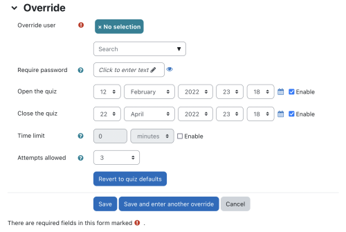</a>

### Can I have different start times/timings/numbers of attempts for different groups?

- In the Quiz administration settings block, there is a link "group overrides" that allows you to do things like grant extensions to certain groups of students.
- Click this link and you will be able to select your groups and change the quiz dates, times and number of attempts:

<a href="File_quizgroupoverride.png.md" class="mw-file-description">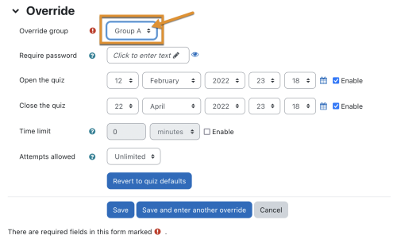</a>

### What happens if students submit answers after the quiz closing date?

It is possible for students to still submit answers after the quiz has closed (for example if they started the attempt before the closing date but then took a long time before submitting). These responses are stored by the quiz module, but the students are not given any credit for them. The teacher can see these answers when reviewing the student's attempts and can give the student credit for them by manually entering a grade in the gradebook. Also the teacher could change the closing date after the fact and regrade the attempts. The students' answers would then get graded.

### How can a "Never submitted quiz" attempt be submitted?

Currently there is no way to retrieve an attempt that was "Never Submitted", and get it back into the "In progress" state. Perhaps the best solution is to plan ahead and set your quiz to set your quiz to be submitted automatically. Alternatively, you can

1.  Update the quiz : set the "close the quiz" date after today
2.  Set "When time expires" to "There is a grace period..."
3.  Under Grade set "Attempts allowed" to "unlimited"
4.  Question behavior: Each attempt builds on the last "Yes"
5.  Invite the students who did not close their exams
6.  Allow them to start a new attempt, and close it immediately.

### Why can't people (guests) attempt a quiz without creating an account and logging in?

This is difficult to implement for technical reasons.

To explain: The quiz has to link all information about an attempt to a particular 'user' record in the database, and each user can only have one open quiz attempt at a time. All not-logged-in users share the same 'guest' user database record. Therefore, two guests could not attempt the quiz at the same time, and even if they could, it would be difficult to prevent one guest seeing another guest's attempts.

Of course, given enough work, it would be possible to change some of those assumptions, and so make it possible for guests to attempt quizzes. Indeed, some of the obstructions to implementing this have already been removed while doing other work on the quiz, but there is still some way to go. If you would like to see this implemented, please vote for <a href="https://tracker.moodle.org/browse/MDL-17892" class="external text" rel="nofollow">MDL-17892</a>.

A workaround is to create a visitor account, say with username = guest, password = visitor, for everyone to share.

### How can I prevent a student from reviewing or jumping around questions in a quiz?

You can block the quiz navigation block and the summary of quiz page with CSS code in a theme. However, if a student fails to answer a question, they will not know if you implement this "solution". Also if others on the site do not want this patch, make sure the theme you select for the course is not used by others.

For example, using the Afterburner theme, enter this in the CSS code area:

div#mod_quiz_navblock {visibility:hidden;}

table.quizsummaryofattempt {visibility:hidden;}

There are other CSS solutions.

### How can I force my students to answer all the question in a quiz before they submit?

There are various ways to answer this:

1.  You can't.
2.  Your students are not stupid. They know they will get zero marks for any question they do not answer, so they already have a strong incentive to answer every question. Furthermore, at the end of the quiz there is the summary page where they can easily check that they have answered all the questions before they submit, so they won't accidentally miss questions.
3.  OK, so you want us to write code that won't let students submit before they have answered each question. Well, all that does is forces the student to put random junk like "asdf" into each question before they click the button, or randomly make a choice in each multiple choice question. There is no educational benefit in this. You get more meaningful information if students leave those questions blank rather than putting in random responses.

### Can I force a user to reattempt only incorrect questions in subsequent attempts?

Try <a href="https://moodle.org/plugins/quizaccess_hidecorrect" class="external text" rel="nofollow">this plugin</a> to Hide Correctly Answered Questions on Re-Attempt.

The easiest way to implement this solution is to use JavaScript or modify the source code on your Moodle site. The JavaScript solution described in <a href="https://moodle.org/mod/forum/discuss.php?d=395125" class="external text" rel="nofollow">this forum thread</a> is as follows:

- Insert the following code in the HTML of the text of a description question.
- Include this description question in the quizzes. If the quizzes are displayed on multiple pages, add the description question on each page.
- If you are using the [Adaptable theme](Adaptable_theme.md "Adaptable theme") you can put the JS in the JS section of the [Adaptable theme](Adaptable_theme.md "Adaptable theme"). With the standard [Boost theme](Boost_theme.md "Boost theme") or [Classic theme](Classic_theme.md "Classic theme") place the script in the Site Administration / Appearance / Additional HTML section. This way you don't have to include the script in every quiz.

<!-- -->

    <h3>Title of the quiz</h3>  // optional
    
Give some info.
      // optional
     
    
    

### Prevent students from taking the quiz some time after its opening time

Suppose a quiz opens at 14:00 on April 12, 2022. You don't want students to be able to start it after 14:10. Here is one way to do it. Note that the solution below is a workaround until a custom quiz access rule plugin is developed.

- Create a <a href="label.md" class="mw-redirect" title="label">label</a> just above the quiz.
- In the label settings and in the "Label text", insert a message such as "Click the \[Mark as done\] button below to access the quiz:"
- Under "[Restrict access](Restrict_access.md "Restrict access")", add a "Date" restriction "until 12 April 2022 14 10" as shown below.
- Under "[Activity completion](Activity_completion.md "Activity completion")", set "Completion tracking" to "Students can manually mark the activity as completed" as shown below.

<a href="File_MoodleDocs_20210412_1528.png.md" class="mw-file-description">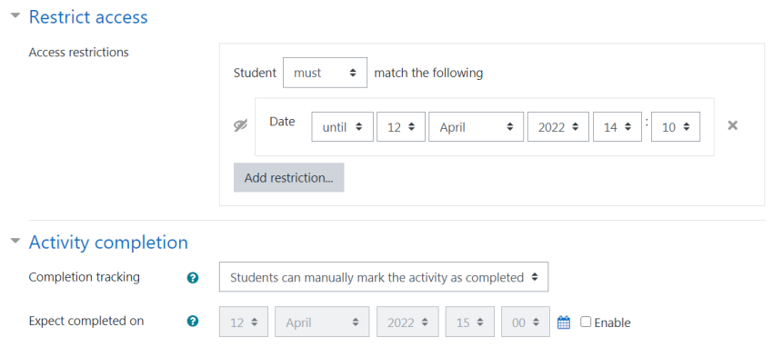</a>

- In the quiz settings and under "[Restrict access](Restrict_access.md "Restrict access")", set an "[Activity completion](Activity_completion.md "Activity completion")" to "Click the \[Mark as done\] button below to access th... must be marked complete" as shown below.

<a href="File_MoodleDocs_20210412_1536.png.md" class="mw-file-description">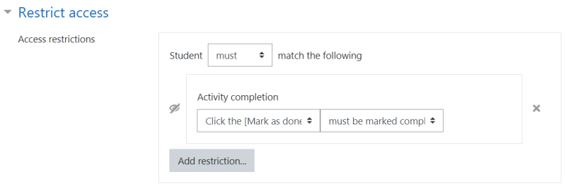</a>

Between 14:00 and 14:10, students will see the following.

- If they do not click the \[Mark as done\] button, the quiz is not visible nor accessible:

- If they click the \[Mark as done\] button, the quiz is visible and accessible:

<a href="File_MoodleDocs_20210412_1556.png.md" class="mw-file-description">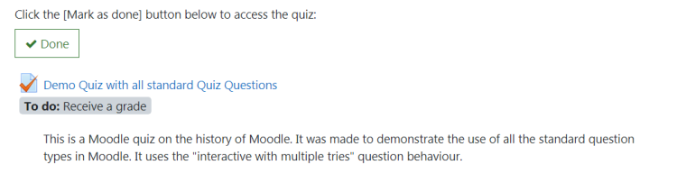</a>

After 2:10 pm, the "Click the \[Mark as done\] button below to access th..." label is no longer visible. So for students who have not clicked the \[Mark as done\] button, the quiz is no longer visible nor accessible. For students who clicked the \[Mark as done\] button, the quiz is accessible and remains accessible even if they temporarily quit and return to the quiz.

You could add another <a href="label.md" class="mw-redirect" title="label">label</a> with the text "It is past 2:10 PM so you missed the opening of the quiz. It is no longer available.", with "Date" and "[Activity completion](Activity_completion.md "Activity completion")" restrictions set in such a way that this label is displayed after 2:10 pm and only to students who have not clicked the \[Mark as done\] button.

### Can I restrict quiz access after a passing grade?

You may use the <a href="https://moodle.org/plugins/quizaccess_failgrade" class="external text" rel="nofollow">Fail grade quiz acces</a> additional plugin.

## Grades

### Why is my quiz not displaying in the gradebook?

Go to the editing quiz page and check that you have a maximum grade that is more than 0 - if your score is 0, then the quiz will not appear in the gradebook.

### I've entered quiz grades manually in the gradebook. How can I allow students to improve on these grades?

When a grade is entered directly in the gradebook, an "overridden" flag is set, meaning that the grade can no longer be changed from within the quiz.

However, the flag can be removed by turning editing on in the <a href="grader_report.md" class="mw-redirect" title="grader report">grader report</a>, then clicking the edit grade icon, unchecking the overridden box and saving the changes.

### How can I set a grade to pass?

See the section 'Setting a grade to pass for a quiz' in [Activity completion settings](Activity_completion_settings.md "Activity completion settings") for details.

### How can I have a quiz that is not graded?

On the Edit quiz page, change the total score and each question's score to 0 instead of the defaults of 10 and 1 per question:

<a href="File_quizscore0.png.md" class="mw-file-description">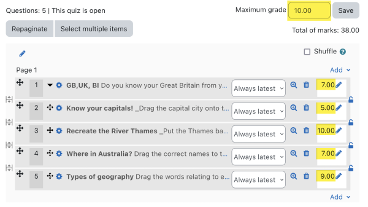</a>

See also the Review options suggested in the forum discussion <a href="https://moodle.org/mod/forum/discuss.php?d=461201#p1853642" class="external text" rel="nofollow">Course enrolment based on answers to questions</a>.

<a href="File_review_options_not_showing_marks.png.md" class="mw-file-description" title="Quiz review options not showing marks">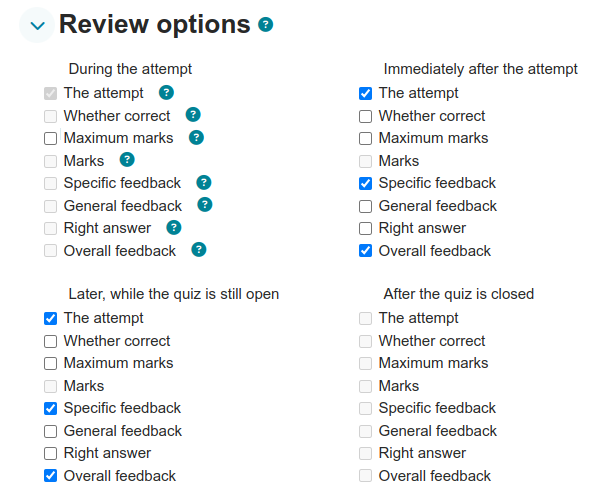</a>

### Can I edit questions after a quiz is started or submitted?

There are a number of cases when you want to do that: you notice a typo or a missing image in a question while the quiz is running, you notice an error in the grading of a question after students have finished the test. In both cases make sure your quiz is set to use the latest version of the problem question, improve and save the question. Then click on the "Regrade all" button in the quiz grading screen. The behaviour in Moodle 4+ quiz is that questions set to use the latest version, will be reloaded in the quiz by pressing the regrade button to use your latest changes. Running and submitted quizzes will now use the new version of the question.

## Appearance

### How can I turn off question flagging?

By default, flags are available in quiz questions.

<a href="File_flag.png.md" class="mw-file-description">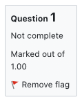</a>

There is a capability attached to this: [Capabilities/moodle/question:flag](Capabilities_moodle_question_flag.md "Capabilities/moodle/question:flag"). Remove this capability from roles that you don't want to see the flags. You can either do that by editing the role definitions globally, or by overriding the permissions in just one quiz or course.

### How can I hide the number of marks available for each question?

Explore the Maximum marks and Marks settings in [Quiz settings#Review options](Quiz_settings.md#Review_options "Quiz settings")

## Why can I not see the revised version of a question when previewing my quiz?

If you preview a quiz and need to revise one of the questions, you will not see the new version until you click to start a new preview.

Similarly, students will not see a revised question until they take the quiz a second time.

### How can I delay the quiz feedback after the quiz has passed

- Suppose the students take a "Main" one-hour quiz from 2 April 14:00 to 2 April 15:00. They shall not have any feedback during and after the quiz until the following week.
- Students take a "Follow up" quiz a week later, starting 9 April 14:00. If they succeed the "Follow up" quiz, they can then review the "Main" quiz and get their points.

This can be done by editing the "Main" and "Follow up" quiz settings, and the Gradebook set up as follows:

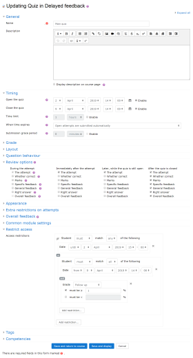

**"Main" quiz settings**   *See also the image on the right* -\>

Timing

     Open the quiz:   2 April 14:00
     Close the quiz:  9 April 14:00

Review options

     During the attempt
        Uncheck feedbacks
     Immediately after the attempt
        Uncheck feedbacks
     Later, while the quiz is still open
        Uncheck feedbacks
     After the quiz is closed
        Check feedbacks

Restrict access

     Student must match any of the following
        Date: until 2 April 15:00
        or
        Student must match all of the following (restriction set)
           Date: from 9 April 14:00
           and
           Grade: Follow up
             Check must be ≥ 1%

**"Follow up" quiz settings**

Timing

     Open the quiz: 9 April 14:00

**Gradebook set up**

    Main quiz: Weight 0.0, ID number "main"
    Follow up quiz: Weight 0.0, ID number "followup"
    Grade item "Total": Weight 100.0, Calculation = [​[main]​] + [​[followup]​]  (<- do not copy/paste this equation, rewrite it)

### Is there a way to display submitted images instead of titles of Images on the review page for the quiz?

Yes. See <a href="https://moodle.org/mod/forum/discuss.php?d=392623#p1582739" class="external text" rel="nofollow">this forum post</a>.

## Errors

### I obtain the error 'The number of random questions required is more than are still available in the category!'

Review your quiz and verify Moodle has enough questions from each category of questions it will be pulling from. You may have inadvertently selected more questions than what exists in the category. Also make sure you're not pulling questions from a category that has zero questions. Because you are picking random questions, rather than a specific question, it may not be apparent at first that you have run out of questions to ask!

### I'm getting the error ' There are not enough questions in the category... ' when trying to add random questions but I DO definitely have enough questions!

Check to see if you have any questions marked as 'Draft' rather than 'Ready'. They will not be available when you want to add random questions until you set them as 'Ready'.

## Quiz plugins

There are a number of ways to extend quizzes, such as adding new reports and questions types. See <a href="https://moodle.org/plugins/browse.php?list=category&amp;id=28" class="external text" rel="nofollow">Moodle plugins directory: Plugin type: Quiz</a>.

## Can I display the feedback for a Moodle question as a pop-up?

Yes! Sometimes, especially if they have the right answer, students don't read the feedback. This is a shame because they can often contain additional explanations. To encourage reading the feedback, you can display them as pop-ups.

Read <a href="https://moodle.org/mod/forum/discuss.php?d=459225#p1844206" class="external text" rel="nofollow">this forum thread</a>.

## See also

- [Effective quiz practices](Effective_quiz_practices.md "Effective quiz practices")
- [Questions FAQ](Questions_FAQ.md "Questions FAQ")

## Any further questions?

Please post in the <a href="https://moodle.org/mod/forum/view.php?id=737" class="external text" rel="nofollow">Quiz forum</a> on moodle.org.
