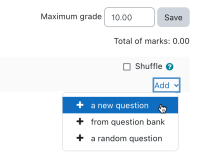
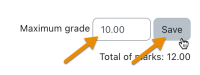
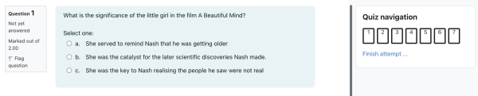
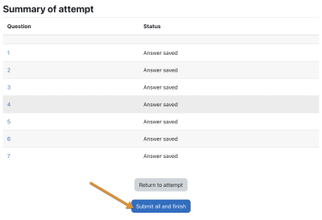
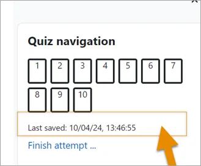
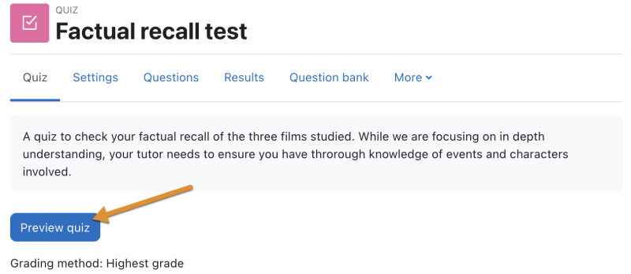

# Quiz_activity

> Sumber: https://docs.moodle.org/502/en/Quiz_activity

  

## What is the Quiz activity?

- The Quiz is a very powerful activity that can meet many teaching needs, from simple, multiple-choice knowledge tests to complex, self-assessment tasks with detailed feedback.
- Questions are created and stored separately in a <a href="Question_bank.md" class="mw-redirect" title="Question bank">Question bank</a> and can be reused in different quizzes.
- When creating a Quiz you can either make the questions first and add them to the Quiz, or add a Quiz activity (as below) and create the questions as you go along.

## How is it set up?

1.  In a course, with the editing turned on, choose Quiz *from the activity chooser.*
2.  Give it a name and, if required, a description.
3.  Expand the other sections to select the settings you want. With the default settings, students can repeat the quiz, moving freely between questions, each on a different page. There is no time limit and scores and feedback display once they have completed the quiz.
4.  To change any of these defaults, and for more information on configuring your quiz, see [Quiz settings](Quiz_settings.md "Quiz settings")
5.  Click Save and display.
6.  Click Edit quiz
7.  Click Add and then click '+ a new question' (If you already made questions in the question bank, then click '+ from question bank' or if you wish to add a question randomly picked from a category of questions, click '+ a random question'.)

1.  Choose the type of question you want to add and then click 'Add' at the bottom:
2.  Add your question. For help, see the documentation [Question types](Question_types.md "Question types").
3.  Cick Save changes and repeat the steps for as many questions as you need.
4.  Click 'Save changes' when you have made your question.
5.  If you want, change the maximum grade for your quiz to reflect the number of questions.

## How does it work?

### Student view

Quizzes are visible on the page once you add them so if you don't want them to see it as you are creating questions, hide it until you are ready.

Depending on the settings, students may see questions all on one page or on separate pages. There will be a block linking to each question.

Students can flag questions to alert the teacher to possible queries.

In order to finish the quiz and potentially see their scores (depending on the settings) students must click 'Submit all and finish' when they reach the Summary of attempt page:

#### Last saved

As a student works through a quiz, they will see a 'Last saved' message in the Quiz navigation block:

### Teacher view

Teachers should preview the quiz to ensure it displays as desired for students:

Grades can be viewed either by clicking the quiz and the link 'Attempts' when students have attempted the quiz, or from the Actions menu top right \> Results (as in the above screenshot)

## More information

- [Quiz settings](Quiz_settings.md "Quiz settings")
- [Building Quiz](Building_Quiz.md "Building Quiz")
- [Using Quiz](Using_Quiz.md "Using Quiz")
- [Quiz reports](Quiz_reports.md "Quiz reports")
- [Quiz FAQ](Quiz_FAQ.md "Quiz FAQ")
- <a href="https://moodle.academy/enrol/index.php?id=152" class="external text" rel="nofollow">Assessment: Exploring quizzes</a> - An intermediate-level Moodle Academy course linked to the Assessment program, focusing on how to use the Quiz activity for formative and summative assessment.
