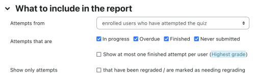
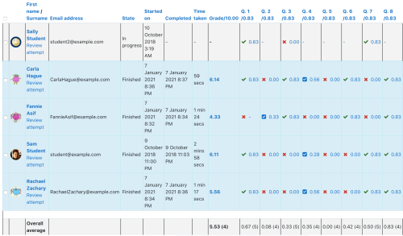
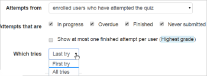
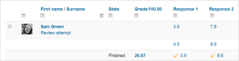

# Quiz_reports

> Sumber: https://docs.moodle.org/502/en/Quiz_reports

In the course you are in, click on your quiz and go to *Administration\> Quiz administration \> Results* This will open a submenu that offers reports on:

- [Grades report](Quiz_grades_report.md "Quiz grades report")
- [Responses report](Quiz_responses_report.md "Quiz responses report")
- [Statistics report](Quiz_statistics_report.md "Quiz statistics report")
- [Manual grading](Quiz_manual_grading_report.md "Quiz manual grading report")

You can also get to the quiz reports where you see a summary of the number of attempts that have been made like "Attempts: 123". That link also goes to the reports.

  

## Grades report

[Grade reports](Quiz_grades_report.md "Quiz grades report") shows all the students' quiz attempts, with the overall grade, and the grade for each question. There are links to review all the details of a student's attempt, just as the student would see it.

There is a setting form at the top of the page that can be used to control what is displayed.

 *Form for selecting what to include in the report*

The teacher can select from:

- enrolled users who have attempted the quiz;
- enrolled users who have not attempted the quiz;
- enrolled users who have, or have not, attempted the quiz;
- all users who have attempted the quiz

 *Report showing information for 3 students*

The results can be downloaded in a variety of formats.

There is a setting form at the top of the page that can be used to control what is displayed.

At the bottom of the page is a graph showing the distribution of scores.

There are check boxes to allow you to individually regrade or delete the selected attempts.

By clicking on the score link, you are able to look at an individual student exam.

## Responses report

This is very similar to the Grades report, except that it shows the responses the students gave, rather than the marks they earned.

It is also possible to show the question text or the right answer, to compare with the student's response. This is helpful when the question is randomised.

For quizzes with interactive question behaviour, it is possible to display responses for the first, last or all tries a student makes:

|  |  |
|----|----|
|  *Selecting number of tries to display* |  *Displaying all tries* |

## Statistics report

This report gives a statistical (psychometric) analysis of the quiz, and the questions within it. The front page of this report gives a summary of the whole test. There are then links to drill down into a detailed analysis of a particular question.

The full report (overview, and detailed analysis of all questions) can be downloaded in a variety of formats, as can the quiz structure analysis table.

Please refer to [Quiz statistics report](Quiz_statistics_report.md "Quiz statistics report") for more detailed information about the different types of statistics that can be gathered via this link.

## Manual grading report

The [Quiz manual grading report](Quiz_manual_grading_report.md "Quiz manual grading report") makes it easy to manually grade questions in the quiz.

The first screen of the report lists all the questions in the quiz that need to be, or have been, manually graded (for example essay questions) with the number of attempts. There is an option to also show the questions that have been automatically graded, which if useful if you ever need to edit the grades by hand.

## See also

- Details of the <a href="http://docs.moodle.org/dev/Quiz_statistics_calculations" class="extiw" title="dev:Quiz statistics calculations">Quiz statistics calculations</a>
- Contributed <a href="http://moodle.org/plugins/browse.php?list=category&amp;id=13" class="external text" rel="nofollow">Quiz report plugins</a> available
