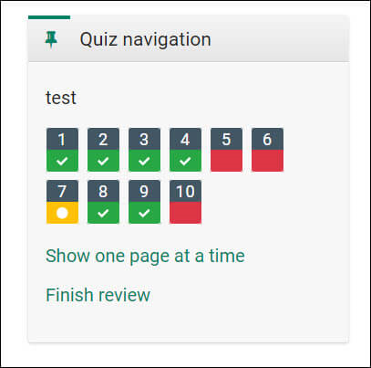
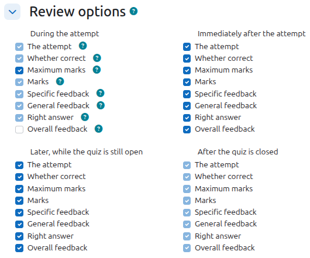
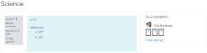
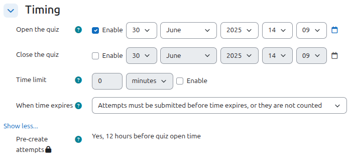

# Quiz_settings

> Sumber: https://docs.moodle.org/502/en/Quiz_settings

Creating a new quiz is a two-step process. In the first step, you create the quiz activity and set its options which specify the rules for interacting with the quiz. In the second step you add questions to the quiz. This page describes the options you can set for the quiz activity. The page [Building Quiz](Building_Quiz.md "Building Quiz") describes how to set up the questions for the quiz.

## General

Add a name here (which students will click on to access the quiz) and, if desired, a description of what they must do.

## Timing

**Note:** The user's time-zone - as set in the user profile - only affects how a particular time is displayed to that user. The actual timing for the quiz is not changed by that.

Open the quiz  
You can specify times when the quiz is accessible for people to make attempts. Before the opening time the quiz will be unavailable to students. They will be able to view the quiz introduction but will not be able to view the questions. Quizzes with start times in the future display both the open and close date for students.

Close the quiz  
After the closing time, the students will not be able to start new attempts. Answers that the student submits after the quiz closing date will be saved but they will not be marked.

Even after the quiz has closed students will still be able to see the quiz description and review their attempts. What exactly they will see depends on the settings you choose for review options (see below).

Note that the quiz is open by default. In other words, if no opening and closing date is specified, i.e. if the Enable check boxes are not checked, the quiz is accessible at all times. If only an opening date is specified, the quiz is available at all times after this date. If only a closing date is specified, the quiz is available at all times until that date.

Time limit  
By default, quizzes do not have a time limit, which allows students as much time as they need to complete the quiz. If you do specify a time limit, several things are done to try and ensure that quizzes are completed within that time:

 *Navigation block showing quiz timer*

1.  A countdown timer is shown. (Students can hide this by pressing the Hide button. The remaining time will reappear when there is less than 100 seconds left.)
2.  When the timer has run out, the quiz is submitted automatically with whatever answers have been filled in so far
3.  If a student manages to cheat and goes over the allotted time, no marks are awarded for any answers entered after the time ran out

When time expires..

**Note:** It is always the case that if the student is actively working on the quiz when the count-down timer reaches zero, then their attempt will be automatically submitted at that moment. This setting only affects what happens if the student starts a timed attempt, then leaves the attempt, and then later time expires.

There are three options as to what will happen when the time limit is up. Choose the one you need from the dropdown menu:

1.  Open attempts are submitted automatically (This is the default)
2.  There is a grace period when open attempts can be submitted, but no more questions answered
3.  Attempts must be submitted before time expires, or they are not counted.

If you select "*There is a grace period...'*" then you can check the box to enable the "Submission grace period" and specify a period of time during which learners may still submit the quiz after the time is up.

**Note:** You can change quiz availability and duration for different groups or users in the Group or User override sections in quiz administration.

Pre-create attempts

If enabled in the site administration (see below), and if the quiz has an opening time set, site performance can be improved by pre-creating quiz attempts. Once quiz attempts are pre-created, questions in the quiz can't be changed.

A teacher can choose whether attempts should be pre-created or not unless the setting is locked in the site administration. The number of hours before the quiz open time cannot be changed, as it is set in the site administration for all quizzes on the site.

### Example of how timing is handled

1.  A student starts a quiz at noon. The quiz has a one-hour time-limit, and a 1-hour delay between attempts. The student gets distracted, and so actually does not submit (using the overdue handling) until 1:30pm. *They are allowed to start their second attempt at 2. pm*
2.  The quiz count-down timer submits a student's quiz attempt at the last second when time expires. Because the server is heavily loaded, it takes 30 seconds to process the student's attempt. *The submission is accepted nonetheless.*
3.  Same situation as above but with a 120-second delay: *The submission is rejected.*
4.  The delay is not because of server load but because the student found a way to cheat the timer. *Moodle cannot know what causes a delay. The behaviour is controlled by the admin setting (quiz \| graceperiodmin), 60 seconds by default.*
5.  A student is a member of 3 groups, all of which have different override settings. Which limits will apply to this student? *If there is any user-specific override, then that is used, and the group overrides for that setting are not used at all. Otherwise, if there are multiple group overrides, the most generous values are used (the earliest open date, the latest close date, the longest time limit, the most number of attempts, and the student can type any of the passwords).*

## Grade

Grade category

If you have categories in your gradebook, select the one you wish the quiz to be in here.

Attempts allowed  
Students may be allowed to have multiple attempts at a quiz. This can help make the process of taking the quiz more of an educational activity rather than simply an assessment.

**Note:** You can change the allowed number of attempts for different groups or users in the Group or User override sections of the Quiz Administration settings block.

Grade to pass

Here you can set a passing grade for the quiz. This may be connected with [Activity completion](Activity_completion.md "Activity completion") and <a href="Conditional_activities.md" class="mw-redirect" title="Conditional activities">Conditional activities</a> such that a student will not be able to access a follow up activity until they have passed the quiz.

Grading method  
When multiple attempts are allowed, there are different ways you can use the grades to calculate the student's final grade for the quiz.

- Highest grade - the final grade is the highest (best) grade in any attempt
- Average grade - the final grade is the average (simple mean) grade of all attempts
- First grade - the final grade is the grade earned on the first attempt (other attempts are ignored)
- Last grade - the final grade is the grade earned on the most recent attempt only

## Layout

New page  
For longer quizzes it makes sense to stretch the quiz over several pages by limiting the number of questions per page. When adding questions to the quiz, page breaks will automatically be inserted according to the setting you choose here. However, you will also be able to move page breaks around by hand later on the editing page.

***Note that changing this setting has no effect on questions you have already added to the quiz***. The setting will only apply to questions you add subsequently. To change the page breaks in an existing quiz, you need to go to the quiz editing screen, tick the 'Show page breaks' checkbox, then use the repaginate control.

If you have many questions that use many high definition images and the server suffers performance issues, showing only one question per page is easier on the server that showing many (or all) questions in one page.

Navigation method (available by clicking *Show More*)

Choose *Sequential* instead of *Free*, if you want to force the student to progress through the questions in order and not go back to a previous question or skip to a later one.

## Question behaviour

How questions behave  
This is the primary way to control the experience a student has as they interact with each question in the quiz. If you want students to get immediate feedback on their response with a chance to try again, if they get it wrong, then select 'Interactive with multiple tries' (and add some hints to your questions and specify a retry penalty if desired). If you want to replicate a traditional exam, select 'Deferred feedback'. In other situations, the other options can be useful. For a description of all the behaviours, see [Question behaviours](Question_behaviours.md "Question behaviours").

Allow redo within an attempt (available by clicking "Show more")  
If using Interactive or Immediate feedback mode, enabling this setting means students can try a question again even if they have used up their allowed attempts. This is helpful if they wish to learn from the feedback given at the end of their attempts. Importantly, for students to continue with the same question, the question definition must contain hints. It must also have been added manually into the quiz, rather than randomly (see [Building Quiz#Adding questions](Building_Quiz.md#Adding_questions "Building Quiz")). Otherwise, the 'redo' will occur with a different question from the one they were working on previously if there are other questions available (such as when the question slot is filled by a random question). A student's grade for that question slot is based on the most recent question they have started. *Note: by default students are allowed three tries to answer a question correctly in Interactive mode before the 'redo' option becomes available. The number of tries cannot be reduced but it can be increased by adding more hints to the question in the 'Multiple tries' section of the question's configuration page.*

Each attempt builds on the last (available by clicking "Show more")  
If multiple attempts are allowed and this setting is set to Yes, then each new attempt contains the results of the previous attempt. This allows the student on the new attempt to concentrate on just those questions that were answered incorrectly on the previous attempt. If this option is chosen then each attempt by a particular student uses the same questions in the same order, independent of randomization settings, and with the same values for questions with random variables. To show a fresh quiz on every attempt, select No for this setting.

In other words, if the option is set to Yes, the new attempt is just a continuation of the previous one. Students simply resume their previous attempt with the exact same questions and same values for questions with random variables, and their score as it was. If the option is set to No, the new attempt is an entirely fresh one, with new questions and new values, and the score reset.

Sometimes the teacher wants one or more students to be able to redo the test from scratch, while other students to be able to just continue where they left off. The option must therefore be set to No for the first student(s) and to Yes for the others. Since the option does not appear in the "User overrides", the teacher must ensure that it is set to No when the first student(s) launch their new attempt and to Yes when the others launch theirs.

## Review options

 *Review options*

The attempt  
Will show how the student responded to each question.

Whether correct  
Displays whether the students response to each question is correct or incorrect.

Maximum marks  
This reveals the maximum mark available for each question.

Marks  
Reveals the marks awarded to the student and the grade for the quiz and *is only available when Maximum marks is selected.*

Specific feedback  
Will show the feedback for the response to the answer as set when adding the question to the quiz. Each response to a question can have feedback for both correct and incorrect answers.

General feedback  
Displays the general feedback for the whole question as set when adding the question to the quiz. You can use the general feedback to give students some background to what knowledge the question was testing.

Right answer  
Reveals the correct answer to each question, whether the student answered correctly or not (See note below).

Overall feedback  
Displays feedback for the entire quiz as set in the quiz settings (See note below).

For each of the above items, you can determine the timeframe when the students will see them:

During the attempt  
is only available when **How questions behave** has been set to **Immediate feedback**, **Immediate feedback with CBM** and **Interactive with multiple tries**. If set to one of these options then a **Check** button will appear below the answer and when clicked the student will submit that response and then receive immediate feedback.

Immediately after the attempt  
means within 2 minutes of the student clicking "submit all and finish".

Later, while the quiz is still open  
means after 2 minutes, but before the close date (if the quiz does not have a close date, this phase never ends).

After the quiz is closed  
means what it says (you never get here for quizzes without a close date).

*Tip:* Checking any of the boxes in the timeframe row, will reveal the test to the student. For example, to allow students to see their quiz immediately after taking it but not later, make sure none of the boxes in "Later" or "After" rows are checked. The student will be able to see their grade but not get into the quiz.

Note: Currently, the Answers display is a bit inconsistent between different question types. For example, the matching question type shows students which of their responses are correct, but does not tell them the right answer for the ones they got wrong. The short answer and multiple choices question types do tell the student what the correct answer is.

Users with the capability 'View hidden grades' [moodle/grade:viewhidden](Capabilities_moodle_grade_viewhidden.md "Capabilities/moodle/grade:viewhidden") (typically teachers and administrators) are not affected by these settings and will always by able to review all information about a student's attempt at any time.

In your list of review options, you must have 'The attempt' (the first option in the lists) selected before you can enable the options to show 'Whether correct', 'Specific feedback', 'General feedback', and 'Right answer'. If you choose not to let the students review the attempt, your only options are to display 'Marks' and 'Overall feedback'.

### How can we show our students only the wrong answers

The following JavaScript hides the questions that the students answered correctly from the review of their previous attempts. Hence, only questions that the students answered incorrectly or partially correctly are displayed.

` `

` `

    
    

where:

    "body#page-mod-quiz-review identifies the review page,

    $(this).find(".state").text() captures the status of the question (correct answer or other),

    if (state == 'Correct') {$(this).remove();} suppresses the display of the question if it has been answered correctly.

You can place this code in different places depending on what you want to get:

- Site level. The script affects all quizzes on your Moodle site.

Place the script in "Additional HTML" (Site administration / Appearance / Additional HTML).

- Course level. The script affects all quizzes only in a specific course.

Create an "HTML" block, at the course level, that contains the script. In the block configuration, set "Where this block appears / Display on page types" to "Any page". In the settings of the quizzes, set "Appearance / Show more... / Show blocks during quiz attempts" to "Yes". If you set this setting to "No", the script will not be activated. Note that you can hide the block from other pages by setting "On this page / Visible" to "No" in the block configuration.

- Quiz level. The script affects only a specific quiz.

Create an "HTML" block, at the quiz level, that contains the script. In the block configuration, set "Where this block appears / Display on page types" to "Review quiz attempt page". In the quiz settings, set "Appearance / Show more... / Show blocks during quiz attempts" to "Yes".

You can also place the script <a href="Text_editor.md#Displaying_the_HTML_code" class="mw-redirect" title="Text editor">in the HTML of the question text</a> of any question. This will affect all questions that appear on the same page, but *only on that page*. For example, if you select "Show one page at a time" on the review page, the questions on a page will be hidden only if one of them contains the script.

<a href="https://moodle.org/mod/forum/discuss.php?d=408123#p1647459" class="external text" rel="nofollow">Reference</a>

  

  

## Appearance

Show the user's picture  
It is now possible, when displaying the user's profile picture for proctoring purposes, to choose whether a large image or thumbnail will be displayed.

Decimal places in grades  
This option determines how many digits will be shown after the decimal separator (see <a href="http://docs.moodle.org/dev/Translation_langconfig" class="extiw" title="dev:Translation langconfig">langconfig</a> ) when the grade is displayed. A setting of 0 for example means that the grades are displayed as integers. This setting is only used for the display of grades, not for the display or marking of answers.

Decimal places in question grades  
By default this is an advanced setting. You need to click Show more... to reveal it. Lets you have a different display of grades for each question compared to the quiz total. For example you may which to see the total as a whole number, but still show fractional grades for each question.

Show blocks during quiz attempts  
Also an advanced setting by default. You can control whether blocks are shown on the page during quiz attempts.

## Safe Exam Browser

<a href="Safe_exam_browser.md" class="mw-redirect" title="Safe exam browser">Safe Exam Browser</a> is a customised open-source web browser which works perfectly integrated into Moodle quiz. It must be downloaded and installed on the computer that the student uses to attempt the quiz. It restricts student to focus on the quiz. Features include full screen, without web navigation options, shortcut keys including copy and paste are disabled and of course surfing the web during an exam. But Safe exam browser can enable specific software or websites to be available.

Require the use of Safe Exam Browser  
Activating the general requirement of Safe Exam Browser opens all the settings for using the Safe Exam Browser. You can choose between *Configure manually*, *Use an existing template*, *Upload my own config* and *Use SEB client config*.

Please refer to the <a href="Safe_exam_browser.md" class="mw-redirect" title="Safe exam browser">Safe exam browser settings page</a> for detailed information on the additional settings and for the usage of Safe Exam Browser in general.

## Extra restrictions on attempts

Require password  
If you specify a password in here then participants must enter the same password before they are allowed to make an attempt on the quiz. This is useful to give only a selected group of students access to the quiz. In Moodle 3.9 onwards, an admin can set that all quizzes on the site require a password in *Site administration \> Plugins \> Activity modules \> Quiz \> General settings*.

Require network address  
You can restrict access for a quiz to particular subnets on the LAN or Internet by specifying a comma-separated list of partial or full IP address numbers. This is especially useful for a proctored (invigilated) quiz, where you want to be sure that only people in a certain room are able to access the quiz. For example: 192.168., 231.54.211.0/20, 231.3.56.211

There are three types of numbers you can use (you can not use text based domain names like example.com):

1.  Full IP addresses, such as 192.168.10.1 which will match a single computer (or proxy).
2.  Partial addresses, such as 192.168 which will match anything starting with those numbers.
3.  CIDR notation, such as 231.54.211.0/20 which allows you to specify more detailed subnets.

Spaces are ignored.

Enforced delay between attempts  
You can set a time (from seconds to weeks) between the first and second attempt of a quiz. You can also (or alternatively) set a time from seconds to weeks for subsequent attempts after the second attempt. Thus, you might allow a student to take the quiz twice immediately with no delay, but if they want to improve their score with a third attempt, they are forced to wait a week and use the time for extra revision.

<!-- -->

Browser security  
This is by default an advanced field, visible by clicking "Show advanced".

The options in this section offer various ways to try to restrict how students may try to 'cheat' while attempting a quiz. However, this is not a simple issue, and what in one situation is considered 'cheating' may, in another situation, just be effective use of information technology. (For example, the ability to quickly find answers using a search engine.)

Note also that this is not just at problem of technology with a technical solution. Cheating has been going on since long before computers, and while computers make certain actions, like copy and paste, easier, they also make it easier for teachers to detect cheating - for example using the quiz reports. The options provided here are not fool-proof, and while they do make some forms of cheating harder for students, they also make it more inconvenient for students to attempt the quizzes, and they are not fool-proof.

**Full screen pop-up with some JavaScript security**

There is a limit to what the quiz, which runs on a web server, can do to restrict what the student sitting at their computer can do while attempting the quiz. However, this option does what is possible:

 *Student view of quiz question with full screen popup.*

- The quiz will only start if the student has a JavaScript-enabled web-browser.
- The quiz appears in a fullscreen popup window that covers all the other windows and has no course navigation controls. (However, it is impossible for a web site to create a browser window that cannot be minimised or moved aside.)
- The students are prevented, as far as is possible, from using facilities like copy and paste.

**Allow quiz to be attempted offline using the mobile app**

If the Moodle app is enabled and used, quizzes can attempted offline. Only quizzes with deferred feedback (with or without CBM) can be attempted offline. Students cannot attempt quizzes offline if:

the quiz has a time limit;

the quiz has a network address;

the quiz uses sequential navigation

## Overall feedback

Overall feedback is shown to a student after they have completed an attempt at the quiz. The text that is shown can depend on the grade the student got. Click "Show editing tools" to display the rich text editor, and drag the bottom right of the text box out to expand it.

For example, if you entered:

Grade boundary: 100%

Feedback: "Well done"

Grade boundary: 40%

Feedback: "Please study this week's work again"

Grade boundary: 0%

Then students who score between 100% and 40% will see the "Well done" message, and those who score between 39.99% and 0% will see "Please study this week's work again". That is, the grade boundaries define ranges of grades, and each feedback string is displayed to scores within the appropriate range.

Grade boundaries can be specified either as a percentage, for example "31.41%", or as a number, for example "7". If your quiz is out of 10 marks, a grade boundary of 7 means 7/10 or better.

Note that the maximum and minimum grade boundaries (100% and 0%) are set automatically.

You can set as many or as few grade boundaries as you wish. The form allows you up to 5 ranges at first, but you can add more by clicking the "Add 3 fields to form" button underneath.

If you're getting confusing error messages about a boundary being out of sequence (when it's obviously \*in\* sequence), or "boundaries must be between 0% and 100%" (and they are) -- check that the Maximum Grade for this quiz is set to something greater than zero.

If you want to reduce the number of boundaries and feedbacks, you will need to remove all feedbacks and boundaries and then add the reduced amount.

## Outcomes

This setting will only appear if [Outcomes](Outcomes.md "Outcomes") have been enabled by the administrator and are used in the course. See [Outcomes](Outcomes.md "Outcomes") for how to remove an outcome once it has been added to a quiz.

## Other settings

Depending on what is enabled for your site and course, you may also need to explore [Common module settings](Common_module_settings.md "Common module settings"), [Restrict access](Restrict_access.md "Restrict access"), [Activity completion](Activity_completion.md "Activity completion"), [Tags](Tags.md "Tags") and [Competencies](Competencies.md "Competencies")

## Group and User overrides

Dates, timing, number of allowed attempts and password may be changed for individual users or groups. See [Quiz overrides](Quiz_overrides.md "Quiz overrides") for details.

## Site administration settings

#### Pre-create quiz attempts

If your site has quizzes with an opening time and many students starting at the same time, such as for large-scale synchronous exams, you can improve performance by pre-creating quiz attempts.

A shorter pre-create attempts period is recommended, as quiz questions cannot be modified once a quiz has attempts. Attempts are generated by a scheduled task running each hour by default. To pre-create attempts when the system is quiet such as overnight, set the period to 12 hours and adjust the scheduled task to run during quieter hours.

1.  Go to *Site administration \> Plugins \> Quiz \> General settings*.
2.  For 'Pre-create period' select an appropriate number of hours.
3.  In the default quiz settings, tick 'Enable pre-create attempts' and if required, set it as an advanced setting and/or locked.
4.  Save changes.

In the quiz settings, if an opening time is set, the setting 'Pre-create attempts' is displayed. If it is not locked, a teacher can choose whether attempts should be pre-created or not. The number of hours before the quiz open time cannot be changed, as it is set in the site administration for all quizzes on the site.

 *Pre-create attempts quiz setting which is advanced and locked*

Note that if a quiz doesn't have an opening time set, the setting 'Pre-create attempts' is not displayed.

## See also

- [Quiz overrides](Quiz_overrides.md "Quiz overrides")
- [How can we show our students only the wrong answers](How_can_we_show_our_students_only_the_wrong_answers.md "How can we show our students only the wrong answers")
