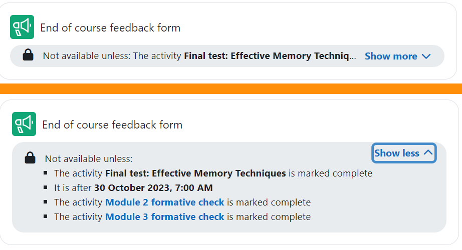
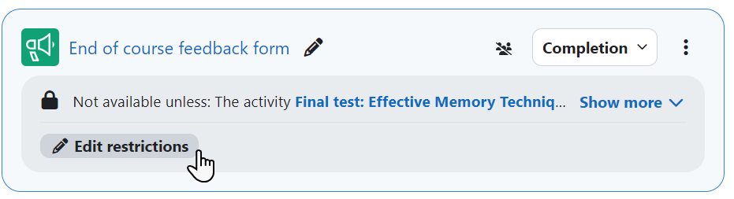

# Restrict_access

> Sumber: https://docs.moodle.org/502/en/Restrict_access

The restrict access feature enables teachers to restrict the availability of any activity or even a course section according to certain conditions such as dates, grade obtained, group or [activity completion](Activity_completion.md "Activity completion").

[New feature  
in **Moodle 5.2**!](Category_New_features.md "Category:New features") If more than one access restriction is set for an activity, students see a Show more/less dropdown.

Teachers with edit mode on can click Edit restrictions to be taken directly to the Restrict access section of the activity.

  

- [Restrict access settings](Restrict_access_settings.md "Restrict access settings")
- [Using restrict access](Using_restrict_access.md "Using restrict access")
- [Restrict access FAQ](Restrict_access_FAQ.md "Restrict access FAQ")
