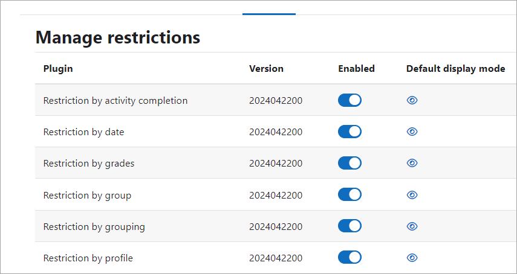
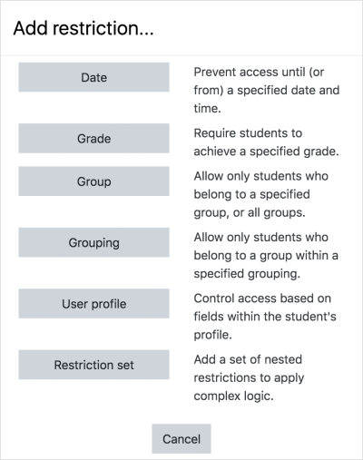
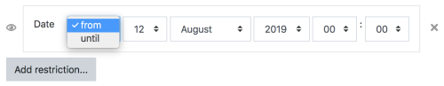
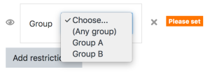
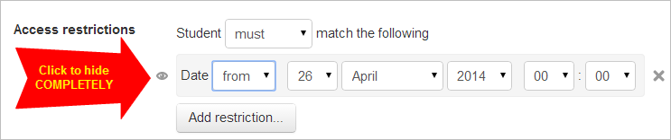
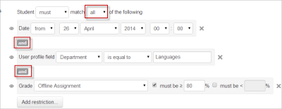
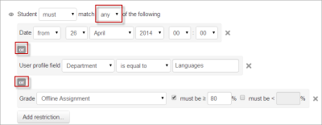
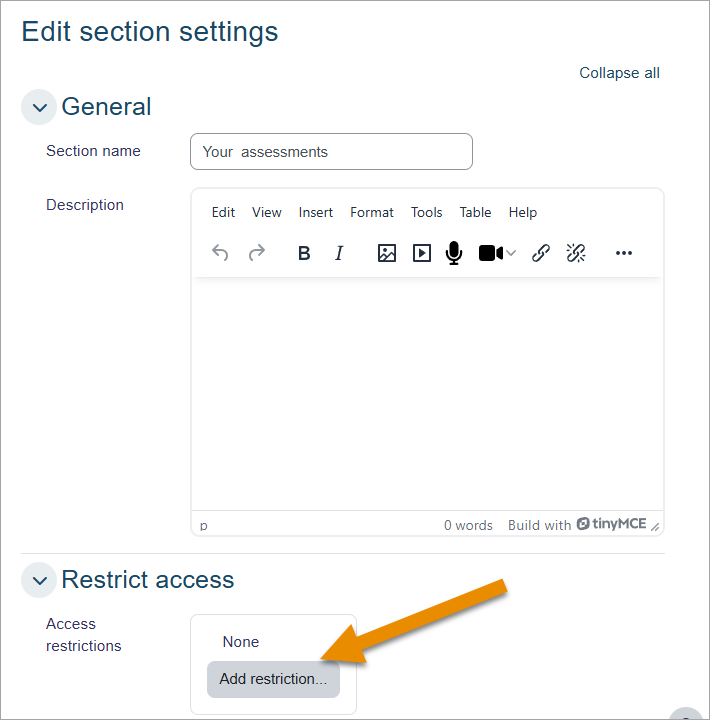

# Restrict_access_settings

> Sumber: https://docs.moodle.org/502/en/Restrict_access_settings

## Enabling the use of restrict access sitewide

To use the restrict access feature, it must be enabled by an administrator by checking the "Enable restricted access" box in *Site administration \> Advanced features*. A restrict access section will then appear for teachers on the Activity settings screen, with an 'Add restriction' button. This section applies to all activities and resources, and is the second to last section in each activities settings area, above [Activity completion](Activity_completion.md "Activity completion") (if it has been turned on).

## Enabling or disabling specific restrictions

In *Site administration \> Plugins \> Availability restrictions \> Manage restrictions* you can toggle to enable or disable any of the individual restriction types for use throughout the site. You can also specify the default display mode of an access restriction, i.e., whether it is hidden ('eye' closed) or visible ('eye' open).

## Restricting activity access

In the settings of each activity there is a Restrict Access section. To get to this, click 'Edit' alongside the activity you want to restrict and then choose 'Edit Settings', or add a new activity, which will bring you to the settings page.

In the 'Restrict Access' section of the activity settings page, click the 'Add restriction' button. A choice of conditions appears:

Restriction can be based upon [Activity completion](Activity_completion.md "Activity completion"), date, grade, the group or grouping the students are in or even user profile fields. The 'Restriction set' button also allows for more complex criteria requiring nested conditions.

### Activity completion

See [Activity completion](Activity_completion.md "Activity completion"). Note that this button only appears if you have Activity completion enabled by the administrator in your site, and it is enabled in your course in *Course administration \> Edit settings \> Completion tracking*.

Instead of selecting a specific activity or resources, access may be restricted to "Previous activity with completion".

### Date

Access can be restricted from or until a certain date and time.

### Grade

You can specify a condition on any grade in the course: the full course grade, the grade for any activity, or a custom grade that you create manually. You can enter either a minimum value (at least percentage), a maximum value (less than percentage), both, or neither. The activity will only appear if the student has a value for the specified grade, and if it falls within any specified number range. You can add more than one grade condition. All conditions must be met in order for the activity to appear.

- The range numbers can be fractional (with up to five decimal places) if necessary.
- Be careful with the maximum value; if the maximum is 7, a student who scores exactly 7 will not see the activity. You could set it to 7.01 if you really wanted to include 7.
- If creating several different activities that appear according to grade ranges, use the same number for the maximum of one activity, and the minimum of the next. For example, you might create one activity with a maximum of 7 and another with a minimum of 7. The first would appear to everyone scoring between 0 and 6.99999, and the second would appear to everyone scoring 7.00000 to 10. This guarantees that everyone with a grade will see one or other.To remove a grade condition, set the assessment name to 'none' and remove the range number values
- If you want to use a condition for students with blank grades then you can add a grade restriction and select the activity you want to use as a restriction. Do not select a checkbox for either the greater than or less than criteria. This will require the student to have a grade. This means students with blank grades do not meet that criterion.

### Group and groupings

If groups or groupings are used in the course, it is possible to restrict the activity to a certain group or grouping. If they are turned off for this course and not available, these options will not be present for use as an restriction.

**NOTE**: This button only appears if you have groups **enabled** in your course.

### User profile

Access can be restricted using one of the following standard profile user fields:

- Address - This is the value in the 'address' column
- City/town - This is the value in the 'city' column
- Country - This is the two letter country code, NOT the name of the country.
- Department - This is the value in the 'department' column
- Email Address - This is the value in the 'email' column
- First name - This is the value in the 'firstname' column
- ID number - This is the value in the 'idnumber' column
- Institution - This is the value in the 'institution' column
- Mobile phone - This is the value in the 'phone2' column
- Phone - This is the value in the 'phone1' column
- Surname - This is the value in the 'lastname' column
- Web page - This is the value in the 'url' column

In addition, you can choose any custom user profile fields if you have created any.

### Restriction set

This allows you to add a set of complex restrictions to apply complex logic. See [Using restrict access](Using_restrict_access.md "Using restrict access") for an example.

## Hiding the conditions

- If the eye is SHUT then students who do not meet that part of the condition will not see the activity at all.
- If the eye is OPEN the students who do not meet that part of the condition will see the name of the activity but it will have information about why they can't access it yet.

The shut eye takes precedence. For example, you could have 2 conditions, one based on date (with eye shut) and one based on completing a previous activity (with eye open). That way, the activity will not appear at all until the date; then it will appear, but tell you that you need to complete the other activity; then when you complete the other activity you can access it.

For OR and NOT AND type conditions, you only get a single eye icon instead of one for each condition

The eye also affects to the visibility of the activity in the gradebook:

- If the eye is SHUT the activity won't appear in the gradebook if the user currently doesn't meet that part of the condition
- If the eye is OPEN the activity will show up in the gradebook (and eventually also its grade) even if the user currently doesn't meet that part of the condition.

## ALL or ANY Conditions

Further restrictions may be added by clicking the 'Add restriction' button again, and it is possible to specify that ALL the conditions or ANY of the conditions are required before the activity is made available. Thus, it is possible to use 'Or' as well as 'And' conditions. See <a href="Using_Conditional_activities.md" class="mw-redirect" title="Using Conditional activities">Using Conditional activities</a> for an example.

|  |  |
|----|----|
|  *'and' condition* |  *'or' condition* |

## Restricting access to a course section

You can restrict access to all the activities and resources within a course section by specifying the conditions in the settings for that particular section.

Do this by editing the section settings from the three dots action menu \> Edit settings.

