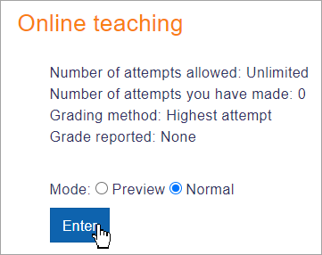
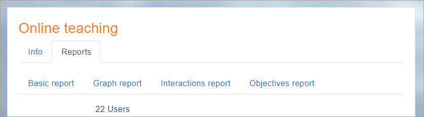

# SCORM_activity

> Sumber: https://docs.moodle.org/502/en/SCORM_activity

  

## What is a SCORM activity?

SCORM (Sharable Content Object Reference Model) is a widely-adopted set of technical standards for e-learning content. It establishes a "universal language" that allows courses and Learning Management Systems (LMSs) to communicate, ensuring seamless interoperability, accessibility, and reusability of web-based learning content.

The SCORM activity in Moodle provides a way for teachers to easily upload and manage SCORM or AICC packages within their courses.

## How is it set up?

1.  In a course, with the editing turned on, choose 'SCORM Package' from the activity chooser.
2.  Give it a name and, if required, a description.
3.  In the Package section, upload your SCORM package
4.  Expand the other sections to select the settings you want, in particular the Appearance and Attempts management sections. For more information, see [SCORM settings](SCORM_settings.md "SCORM settings")
5.  Click Save and return to course.

Note: SCORM packages can also be added by selecting the Single activity course format when setting up a course. This is suitable if your Moodle course only consists of the SCORM package and no other activities.

## How does it work?

### Student view

Students click on the SCORM icon in the course to access it. Depending on the Appearance settings, they can browse (preview) the activity before attempting it and then select Normal to begin. If Preview is disabled, they only see the Enter button.

  

### Teacher view

Teachers additionally see a Reports tab, where they can access different information about student attempts.

## More information

- [SCORM settings](SCORM_settings.md "SCORM settings")
- [Using SCORM](Using_SCORM.md "Using SCORM")
- [Creating SCORM Content](Creating_SCORM_Content.md "Creating SCORM Content")
- [SCORM FAQ](SCORM_FAQ.md "SCORM FAQ")
