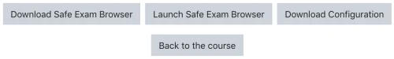
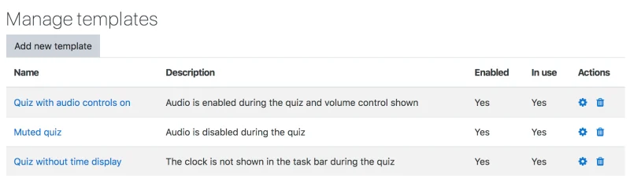

# Safe_Exam_Browser

> Sumber: https://docs.moodle.org/502/en/Safe_Exam_Browser

The quiz has built in settings to allow secure exams using the **Safe Exam Browser**. Safe Exam Browser is offered under a Mozilla Public Licence. The application is available for Windows, macOS and iOS as open source software.

## Features

### Scope and functionality

Safe Exam Browser is a customised web browser, available for Windows (7, 8.1, 10, 11), macOS (starting 10.7, recommended 10.11 or newer) and iOS (9.3.5 or newer). The application must be <a href="https://safeexambrowser.org/download" class="external text" rel="nofollow">downloaded and installed</a> on the device that the student uses to attempt the quiz. The restrictions placed on students are similar to those in the quiz *Extra restrictions on attempts \> Browser security* "Full screen pop-up with some JavaScript security" case, but because Safe Exam Browser is software running on the student's computer, it can do a much more effective job of restricting their actions.

- Students will only be able to attempt the quiz if they are using Safe Exam Browser.
- The browser window won't have a URL or search field and back/forward navigation and reload can be disabled.
- Safe Exam Browser cannot be closed until the test is submitted.
- Switching to other applications is disabled by default, but it's possible to allow to use specific third-party applications during an exam.
- Shortcut keys such as Win+Tab, Alt+Tab, Ctrl+Alt+Del, Alt+F4, Print Screen, Cmd+Tab are disabled or cannot be used to close Safe Exam Browser or to switch to other user accounts on the computer. The possibility of taking screen shots is disabled.
- The clipboard is cleared when starting and quitting Safe Exam Browser.
- The browser context menu is disabled.
- Specific web sites/pages/resources can be configured to be accessible during an exam, using a URL filter.
- Spell checking and dictionary lookup is disabled, but can optionally be allowed.

In order to enable students to take an attempt with Safe Exam Browser, it is necessary to hand them a Safe Exam Browser configuration file which contains the rules applying. This Safe Exam Browser configuration file can either be generated using the Safe Exam Browser config tool (the documentation can be found under <a href="https://safeexambrowser.org/windows/win_usermanual_en.html#configuration" class="external text" rel="nofollow">https://safeexambrowser.org/windows/win_usermanual_en.html#configuration</a>) or directly within Moodle.

If done within Moodle, on a quiz page, students are offered some choices. They can – depending on your settings – either

1.  Download the Safe Exam Browser. This button redirects to the configured download location for Safe Exam Browser, default is <a href="https://safeexambrowser.org/download_en.html" class="external text" rel="nofollow">https://safeexambrowser.org/download_en.html</a>.
2.  Launch the Safe Exam Browser, which applies the settings and sends the students to the quiz starting page.  
    Note: The "Launch Safe Exam Browser" button to start the quiz in Safe Exam Browser from another browser works with Safe Exam Browser 3.0.1 for Windows and Safe Exam Browser 2.1.5pre2 for macOS onwards only. For other Safe Exam Browser versions, please use "Download configuration" and then open the downloaded config file, which will start Safe Exam Browser into the quiz.
3.  Download the Safe Exam Browser configuration file. - This also allows you to use the configuration file as a template.
4.  Return to the Moodle course.

Different measures assure that the Safe Exam Browser used for taking the quiz is in fact using the correct configuration and no modified or manipulated Safe Exam Browser can be used.

A <a href="https://safeexambrowser.org/developer/documents/SEB-Specification-BrowserExamKey.pdf" class="external text" rel="nofollow">Browser Exam Key</a> or multiple Browser Exam Keys can be set to validate the SEB version(s) used by students to access the quiz, and to assure that the Safe Exam Browser client is correctly configured/secured for that specific quiz.

Another possibility is to use the Config Key. Then, during the quiz, Moodle sends its responses with a <a href="https://safeexambrowser.org/developer/seb-config-key.html" class="external text" rel="nofollow">Config Key</a> custom HTTP request header, which is combined with the URL of the HTTP request into a SHA256 hash. The following minimum versions of the Safe Exam Browser are required for use of the Config Key feature: macOS – 2.1.5pre2, Windows – 2.4, iOS – 2.1.16.

### Safe Exam Browser settings

**Require the use of Safe Exam Browser** - Set whether students can only attempt the quiz using the Safe Exam Browser. The available options are:

- *No*: Safe Exam Browser is not required to attempt the quiz.
- *Yes – Configure manually*: No template for the configuration of Safe Exam Browser will be used. You can configure Safe Exam Browser manually.
- *Yes – Use an existing template*: A template for the configuration of Safe Exam Browser can be used. Templates are managed by the Moodle Administrator. Your manual settings overwrite the settings in the template.
- *Yes – Upload my own config*: You can upload your own Safe Exam Browser configuration file. All manual settings and the use of templates will be disabled.
- *Yes – Use SEB client config*: No configurations of Safe Exam Browser are on Moodle side. The quiz can be attempted with any configuration of Safe Exam Browser. You hand the Safe Exam Browser config file over to students by other means, like you did with Moodle ≤ 3.8.

*Yes – Use an existing template* is only shown when there really are templates to choose from. If no administrator or manager has uploaded any template and set at least one to *Enabled*, the option is not shown.

**Safe Exam Browser config template** - Choose a template for the configuration of Safe Exam Browser to apply. This setting is only shown if *Require the use of Safe Exam Browser* is set to *Yes – Use an existing template* and when there really are templates to choose from. If no administrator or manager has uploaded any template and set at least one to *Enabled*, the option is not shown.

**Show Safe Exam Browser download button** - Set whether a button for Safe Exam Browser download will be shown on the quiz start page. Can only be set if *Require the use of Safe Exam Browser* is set to *Yes – Configure manually*, *Yes – Use an existing template*, *Yes – Upload my own config* or *Yes – Use SEB client config*.

**Show Exit Safe Exam Browser button, configured with this quit link** - In the according field you can enter a link to quit Safe Exam Browser. It will be used on an "Exit Safe Exam Browser" button on the page that appears after the exam is submitted. Clicking the button or a link to the same URL placed wherever you want to put it, it is possible to quit Safe Exam Browser without having to enter a quit password. If the field is left empty, then the "Exit Safe Exam Browser" button does not appear and there is no link set to quit Safe Exam Browser. Can only be set if *Require the use of Safe Exam Browser* is set to *Yes – Configure manually*.

**Ask user to confirm quitting** - If enabled, users have to confirm quitting of Safe Exam Browser when a quit link is detected. Note this setting does just affect quitting with the quit link and doesn't affect quitting with the "Quit" button, Ctrl-Q or the close button in the main browser window. Can only be set if *Require the use of Safe Exam Browser* is set to *Yes – Configure manually*.

**Enable quitting of SEB** - Set whether users can quit Safe Exam Browser with the "Quit" button in the Safe Exam Browser task bar or by pressing the keys Ctrl-Q or by clicking the main browser window close button. Can only be set if *Require the use of Safe Exam Browser* is set to *Yes – Configure manually* or *Yes – Use an existing template*.

**Quit password** - Here, it is possible to provide a password which is prompted when users try to quit Safe Exam Browser with the "Quit" button, Ctrl-Q or the close button in the main browser window. If no quit password is set, then Safe Exam Browser just prompts "Are you sure you want to quit Safe Exam Browser?". Can only be set if *Require the use of Safe Exam Browser* is set to *Yes – Configure manually* or *Yes – Use an existing template*.

**Enable reload in exam** - Used to allowing page reload during a quiz (reload button in Safe Exam Browser task bar, browser tool bar, iOS side slider menu, keyboard shortcut F5/cmd+R). Offline caching might break when the user tries to reload a page without internet connection. Can only be set if *Require the use of Safe Exam Browser* is set to *Yes – Configure manually*.

**Show SEB task bar** - Set whether users are shown the Safe Exam Browser task bar. Can only be set if *Require the use of Safe Exam Browser* is set to *Yes – Configure manually*.

**Show reload button** - Set whether users are shown the reload user interface element in the task bar bottom right corner. Can only be set if *Require the use of Safe Exam Browser* is set to *Yes – Configure manually* and *Show SEB task bar* is set to *Yes*.

**Show time** - Set whether users are shown an element in the task bar with the current time. Can only be set if *Require the use of Safe Exam Browser* is set to *Yes – Configure manually* and *Show SEB task bar* is set to *Yes*.

**Show keyboard layout** - Set whether users are shown an element in the task bar to choose the keyboard layout. Can only be set if *Require the use of Safe Exam Browser* is set to *Yes – Configure manually* and *Show SEB task bar* is set to *Yes*.

**Show Wi-Fi control** - Set whether users are shown an element in the task bar to choose the Wi-Fi. Can only be set if *Require the use of Safe Exam Browser* is set to *Yes – Configure manually* and *Show SEB task bar* is set to *Yes*.

**Enable audio controls** - Set whether users are shown an element in the task bar to change the audio volume. Can only be set if *Require the use of Safe Exam Browser* is set to *Yes – Configure manually* and *Show SEB task bar* is set to *Yes*.

**Mute on startup** - Set whether the audio volume is initially mute when Safe Exam Browser launches. Can only be set if *Require the use of Safe Exam Browser* is set to *Yes – Configure manually* and *Show SEB task bar* as well as *Enable audio controls* is set to *Yes*.

**Enable spell checking** - Set whether spell checking is enabled in Safe Exam Browser. Can only be set if *Require the use of Safe Exam Browser* is set to *Yes – Configure manually*.

**Enable URL filtering** - Set whether URL filtering is enabled in Safe Exam Browser. Can only be set if *Require the use of Safe Exam Browser* is set to *Yes – Configure manually*.

**Filter also embedded content** - Set whether URL filtering applies to embedded content, too, in Safe Exam Browser. Can only be set if *Require the use of Safe Exam Browser* is set to *Yes – Configure manually* and *Enable URL filtering* is set to *Yes*.

**Expressions allowed** - Insert a set of simple expressions URL are tested against and allowed for accessing during an exam. Can only be set if *Require the use of Safe Exam Browser* is set to *Yes – Configure manually* and *Enable URL filtering* is set to *Yes*.

**Regex allowed** - Insert a set of regular expressions URL are tested against and allowed for accessing during an exam. Can only be set if *Require the use of Safe Exam Browser* is set to *Yes – Configure manually* and *Enable URL filtering* is set to *Yes*.

**Expressions blocked** - Insert a set of simple expressions URL are tested against and blocked for accessing during an exam. Can only be set if *Require the use of Safe Exam Browser* is set to *Yes – Configure manually* and *Enable URL filtering* is set to *Yes*.

**Regex blocked** - Insert a set of regular expressions URL are tested against and blocked for accessing during an exam. Can only be set if *Require the use of Safe Exam Browser* is set to *Yes – Configure manually* and *Enable URL filtering* is set to *Yes*.

**Allowed browser exam keys** - Insert allowed Browser Exam Keys for versions of Safe Exam Browser that are permitted to access this quiz. If no keys are entered, then Moodle does not check Browser Exam Keys. Can only be set if "Require the use of Safe Exam Browser" is set to "Yes – Upload my own config" or "Yes – Use SEB client config". When using the option "Yes – Upload my own config", you have to re-download the configuration file from the attempt quiz page (using the button "Download Configuration") and use that file to calculate the Browser Exam Key in each SEB version you want to allow for this quiz. These re-calculated Browser Exam Keys you need to copy-paste into the "Allowed browser exam keys" field (each key on a new line). The reason for this is that Moodle changes the Start URL setting value and formatting of the configuration file you initially uploaded to the quiz settings, therefore the Browser Exam Key changes. This doesn't apply when using the option "Yes – Use SEB client config". Remember that using the Config Key, which Moodle automatically calculates, is much easier.

### What setting prevails

If there's two different values for e.g. "Enable quitting of SEB" in the template and the user interface, the value in the user interfaces is taken more into consideration. That means that a value not set/left empty does reset a value in the template.

This table shows the combinations.

<table class="wikitable" data-border="1">
<tbody>
<tr>
<th style="text-align: left; vertical-align: top;">Setting</th>
<th style="text-align: left; vertical-align: top;">In template</th>
<th style="text-align: left; vertical-align: top;">In Moodle</th>
<th style="text-align: left; vertical-align: top;">Combined Config</th>
</tr>
&#10;<tr>
<td style="text-align: left;"><strong>Enable quitting of SEB</strong></td>
<td style="text-align: left;">yes</td>
<td style="text-align: left;">yes</td>
<td style="text-align: left;">yes</td>
</tr>
<tr>
<td style="text-align: left;"><strong>Quit password</strong></td>
<td style="text-align: left;">123</td>
<td style="text-align: left;">–</td>
<td style="text-align: left;">–</td>
</tr>
<tr>
<td colspan="4" style="text-align: left;"> </td>
</tr>
<tr>
<td style="text-align: left;"><strong>Enable quitting of SEB</strong></td>
<td style="text-align: left;">yes</td>
<td style="text-align: left;">yes</td>
<td style="text-align: left;">yes</td>
</tr>
<tr>
<td style="text-align: left;"><strong>Quit password</strong></td>
<td style="text-align: left;">123</td>
<td style="text-align: left;">456</td>
<td style="text-align: left;">456</td>
</tr>
<tr>
<td colspan="4" style="text-align: left;"> </td>
</tr>
<tr>
<td style="text-align: left;"><strong>Enable quitting of SEB</strong></td>
<td style="text-align: left;">no</td>
<td style="text-align: left;">yes</td>
<td style="text-align: left;">yes</td>
</tr>
<tr>
<td style="text-align: left;"><strong>Quit password</strong></td>
<td style="text-align: left;">123</td>
<td style="text-align: left;">–</td>
<td style="text-align: left;">–</td>
</tr>
<tr>
<td colspan="4" style="text-align: left;"> </td>
</tr>
<tr>
<td style="text-align: left;"><strong>Enable quitting of SEB</strong></td>
<td style="text-align: left;">no</td>
<td style="text-align: left;">yes</td>
<td style="text-align: left;">yes</td>
</tr>
<tr>
<td style="text-align: left;"><strong>Quit password</strong></td>
<td style="text-align: left;">–</td>
<td style="text-align: left;">–</td>
<td style="text-align: left;">–</td>
</tr>
<tr>
<td colspan="4" style="text-align: left;"> </td>
</tr>
<tr>
<td style="text-align: left;"><strong>Enable quitting of SEB</strong></td>
<td style="text-align: left;">no</td>
<td style="text-align: left;">yes</td>
<td style="text-align: left;">yes</td>
</tr>
<tr>
<td style="text-align: left;"><strong>Quit password</strong></td>
<td style="text-align: left;">–</td>
<td style="text-align: left;">456</td>
<td style="text-align: left;">456</td>
</tr>
<tr>
<td colspan="4" style="text-align: left;"> </td>
</tr>
<tr>
<td style="text-align: left;"><strong>Enable quitting of SEB</strong></td>
<td style="text-align: left;">–</td>
<td style="text-align: left;">no</td>
<td style="text-align: left;">no</td>
</tr>
<tr>
<td style="text-align: left;"><strong>Quit password</strong></td>
<td style="text-align: left;">–</td>
<td style="text-align: left;">–</td>
<td style="text-align: left;">–</td>
</tr>
<tr>
<td colspan="4" style="text-align: left;"> </td>
</tr>
<tr>
<td style="text-align: left;"><strong>Enable quitting of SEB</strong></td>
<td style="text-align: left;">–</td>
<td style="text-align: left;">yes</td>
<td style="text-align: left;">yes</td>
</tr>
<tr>
<td style="text-align: left;"><strong>Quit password</strong></td>
<td style="text-align: left;">–</td>
<td style="text-align: left;">–</td>
<td style="text-align: left;">–</td>
</tr>
<tr>
<td colspan="4" style="text-align: left;"> </td>
</tr>
<tr>
<td style="text-align: left;"><strong>Enable quitting of SEB</strong></td>
<td style="text-align: left;">–</td>
<td style="text-align: left;">yes</td>
<td style="text-align: left;">yes</td>
</tr>
<tr>
<td style="text-align: left;"><strong>Quit password</strong></td>
<td style="text-align: left;">–</td>
<td style="text-align: left;">456</td>
<td style="text-align: left;">456</td>
</tr>
<tr>
<td colspan="4" style="text-align: left;">( "–" means not set)</td>
</tr>
</tbody>
</table>

## Site administration settings

### Templates

Location: *Site administration \> Plugins \> Activity modules \> Quiz \> Safe Exam Browser templates*.

#### Create a template:

1.  Create a quiz and set the relevant settings for Safe Exam Browser.
2.  View the quiz page and select the "Download Configuration"
3.  On the "Add new template" form, use the downloaded configuration (\*.seb file).
4.  "Save changes" to save the template.

#### Editing a template

Editing a template will display the template contents as the **raw** plist format XML. This may be difficult to amend.

### General settings

Auto-configure SEB  
If enabled, users who navigate to the quiz using the Safe Exam Browser will be automatically forced to reconfigure their Safe Exam Browser.

<!-- -->

Show Safe Exam Browser config links  
Choose whether to show links for the user to access the Safe Exam Browser configuration file when access to quiz is prevented, and if so by which protocol, seb:// or http://.

<!-- -->

Safe Exam Browser download link  
The URL for downloading the Safe Exam Browser application.

<!-- -->

Quiz password required  
If enabled, all quizzes that require the Safe Exam Browser must have a quiz password set.

<!-- -->

Display blocks before starting quiz  
If enabled, blocks will be displayed before a user attempts the quiz.

<!-- -->

Display blocks after finishing quiz  
If enabled, blocks will be displayed after a user has finished their quiz attempt.

### Capabilities

The following capabilities relate to the Safe Exam Browser quiz settings:

- [Change SEB quiz setting: Use SEB client configuration](Capabilities_quizaccess_seb_manage_seb_usesebclientconfig.md "Capabilities/quizaccess/seb:manage seb usesebclientconfig")
- [Change SEB quiz setting: Configure manually](Capabilities_quizaccess_seb_manage_seb_configuremanually.md "Capabilities/quizaccess/seb:manage seb configuremanually")
- [Change SEB quiz setting: Select SEB config file](Capabilities_quizaccess_seb_manage_filemanager_sebconfigfile.md "Capabilities/quizaccess/seb:manage filemanager sebconfigfile")
- [Change SEB quiz setting: Activate URL filtering](Capabilities_quizaccess_seb_manage_seb_activateurlfiltering.md "Capabilities/quizaccess/seb:manage seb activateurlfiltering")
- [Change SEB quiz setting: Allowed browser exam keys](Capabilities_quizaccess_seb_manage_seb_allowedbrowserexamkeys.md "Capabilities/quizaccess/seb:manage seb allowedbrowserexamkeys")
- [Change SEB quiz setting: Allow reload](Capabilities_quizaccess_seb_manage_seb_allowreloadinexam.md "Capabilities/quizaccess/seb:manage seb allowreloadinexam")
- [Change SEB quiz setting: Enable spell checking](Capabilities_quizaccess_seb_manage_seb_allowspellchecking.md "Capabilities/quizaccess/seb:manage seb allowspellchecking")
- [Change SEB quiz setting: Allow quit](Capabilities_quizaccess_seb_manage_seb_allowuserquitseb.md "Capabilities/quizaccess/seb:manage seb allowuserquitseb")
- [Change SEB quiz setting: Select manual configuration](Capabilities_quizaccess_seb_manage_seb_configuremanually.md "Capabilities/quizaccess/seb:manage seb configuremanually")
- [Change SEB quiz setting: Enable audio control](Capabilities_quizaccess_seb_manage_seb_enableaudiocontrol.md "Capabilities/quizaccess/seb:manage seb enableaudiocontrol")
- [Change SEB quiz setting: Simple expressions allowed](Capabilities_quizaccess_seb_manage_seb_expressionsallowed.md "Capabilities/quizaccess/seb:manage seb expressionsallowed")
- [Change SEB quiz setting: Simple expressions blocked](Capabilities_quizaccess_seb_manage_seb_expressionsblocked.md "Capabilities/quizaccess/seb:manage seb expressionsblocked")
- [Change SEB quiz setting: Filter embedded content](Capabilities_quizaccess_seb_manage_seb_filterembeddedcontent.md "Capabilities/quizaccess/seb:manage seb filterembeddedcontent")
- [Change SEB quiz setting: Quit link](Capabilities_quizaccess_seb_manage_seb_linkquitseb.md "Capabilities/quizaccess/seb:manage seb linkquitseb")
- [Change SEB quiz setting: Mute on startup](Capabilities_quizaccess_seb_manage_seb_muteonstartup.md "Capabilities/quizaccess/seb:manage seb muteonstartup")
- [Change SEB quiz setting: Quit password](Capabilities_quizaccess_seb_manage_seb_quitpassword.md "Capabilities/quizaccess/seb:manage seb quitpassword")
- [Change SEB quiz setting: Regex expressions allowed](Capabilities_quizaccess_seb_manage_seb_regexallowed.md "Capabilities/quizaccess/seb:manage seb regexallowed")
- [Change SEB quiz setting: Regex expressions blocked](Capabilities_quizaccess_seb_manage_seb_regexblocked.md "Capabilities/quizaccess/seb:manage seb regexblocked")
- [Change SEB quiz setting: Require Safe Exam Browser](Capabilities_quizaccess_seb_manage_seb_requiresafeexambrowser.md "Capabilities/quizaccess/seb:manage seb requiresafeexambrowser")
- [Change SEB quiz setting: Show keyboard layout](Capabilities_quizaccess_seb_manage_seb_showkeyboardlayout.md "Capabilities/quizaccess/seb:manage seb showkeyboardlayout")
- [Change SEB quiz setting: Show reload button](Capabilities_quizaccess_seb_manage_seb_showreloadbutton.md "Capabilities/quizaccess/seb:manage seb showreloadbutton")
- [Change SEB quiz setting: Show task bar](Capabilities_quizaccess_seb_manage_seb_showsebtaskbar.md "Capabilities/quizaccess/seb:manage seb showsebtaskbar")
- [Change SEB quiz setting: Show time](Capabilities_quizaccess_seb_manage_seb_showtime.md "Capabilities/quizaccess/seb:manage seb showtime")
- [Change SEB quiz setting: Show Wi-Fi control](Capabilities_quizaccess_seb_manage_seb_showwificontrol.md "Capabilities/quizaccess/seb:manage seb showwificontrol")
- [Change SEB quiz setting: Show download link](Capabilities_quizaccess_seb_manage_seb_showsebdownloadlink.md "Capabilities/quizaccess/seb:manage seb showsebdownloadlink")
- [Change SEB quiz setting: Select SEB template](Capabilities_quizaccess_seb_manage_seb_templateid.md "Capabilities/quizaccess/seb:manage seb templateid")
- [Change SEB quiz setting: Confirm on quit](Capabilities_quizaccess_seb_manage_seb_userconfirmquit.md "Capabilities/quizaccess/seb:manage seb userconfirmquit")
- [Change SEB quiz setting: Use SEB client configuration](Capabilities_quizaccess_seb_manage_seb_usesebclientconfig.md "Capabilities/quizaccess/seb:manage seb usesebclientconfig")
- [Manage Safe Exam Browser templates](Capabilities_quizaccess_seb_managetemplates.md "Capabilities/quizaccess/seb:managetemplates")
