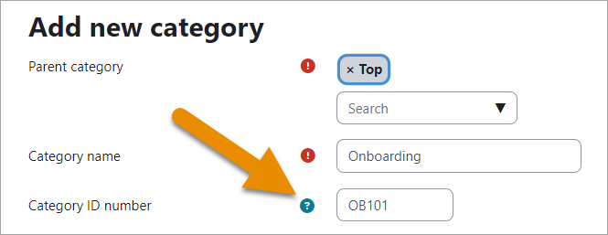

# Teacher_role

> Sumber: https://docs.moodle.org/502/en/Teacher_role

## Teacher role

Teachers can do almost anything within a course, including adding or changing the activities and grading students. By default, teachers can also assign a [Non-editing teacher role](Non-editing_teacher_role.md "Non-editing teacher role") and a [Student role](Student_role.md "Student role") to other users. (To allow teachers to enrol other teachers, see [Assign roles](Assign_roles.md "Assign roles")

By default users are not assigned the role of Teacher throughout the site, but are only assigned (enrolled) as a teacher to a single course/class at a time. The same applies to students. Teachers can only teach in the courses they have been enrolled in. (If you really need your teacher to access all courses, see \#13 of [Roles FAQ](Roles_FAQ.md "Roles FAQ")

## Assigning a user the role of teacher in a course

1.  As a manager or administrator, go to the Participants page in the course

2.  Click the button 'Enrol users'

3.  Search for the teacher and select Teacher as role to assign

4.  Click the button 'Enrol users'

The user will then appear in the list of enrolled users and will no longer be available in the search list.

For more information on manually enrolling teachers, see [Manual enrolment](Manual_enrolment.md "Manual enrolment").

## Changing Teacher Permissions

*Note: if you need to modify the Teacher role significantly, it is advisable to create a new role rather than editing the default teacher role. See [Creating custom roles](Creating_custom_roles.md "Creating custom roles")*

If you really need to change the default Teacher role, go to *Administration\>Site administration\>Users\>Permissions\>Define roles.* In the right pane you will see Manage Roles with a list of user roles. To the right of the teacher description, click on the edit icon.

From the Editing role 'Teacher' page you can change what a teacher can or cannot do by checking or unchecking the Allow check-boxes under Capability/Permission. Be careful what you allow a teacher to do here. Consider the security vulnerabilities of giving a teacher an inappropriate permission. Only give the teacher permissions that are necessary or appropriate. To the right of many of the Allow check boxes are colored triangles the notify you of possible security warnings for each choice. Use those warnings to help you decide which permissions you will or won't give to your teachers.

## Assigning The Teacher role in a category

As stated above, by default teachers are not given the role of teacher. However, under some conditions (such as for homeschool parents) you may want to assign a user, or some users, the role of teacher for all the courses in one category, or for all the courses in your whole site without having to enrol as a teacher for each class. If so, you can (If necessary, add a new role and) give that permission on this same *Editing role 'Teacher'* page, under *Role archetype*. Under *Context types where this role may be assigned* check whichever apply.

- *Course*: (Default setting-already checked) allows you to enrol a teacher to a specific course.

- *Category*: (Allows the user to be a teacher in any course contained in the specific category).If you click on the check-box for *Category*, it enables a user to access all the courses in a particular category or multiple categories (depending to which they are assigned). To assign a Teacher to a *Category*, navigate to that category, then use the *Administration* menu to *Assign roles*. (If you are not inside the category the *Assign roles* menu item will not show.) If you want one Teacher to apply to all the Course Categories, then navigate to every category and Assign roles for each category.

If you want to give only some teachers these privileges, you may want to create another Teacher role that gives those permissions only to those trusted teachers who have been assigned that role.

### Bulk assigning the Teacher role in a category

- Make sure the category context is checked for the Teacher role and that the capability [enrol/category:synchronised](Capabilities_enrol_category_synchronised.md "Capabilities/enrol/category:synchronised") is set to Allow - both from *Site administration \> Users \> Define roles \> Teacher*.

- Enable Category enrolments from *Site administration \> Enrolments \> Manage enrol plugins.*

- Make sure your chosen category has an ID number (and if not, add one) and make a note of it.

- Create your csv.

  - For existing users, just include **username**. For new users, include their other essential details as in [Upload users](Upload_users.md "Upload users").

  - Add the field **category1** where category1 is the ID number of the your chosen category.

  - Add the field **categoryrole1** and use the shortname "editingteacher".

  - Repeat these for any other categories, using category2, categoryrole2 and so on.

  - Upload the file from Site administration \> Users \> Upload users.

## See also

- For more information about why we use the label of "Teacher" see the <a href="http://moodle.org/mod/forum/discuss.php?d=43024" class="external text" rel="nofollow">Why "teacher" discussion</a>

- <a href="https://moodle.org/mod/forum/discuss.php?d=388219" class="external text" rel="nofollow">How to reduce complexity for teachers in Moodle</a> forum discussion

