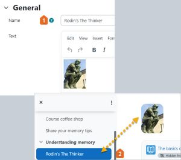

# Text_and_media_area

> Sumber: https://docs.moodle.org/502/en/Text_and_media_area

  

## What is a Text and media area?

(Formerly known as a Label) a Text and media area serves as a spacer on a Moodle course page.It can be used to add text,images, multimedia or code in between other resources in the different sections. It is a very versatile resource and can help to improve the appearance of a course if used thoughtfully. Banners or descriptions may be added here to distinguish between and highlight different areas. (Note that excessive use of multimedia (sound, video) in Text and media areas can slow down the loading of a course page.)

## How is it set up?

- In a course, with Edit mode enabled, choose Text and media area from the activity chooser.
- Give it a name (title). What you enter here will display in the course index on the left. (This is for accessibility reasons.) If you leave it empty, the first few words or characters of the Text and media area will be used. **Note the name will not be displayed on the course page; this field is for the title in the course index.**
- In the text box, add your text, images, sound or video files as desired.
- Expand the other settings to specify what you require and then click Save and return to course.

## How does it work?

### Student view

What students see in the Text and media area depends on how the teacher has configured it. Text and media areas display as a part of the course page, so there is no icon to click on. Note that they can only have manual <a href="activity_completion.md" class="mw-redirect" title="activity completion">activity completion</a>.

### Teacher view

If teachers have set [access restrictions](Restrict_access.md "Restrict access") on the Text and media area, these will display to the teacher. They are useful when gamifying your Moodle course, for example by revealing an image in a Text and media area only when a previous activity was completed.

**Note:** Currently [access restrictions](Restrict_access.md "Restrict access") only work when the 'eye' is closed when configuring the setting for Text and media areas. If the eye icon is not closed, then students see the content as normal. This is reported in <a href="https://tracker.moodle.org/browse/MDL-81874" class="external text" rel="nofollow">MDL-81874</a>

## More information

- [Text and media area settings](Text_and_media_area_settings.md "Text and media area settings")
- [Using Text and media area](Using_Text_and_media_area.md "Using Text and media area")
- [Text and media area FAQ](Text_and_media_area_FAQ.md "Text and media area FAQ")
