# Using_restrict_access

> Sumber: https://docs.moodle.org/502/en/Using_restrict_access

## A basic example

Students are required to undertake 4 tasks in a precise order. According to their score in a quiz, the fourth task - a Moodle lesson - is either at a lower or more advanced level. They must

- view a page explaining the course
- post an introductory message in a forum
- take a quiz
- move onto a lesson tailored to their performance in the quiz.

Here is the teacher view.

<a href="File_RestrictedTeacherView52.png.md" class="mw-file-description" title="teacher view of sequence of conditional activities">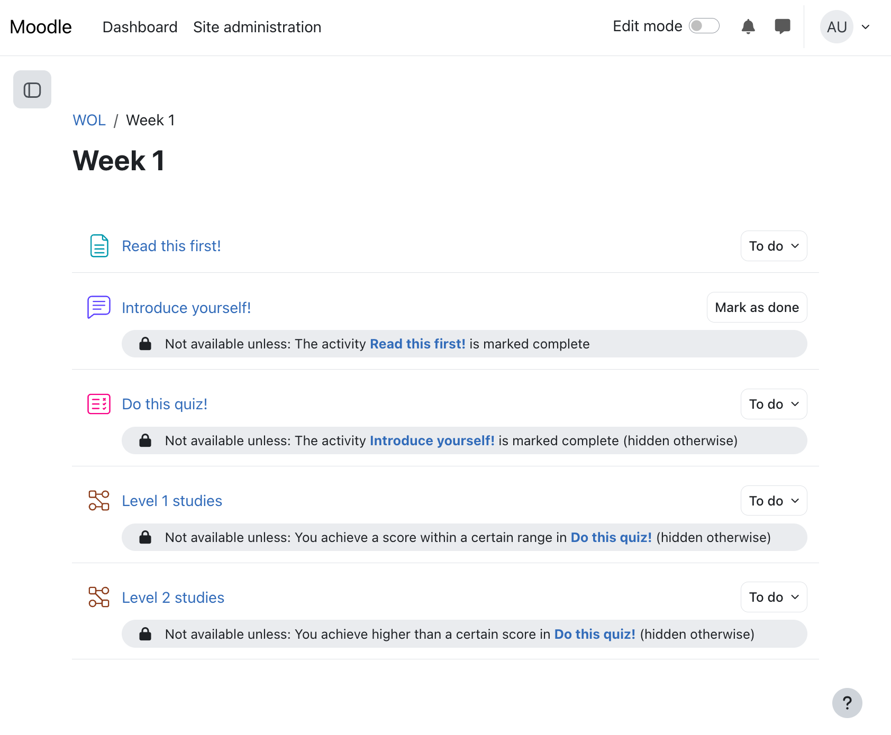</a>

Students will only see the first task (the webpage)with the second task (the forum) greyed out. The other tasks only appear once the conditions have been met.

<a href="File_RestrictedStudentView2_52.png.md" class="mw-file-description">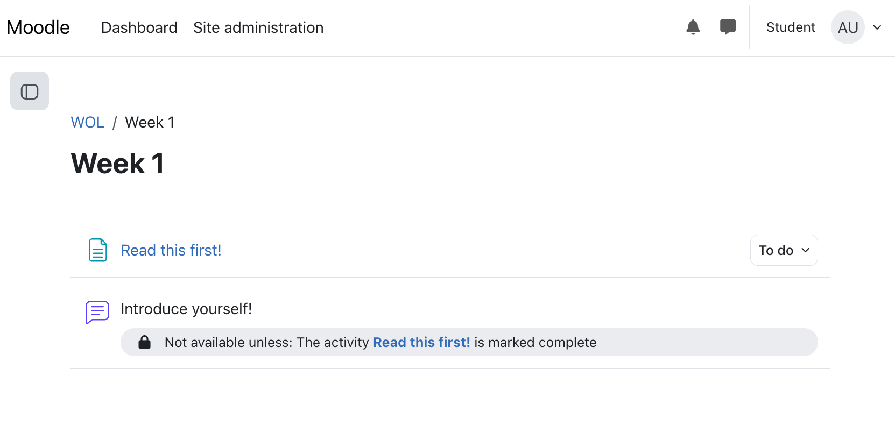</a>

*How's it done?*

- Task 1, the page must be read (or at least viewed) before students can access the forum. In task 1 the activity completion condition is set to *require view*

<a href="File_usermustviewactivity.png.md" class="mw-file-description" title="&quot;require view&quot; condition">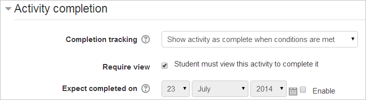</a>

- Task 2, the forum, needs to have the restrictions set such that the page *Read This First* must be marked complete. The "open" eye icon means the forum is greyed out until available:

<a href="File_CAactivitycompletion1a.png.md" class="mw-file-description" title="&quot;must be marked complete&quot;/greyed out&quot;">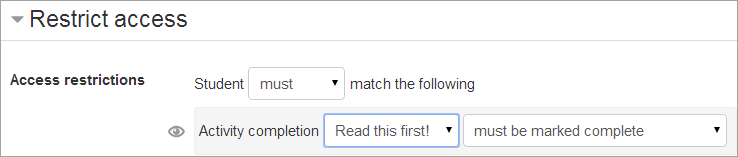</a>

- Task 2, the forum, needs to require students to make a post before they can do the quiz. The activity completion condition is set to " require posts"

<a href="File_CA1a.png.md" class="mw-file-description" title="&quot;require posts&quot;">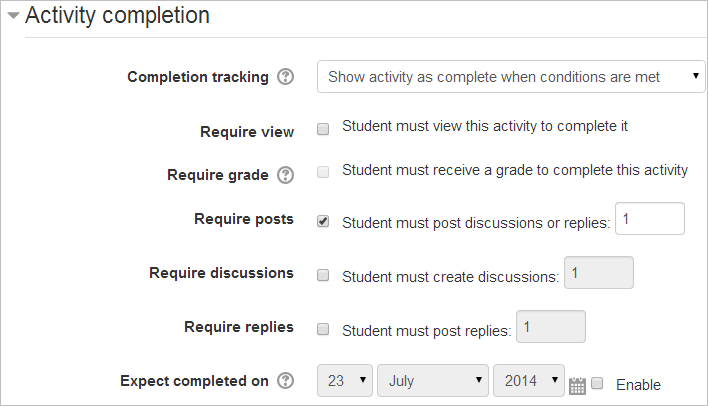</a>

- Task 3, the quiz, needs to have the restrictions set such that the forum must be marked complete. The "crossed out eye" icon means the quiz is completely hidden until a student has posted in the forum:

<a href="File_CAactivitycompletion2a.png.md" class="mw-file-description" title="&quot;must be marked complete/hide activity entirely&quot;">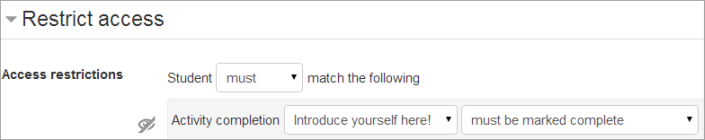</a>

- The student must get a grade in the quiz for the activity to be complete:

<a href="File_quizrequiregrade.png.md" class="mw-file-description" title="&quot;require grade&quot;">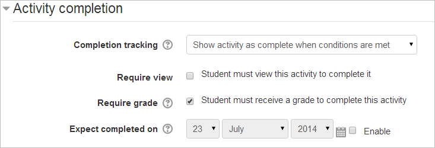</a>

- Task 4 is two lessons - either at level 1 (basic) or level 2 (advanced). If the student scores less than 50% in the quiz they do Level 1; if they score more, they do Level 2. In the Level 1 lesson, the restriction is set such that students can only access it if they get under 50% in the quiz

<a href="File_Gradecompletion1.png.md" class="mw-file-description" title="grade completion">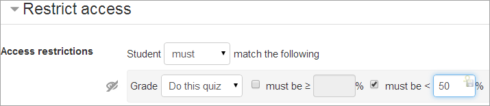</a>

The Level 2 lesson has the restriction set such that students can only access it if they get 50% or more:

<a href="File_Gradecompletion2.png.md" class="mw-file-description" title="grade completion">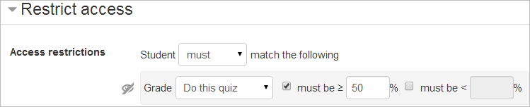</a>

## An example of "all or any"

- It's possible to set conditions such that a particular activity is available if one or more previous activities are marked complete, rather than all of them. In this screenshot, the Advanced task will become available either if the student gets above a certain grade in the quiz or if they receive a grade in the assignment.

<a href="File_RestrictedEitherOrConditions52.png.md" class="mw-file-description">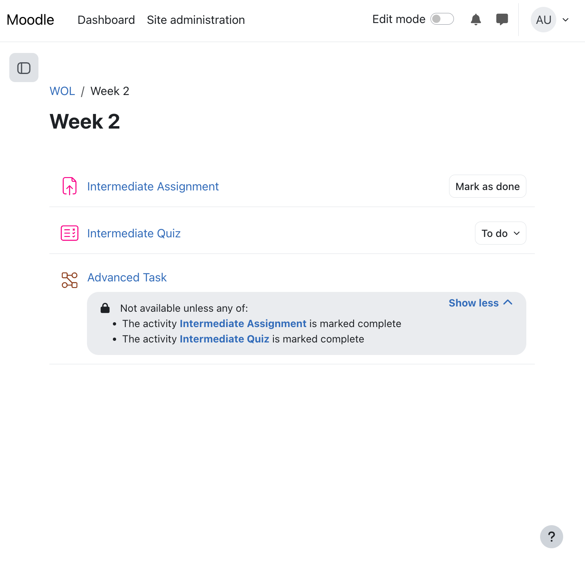</a>

- When the first restriction is set, the teacher can then click the "Add restriction" button again to add a second (and subsequent) restrictions. The teacher can then change the "all" to "any", thus changing the "and" to "or":

<a href="File_eitheror2.png.md" class="mw-file-description">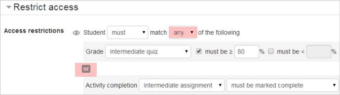</a>

## An example of a Restriction set

- The Restriction set button offers the possibility of creating several criteria using *all/any* to create complex conditions. In the screenshot below, students can only access the Assessment and Feedback section of the course if they have EITHER completed the work on Monet OR if they completed all the work on Pissarro.

<a href="File_restrictaccesslinks.png.md" class="mw-file-description">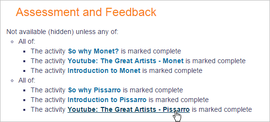</a>

- The actual settings for this are as follows:

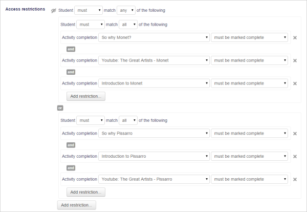

## Tricks and techniques

With a bit of lateral thinking, you can achieve some interesting results beyond the most obvious uses of the system. Here is one example:

### Project allocation

Imagine that you let students choose one of two projects. Each project has its own activities (a forum for all the people doing that project, resources with information about the project, etc.). You want it to hide all the activities that a student isn't doing.

  

1.  Create two forums called 'Frog project sign-up forum' and 'Zombie project sign-up forum'.
2.  Set both forums to be automatically marked complete once the user makes 1 post.
3.  Set each forum to be conditionally available only if the other forum is NOT complete.
4.  Create other activities for the frog and zombie projects. For each Frog activity, set it to be conditionally available only if the Frog sign-up forum is marked complete. For each Zombie activity, set it to be conditionally available only if the Zombie sign-up forum is marked complete.

When a student first visits the site, they see the frog and zombie sign-up forums and none of the project activities. As soon as they post in one of the forums, the other forum will disappear, and all the activities for their preferred project will appear. (If they want to change their mind, they can delete their forum post so that it isn't marked complete any more, and it'll be back to square one.)

## Gamification

Many Moodlers are using Restrict access as a means to "gamify" their course. This section is for sharing examples and ideas:

- [Quizventure activity](Quizventure_activity.md "Quizventure activity") - an activity module that loads questions from the course it's added to. The possible answers come down as space ships and you have to shoot the correct one.
- [Level Up!](Level_up__quick_guide.md "Level up! quick guide") - a customisable block which a teacher can add to a course to give experience points to students as they progress through a course.
- <a href="blocks_stash.md" class="mw-redirect" title="blocks/stash">Stash</a> - a block that allows a teacher to create and then show items around a course. Students can then go and collect these items which will then appear in their stash block.
- [Game module](Game_module.md "Game module") - This module contains 8 games: hangman, crosswords, cryptex, millionaire, sudoku, hidden picture, snakes& ladders and book with questions.
- [Exabis games activity](Exabis_games_activity.md "Exabis games activity") - the goal of this activity is to bring the aspect of game-based-learning into Moodle-courses.
- [PhET simulations](PhET_simulations.md "PhET simulations") - interactive simulations for science ([physics](Physics.md "Physics"), [biology](Biology.md "Biology"), [chemistry](Chemistry.md "Chemistry"), Earth sciences) and [math](Mathematics.md "Mathematics") at elementary, middle school, high school and University levels.
- The <a href="https://moodle.org/plugins/block_ranking" class="external text" rel="nofollow">Ranking block</a> can improve the gamification into the course. It works with the activity completion tracking, so you need to enable that and configure the criteria for all activities you want to monitor. The plugin only add points to activities with completion criteria.
- A <a href="https://moodle.org/mod/forum/discuss.php?d=343722" class="external text" rel="nofollow">way to create a very simple 'game' where the text is blurred but as you hover over it it appears</a>
- The <a href="https://moodle.org/plugins/local_mootivated" class="external text" rel="nofollow">Mootivated</a> is a mobile app that rewards student effort for learning in Moodle. Coins are awarded for working in Moodle and they can be spent in either the Avatar Part Store or your School Store.
- The [Ranking block](Ranking_block.md "Ranking block") works together with the moodle course completion. In the moodle course you configure the criteria to the end of the course. The ranking block monitors these activities and add points to the students based on accomplishing the activities.

### Moodle game-related forum threads

- <a href="https://moodle.org/mod/forum/discuss.php?d=280546" class="external text" rel="nofollow">Educational gaming for Moodle</a>
- <a href="https://moodle.org/mod/forum/discuss.php?d=276994" class="external text" rel="nofollow">Have you used Games in Moodle?</a>
- <a href="https://moodle.org/mod/forum/discuss.php?d=265096" class="external text" rel="nofollow">Turn your quiz into an arcade game</a>
- <a href="https://moodle.org/mod/forum/discuss.php?d=263547" class="external text" rel="nofollow">Now you see it; now you don't</a>
- <a href="https://moodle.org/mod/forum/discuss.php?d=261797" class="external text" rel="nofollow">Is gamification an old idea by a new name?</a>
- <a href="https://moodle.org/mod/forum/discuss.php?d=261746" class="external text" rel="nofollow">Gamification: Weekly Team Scorecards!?</a>

### Moodle Academy course

- <a href="https://moodle.academy/course/view.php?id=18" class="external text" rel="nofollow">Introduction to gamification</a> - An intermediate-level Moodle Academy course that guides you in creating a gamified course in Moodle.

## Should you really use restrict access?

The restrict access feature is a way for you to force your students to do things in a certain order. Is that really what you want? The answer will depend on your particular circumstances, but it is worth taking a moment to reflect upon the degree to which restricting access is appropriate for your course.It is certainly good course design to make it clear to your students what they are expected to do next, to give good guidance. Restricting access can be used to create alternative pathways and to introduce repetition. As course sizes grow, such mechanisms can allow teachers to offer learning experiences that cater more to individuals, providing reinforcement when it is needed. However, some may still prefer to use labels and layout rather than locks and keys to direct the learning path.

## See also

- Forum thread <a href="https://moodle.org/mod/forum/discuss.php?d=231400" class="external text" rel="nofollow">Conditional by number of days</a> for using post threshold blocking to restrict access to topics by days.
- With the <a href="https://moodle.org/plugins/availability_language" class="external text" rel="nofollow">Availability language</a> plugin, it is possible to restrict modules or whole sections based on language. It makes it easy to show an English resource only to English users and an activity in French only to French speaking students.
