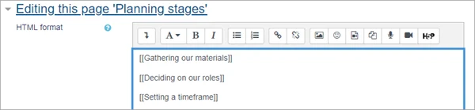
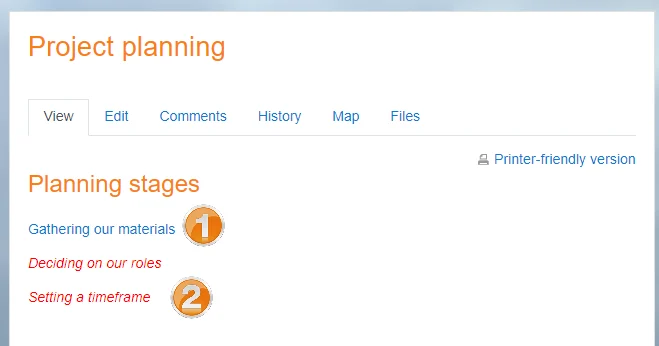

# Wiki_activity

> Sumber: https://docs.moodle.org/502/en/Wiki_activity

  

## What is the Wiki activity?

- The WIki activity allows students to create a collaborative document by building pages together, similar to Wikipedia. Unlike other collaborative editing programs (such as Google docs) the Wiki is a standard Moodle activity and so no extra permissions or logins are needed.
- Although Wikis are usually collaborative, it is possible to allow each student to create their own Wiki for individual use.

## How is it set up?

1.  In a course, with the editing turned on, choose 'Wiki' from the activity chooser.
2.  Give it a name and, if required, a description.
3.  For Wiki mode, choose Collaborative if you want students to work together in the same wiki, or Individual if you want them to each have their own wiki.
4.  Choose the First page name carefully, as it cannot be changed.
5.  For Format, leave it as the default if you are not sure what the others mean.
6.  Expand the other sections to select the settings you want and click Save and display.
7.  Click the Create page button and helpfully add text and/or create new pages by adding double square brackets around their titles

8.Click Save and display and, if you want to start the pages yourself, click a link, add some text and click Create page.

## How does it work?

### Student view

- Students click on the Wiki icon in the course to access it and can either go to an existing page (1), activate a draft page by clicking the link (2) or create a new page by adding double square brackets around its title.

- The Edit tab allows them to edit the page, which they can preview before saving.
- The History tab shows who has done what in the Wiki, and the Map tab shows a menu of the pages.
- Depending on the teacher's settings, other tabs might include Comments and the ability to upload files.

### Teacher view

Teachers additionally see an Administration tab, where they can remove pages or delete page versions.

## More information

- [Wiki settings](Wiki_settings.md "Wiki settings")
- [Using Wiki](Using_Wiki.md "Using Wiki")
- <a href="Wiki_module_FAQ.md" class="mw-redirect" title="Wiki module FAQ">Wiki FAQ</a>
