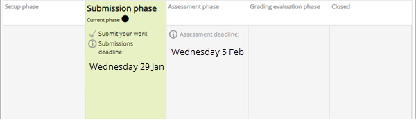
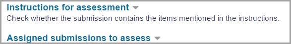
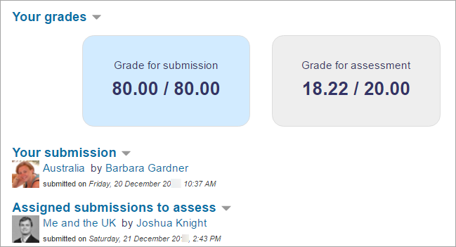
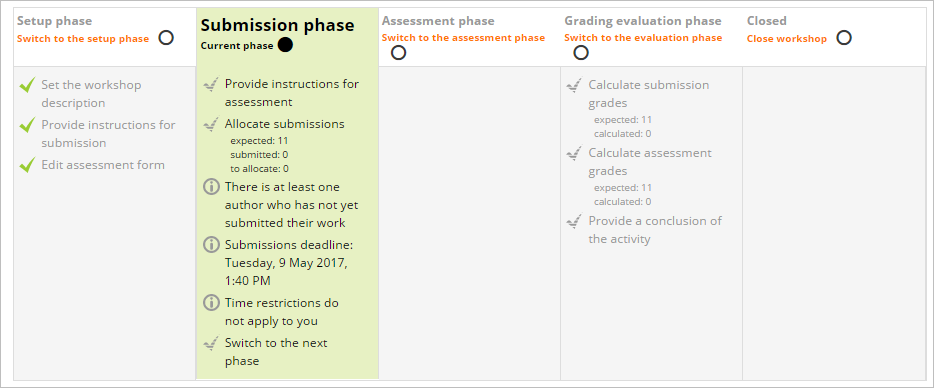
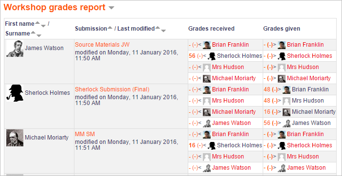

# Workshop_activity

> Sumber: https://docs.moodle.org/502/en/Workshop_activity

  

## What is the Workshop activity?

Workshop is a powerful peer assessment activity. Students add submissions which are then distributed amongst their peers for assessment based on a grading scale specified by the teacher.

  

## How is it set up?

1.  In a course, with the editing turned on, choose 'Workshop' from the activity chooser.
2.  Give it a name and, if needed, a description
3.  Expand the other sections to select the settings you want. If you are not sure, leave everything as default. See [Workshop settings](Workshop_settings.md "Workshop settings") for more detailed information.
4.  Grading settings - students receive two grades, one for the work they submit and one for the quality of their peer assessments. The page [Workshop grading strategies](Workshop_grading_strategies.md "Workshop grading strategies") explains this more.
5.  Submission settings is where you explain the task they must submit.
6.  Assessment settings is where you give a brief outline of how they will assess the work of their peers.
7.  Feedback will, if enabled, allow students to add text comments when they review each other's work.
8.  Example submissions, if enabled, allows you to provide examples for students to practise with before they begin peer assessing. (Enabling this opens more options.)
9.  Availability gives you the option to allow students to start peer assessing as soon as the submission deadline is over, rather than you enabling this manually.
10. Click Save and display and explore the Workshop phases in the section Teacher view below, making sure you complete the Set up phase and switch to the Submission phase when you want your students to begin the activity.

## How does it work?

### Student view

- Students click on the Workshop icon in the course to access it. Initially they will see either the Set up phase (if the teacher is still preparing the Workshop) or the Submission phase when they are allowed to submit.

- Other phases will be highlighted at different times depending on the teacher's settings. During the Assessment phase, students scroll down the page to view the submissions they must review:

- Once grades are calculated and finalised, and the workshop is closed, students see their two grades.

### Teacher view

Once a Workshop activity has been created and saved, it is in the Set up phase. It must be in the Submission phase for students to be able to submit work and then moved to the Assessment phase for them to review each other's submissions. The switch may automatic or manual.

#### Setup phase

- Click 'Edit assessment form' to provide detailed grading criteria for your students to use. When finished, click 'Save and close', and all ticks on the Setup phase will be the same colour.
- You are ready to switch to the Submission phase which lets students send in their work. Click the icon or text at the top of Submission phase. This phase will be highlighted.

#### Submission phase

- Students will now be able to submit their work during this time, until any deadline you specified - unless you also allowed late submissions.
- Click the link 'Allocate submissions' to decide if you yourself want to choose which student assesses whose work (*Manual allocation*), or if you want Moodle to choose for you (*Random allocation*) And do you want students to assess others' work even if they have not submitted anything themselves?
- If,in the **Availability** section you set the workshop to switch to the submission phase automatically once the submission deadline is over, choose *Scheduled allocation.*

- You can see how many have submitted and how many still need to submit. Click the icon or text to move to the Assessment phase if you chose to switch phases yourself. The phase will be highlighted. (Remember that you can move back a phase if you need to, for example if you want to allow a student to resubmit.)

#### Assessment phase

- Students will assess the work of their peers according to the instructions and criteria you gave them.
- You can monitor their progress by looking at the grades underneath the phases screen:

- When you are ready, click the icon or text to move to the Grading evaluation phase. This phase will be highlighted.

#### Grading evaluation phase

- Here, Moodle calculates the final grades for submission and for assessment. The page **[Using Workshop](Using_Workshop.md "Using Workshop")** gives more details on how the grading works.
- For the grade for assessment, you can decide how strict you want the comparison to be. If you are not sure, leave it as the default 'fair'.
- You can recalculate the grades several times.
- You can change grades here if you need to.
- You can show to other students selected submissions if you wish. Click on a submission in the workshop grades report (image above) and scroll down to 'Feedback for the author'. Tick the box to publish this submission. Other students will see it once the workshop is closed.

#### Closing the workshop

When you are satisfied with the final grading, click the icon or text to close the workshop. The Closed phase will be highlighted and students will be able to see their grades, any published submissions and a conclusion if you added one.

## More information

- [Workshop settings](Workshop_settings.md "Workshop settings")
- [Using Workshop](Using_Workshop.md "Using Workshop")
- [Workshop FAQ](Workshop_FAQ.md "Workshop FAQ")
- [Workshop grading strategies](Workshop_grading_strategies.md "Workshop grading strategies")
