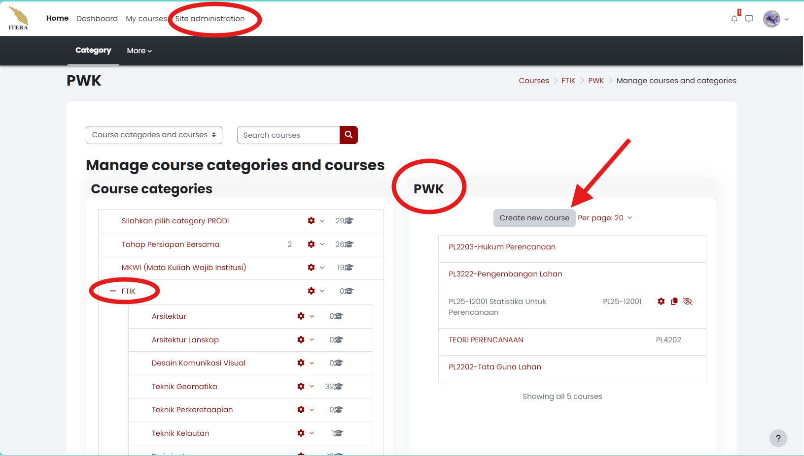
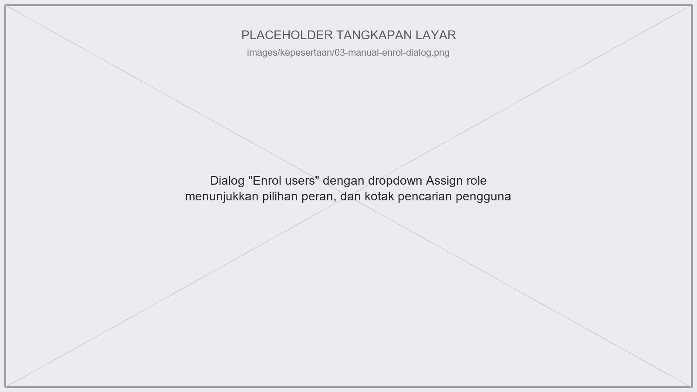
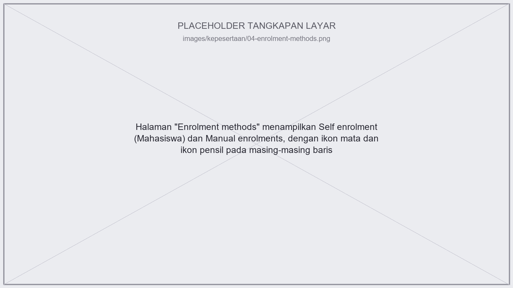
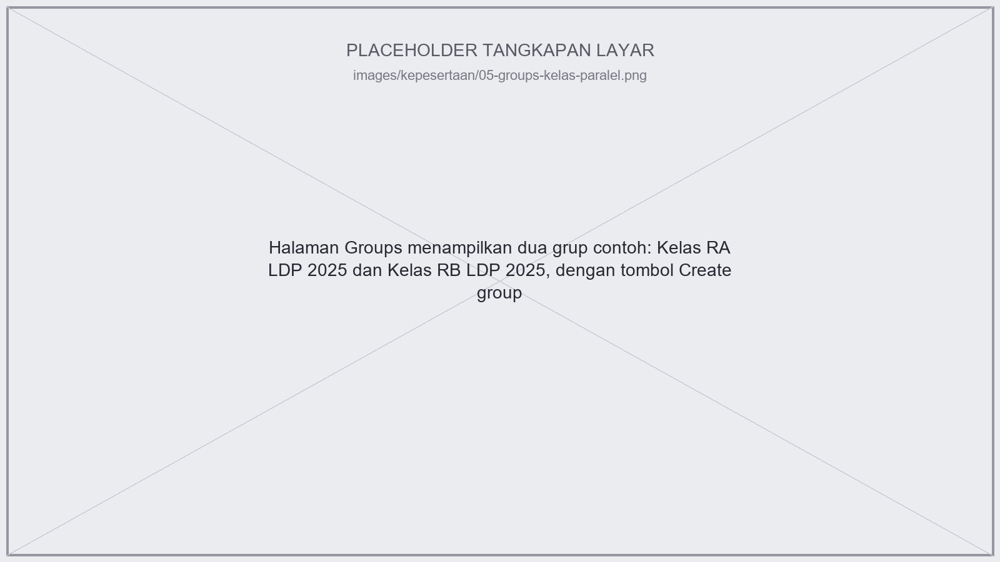
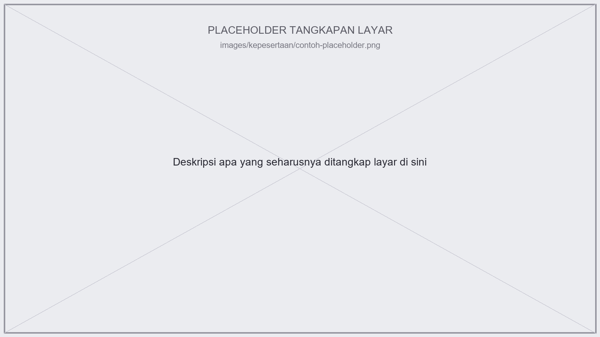

# Kepesertaan {#sec-kepesertaan}

Bab ini menelusuri siklus penuh kepesertaan sebuah mata kuliah: dari kursusnya belum ada sama sekali, mahasiswa didaftarkan per kelas paralel, dosen dan asisten ditetapkan, sampai bagaimana memutar peserta tiap semester saat ada mahasiswa lulus dan mahasiswa baru masuk.

## Membuat Mata Kuliah {#sec-membuat-mk}

Di Moodle, satu **kursus** (*course*) pada dasarnya setara dengan satu mata kuliah. Sebelum membuatnya, ada satu hal yang perlu diketahui lebih dulu: **dosen biasa (Teacher) secara default tidak bisa membuat kursus baru sendiri.** Hak ini hanya dimiliki oleh peran **Administrator**, **Manager**, atau **Course creator** (di ITERA diberi label "Dosen Pengembang MK").

::: {.callout-note}
## Catatan sumber
Temuan bahwa akun dosen di kuliah2.itera.ac.id ternyata *punya* akses ke `course/management.php` (yang menampilkan seluruh kategori dan kursus institusi) menunjukkan sebagian dosen di ITERA diberi peran pengelola/manajer tambahan di luar peran Teacher biasa — bukan berarti semua dosen otomatis bisa membuat kursus. Kalau tombol "Create new course" tidak muncul di akun Anda, ini normal; hubungi admin LMS program studi/fakultas untuk dibuatkan kursusnya atau diberi akses Course creator.
:::

### Langkah Membuat Kursus

1. Buka **Site administration → Courses → Manage courses and categories** (`/course/management.php`).
2. Pilih kategori tempat mata kuliah Anda bernaung. Di ITERA, struktur kategorinya dua level: **Fakultas → Program Studi** (misalnya `FTIK / PWK`), ditambah kategori administratif seperti **Tahap Persiapan Bersama** dan **MKWI (Mata Kuliah Wajib Institusi)** untuk mata kuliah lintas prodi.
3. Klik **"Create new course"**.
4. Isi form pengaturan kursus (`/course/edit.php`), lalu **"Save and display"**.

### Field yang Perlu Diperhatikan di Form Kursus

| Field | Penjelasan |
|---|---|
| **Course full name** | Nama lengkap yang tampil di daftar kursus, Dashboard, dan judul tab browser. |
| **Course short name** | Nama singkat untuk navigasi. Di ITERA memakai format `[PRODI][TAHUN]-[NOMOR]`, contoh `PL25-12001` untuk mata kuliah Statistika Untuk Perencanaan Prodi PWK angkatan 2025. |
| **Course category** | Tempat kursus dikelompokkan (lihat struktur kategori di atas). |
| **Course visibility** | Show/Hide. Kursus yang di-*hide* tidak muncul di daftar kursus untuk mahasiswa, tapi tetap terlihat oleh dosen dan manajer. |
| **Course start/end date** | Memengaruhi tampilan log dan format mingguan (kalau dipakai); tanggal akhir dipakai untuk menandai kursus sebagai "past" di daftar "My courses" mahasiswa. |
| **Course summary** | Ringkasan yang tampil di daftar kursus dan ikut ter-*index* saat pencarian kursus. |
| **Course image** | Gambar sampul kursus, tampil di daftar kursus. |
| **Format** | Lihat opsi format kursus di @sec-tampilan-kelas. |

::: {.callout-tip}
## Kursus vs kelas paralel
Satu mata kuliah = satu kursus, **bukan** satu kursus per kelas paralel. Kalau mata kuliah Anda punya Kelas A dan Kelas B, keduanya tetap satu kursus Moodle yang sama — pemisahannya dilakukan lewat fitur **Groups**, dibahas di @sec-enroll-mahasiswa. Ini penting dipahami dari awal supaya Anda tidak membuat kursus terpisah untuk tiap kelas paralel.
:::

## Meng-enroll Mahasiswa jadi Peserta per Kelas {#sec-enroll-mahasiswa}

Setelah kursus dibuat, mahasiswa perlu didaftarkan sebagai peserta. Di kuliah2.itera.ac.id, ada dua metode pendaftaran (*enrolment*) yang lazim dipakai dosen, plus satu fitur pemisah kelas paralel yang berjalan terpisah dari metode pendaftaran itu sendiri.

### Metode 1: Manual Enrolment

Dosen mendaftarkan mahasiswa satu per satu atau dalam kelompok, secara manual.

1. Dari navigasi kursus, klik **Participants**.
2. Klik tombol **"Enrol users"**.
3. Pada dropdown **"Assign role"**, pilih peran **Mahasiswa (Student)**.
4. Cari dan pilih mahasiswa yang ingin didaftarkan (bisa lebih dari satu).
5. Klik **"Enrol selected users and cohorts"**.

::: {.callout-tip}
## Kapan manual enrolment lebih cocok
Manual enrolment cocok dipakai kalau daftar mahasiswa Anda sudah pasti (misalnya dari SIAKAD) dan Anda ingin kontrol penuh siapa saja yang masuk — tidak ada risiko orang yang salah ikut mendaftar sendiri.
:::

### Metode 2: Self Enrolment dengan Enrolment Key

Mahasiswa mendaftarkan diri sendiri ke kursus, biasanya memakai *enrolment key* ("kata sandi kursus") supaya tidak sembarang orang bisa masuk.

1. Dari navigasi kursus, klik **Participants → Enrolment methods** (`/enrol/instances.php?id=<id kursus>`).
2. Aktifkan **Self enrolment (Mahasiswa)** lewat ikon mata, lalu klik ikon pensil untuk mengatur.
3. Isi **Enrolment key** kalau ingin membatasi siapa yang bisa mendaftar sendiri — bagikan kata sandi ini hanya ke mahasiswa yang berhak.

::: {.callout-tip}
## Kapan self enrolment lebih cocok
Self enrolment menghemat waktu Anda kalau jumlah mahasiswa besar — Anda tinggal membagikan kata sandi kursus, mahasiswa mendaftar sendiri, tidak perlu menambahkan satu-satu. Konsekuensinya, Anda melepas sedikit kendali: siapa pun yang tahu kata sandinya bisa masuk, jadi jaga agar kata sandi tidak tersebar ke luar kelas.
:::

### Memisahkan Kelas Paralel dengan Groups {#sec-groups}

Karena satu mata kuliah = satu kursus (lihat @sec-membuat-mk), kelas paralel (misalnya Kelas RA vs Kelas RB) dipisahkan lewat fitur **Groups**, bukan kursus terpisah.

1. Dari navigasi kursus, klik **Participants → Groups**.
2. Klik **"Create group"**, beri nama sesuai kelas (contoh yang ditemukan di kursus Statistika: `Kelas RA LDP 2025`, `Kelas RB LDP 2025`).
3. Tambahkan mahasiswa ke grup lewat tombol **"Add/remove users"**, atau — kalau memakai self enrolment — set **group enrolment key** berbeda per kelas supaya mahasiswa otomatis masuk grup yang benar saat mendaftar sendiri.

::: {.callout-tip}
## Manfaat Groups bagi dosen
Dengan Groups, Anda bisa memfilter tampilan gradebook dan aktivitas supaya hanya menampilkan satu kelas dalam satu waktu — berguna kalau Anda mengajar beberapa kelas paralel sekaligus dan tidak ingin nilai/tampilan tercampur. Kalau mata kuliah Anda diampu bersama dosen lain per kelas, **group mode "Separate groups"** (diatur di pengaturan kursus, bagian Groups) membuat tiap dosen hanya melihat kelasnya sendiri.
:::

### Membuat Banyak Grup Sekaligus dengan Auto-create Groups {#sec-auto-create-groups}

Membuat grup satu per satu lewat "Create group" masih masuk akal untuk dua-tiga kelas paralel. Tapi begitu Anda perlu membagi 120 mahasiswa ke dalam 30 kelompok tugas besar, cara itu menyita waktu berjam-jam. Untuk kasus seperti ini, Moodle punya tombol **"Auto-create groups"** di halaman yang sama (**Participants → Groups**).

Setelah tombol itu diklik, klik dulu **"Expand all"** di kanan atas — sebagian pengaturan penting (termasuk bagian Grouping) tersembunyi kalau tidak diperluas.

#### Naming scheme: Menamai Grup secara Berpola

Kolom **Naming scheme** menentukan pola nama grup yang akan dihasilkan. Ada dua karakter khusus di sini:

- `#` diganti dengan **angka** berurutan (1, 2, 3, ...)
- `@` diganti dengan **huruf** berurutan (A, B, C, ...)

| Yang Anda ketik | Nama grup yang dihasilkan |
|---|---|
| `Kelompok #` | Kelompok 1, Kelompok 2, Kelompok 3, ... |
| `Kelompok @` | Kelompok A, Kelompok B, Kelompok C, ... |
| `@` | A, B, C, D, ... |
| `Kelas R@` | Kelas RA, Kelas RB, Kelas RC, ... |
| `Kelas R@ LDP 2025` | Kelas RA LDP 2025, Kelas RB LDP 2025, ... |

::: {.callout-tip}
## Pola `R@` cocok untuk penamaan kelas di ITERA
Kelas paralel di ITERA lazim dinamai dengan awalan huruf R — RA, RB, RC, dan seterusnya. Pola inilah yang persis diakomodasi oleh karakter `@`: cukup tulis `Kelas R@` sebagai naming scheme, lalu tentukan berapa jumlah kelas paralelnya, dan Moodle membuat seluruh grupnya sekaligus dengan nama yang konsisten. Anda tidak perlu mengetik "Kelas RA", "Kelas RB", "Kelas RC" satu per satu dan berisiko salah ketik atau tidak konsisten spasinya.
:::

Dua catatan kecil soal naming scheme:

- **Jangan memakai `#` dan `@` bersamaan** dalam satu pola. Moodle mengganti kedua simbol itu sekaligus dan hasilnya jarang sesuai harapan.
- **Setelah huruf Z habis**, penomoran huruf dilanjutkan ke AA, AB, dan seterusnya. Untuk jumlah grup yang besar (di atas 26), penomoran angka (`#`) biasanya jauh lebih enak dibaca.

#### Menentukan Jumlah: Berapa Grup atau Berapa Anggota

Di bawah naming scheme, Anda memilih dasar pembagiannya lewat dropdown **"Auto create based on"**:

- **Number of groups** — Anda tentukan *berapa grup* yang dibuat, Moodle yang membagi rata jumlah anggotanya. Cocok untuk kelas paralel (Anda tahu ada 4 kelas: RA–RD) dan untuk tugas besar dengan jumlah topik tetap (ada 8 topik, berarti 8 kelompok).
- **Members per group** — Anda tentukan *berapa orang per grup*, Moodle yang menghitung jumlah grupnya. Cocok kalau yang Anda patok adalah ukuran tim, misalnya "setiap kelompok tugas besar berisi 4 orang".

#### Prevent Last Small Group: Menghindari Kelompok Sisa yang Timpang

Kalau Anda memakai **Members per group**, ada satu jebakan: sisa pembagian bisa membentuk kelompok terakhir yang isinya jauh lebih sedikit dari yang lain — dan kelompok itu jadi dirugikan karena beban kerjanya sama tapi anggotanya lebih sedikit.

Centang **"Prevent last small group"** untuk mencegahnya. Kalau kelompok terakhir akan berisi kurang dari 70% ukuran yang diharapkan, kelompok itu tidak jadi dibuat; anggotanya disebar ke kelompok-kelompok yang sudah ada.

Dua contoh dari dokumentasi resmi Moodle:

- Kelas berisi **80 mahasiswa**, diminta 30 orang per kelompok. Kelompok ketiga hanya akan berisi 20 orang (66% dari 30), jadi Moodle hanya membuat **dua kelompok berisi 40 orang**.
- Kelas berisi **81 mahasiswa**, diminta 30 orang per kelompok. Kelompok ketiga berisi 21 orang (70% dari 30), masih di atas ambang, jadi Moodle membuat **tiga kelompok: 30, 30, dan 21 orang**.

#### Menentukan Siapa yang Masuk

Bagian **Group members** mengatur dari mana anggota diambil dan bagaimana mereka diurutkan:

| Pengaturan | Penjelasan |
|---|---|
| **Select members from role** | Pilih peran yang ikut dibagi — biasanya **Mahasiswa (Student)** saja, supaya dosen dan asisten tidak ikut terbagi ke dalam kelompok. |
| **Select members from cohort / group / grouping** | Membatasi sumber anggota hanya dari *cohort*, grup, atau grouping tertentu. Berguna kalau Anda ingin membagi kelompok tugas **di dalam satu kelas paralel saja**. |
| **Allocate members** | Cara pembagiannya: acak (*randomly*), urut abjad nama depan/belakang, atau urut nomor ID. Untuk tugas kelompok, acak biasanya paling adil. |
| **Ignore users in groups** | Centang ini supaya mahasiswa yang sudah punya grup tidak ikut dibagi lagi. |
| **Include only active enrolments** | Menentukan apakah mahasiswa berstatus *suspended* ikut dimasukkan (lihat @sec-manajemen-lulus). |

Sebelum benar-benar dibuat, klik **"Preview"**. Moodle akan menampilkan calon nama grup beserta daftar anggotanya, sehingga Anda bisa memastikan hasilnya sesuai sebelum menekan **"Submit"**.

::: {.callout-important}
## Auto-create untuk kelas paralel: hati-hati soal anggotanya
Auto-create sangat membantu untuk **membuat nama-nama grupnya**, tapi pembagian anggotanya bersifat otomatis (acak atau urut abjad) — sementara keanggotaan kelas paralel RA/RB/RC sudah ditentukan SIAKAD, bukan boleh diacak.

Karena itu, untuk kelas paralel alurnya sebaiknya: pakai auto-create hanya untuk membuat kerangka grup dengan pola `Kelas R@`, lalu isi anggotanya sendiri lewat **"Add/remove users"** atau lewat *group enrolment key* per kelas. Di formulir auto-create ada pilihan peran **"No role"** pada *Select members from role* yang seharusnya menghasilkan grup kosong tanpa anggota — **ini belum diverifikasi langsung di kuliah2.itera.ac.id**, jadi coba dulu dan cek hasilnya di halaman Groups sebelum diandalkan.
:::

### Membagi Kelompok Tugas Besar dengan Groups {#sec-groups-tugas}

Selain memisahkan kelas paralel, Groups punya kegunaan kedua yang sering luput: **membagi mahasiswa ke dalam kelompok tugas**. Bedanya hanya di niat, bukan di fiturnya — Moodle memperlakukan keduanya sama.

Bandingkan dua cara mengelola tugas besar berkelompok:

**Tanpa Groups.** Anda membuat satu Assignment untuk semua. Tiap kelompok mengunggah lewat satu perwakilan, lalu Anda menyalin nilai yang sama ke semua anggota satu per satu di gradebook. Kalau ada 30 kelompok berisi 4 orang, itu 120 kali entri nilai manual, dan Anda harus mengingat sendiri siapa satu kelompok dengan siapa.

**Dengan Groups.** Anda buat 30 grup sekaligus lewat auto-create (naming scheme `Kelompok #`, 4 anggota per grup, alokasi acak). Lalu di pengaturan Assignment, aktifkan **"Students submit in groups"**. Konsekuensinya:

- Satu pengumpulan mewakili satu kelompok — siapa pun anggotanya yang mengunggah, seluruh anggota tercatat sudah mengumpulkan.
- Nilai dan *feedback* yang Anda beri sekali otomatis mengalir ke semua anggota kelompok (kalau opsi *Require all group members submit* dan pengaturan nilai kelompok diatur sesuai kebutuhan).
- Anda bisa memfilter tampilan penilaian per kelompok, jadi memeriksanya bisa dilakukan kelompok demi kelompok, bukan mahasiswa demi mahasiswa.

Pembahasan detail pengaturan pengumpulan berkelompok pada aktivitas Assignment ada di @sec-grading.

Kegunaan lain yang sering dipakai:

- **Forum diskusi kelompok** — dengan group mode *Separate groups*, tiap kelompok punya ruang diskusi sendiri di dalam satu forum yang sama, dan mereka tidak melihat diskusi kelompok lain.
- **Membatasi akses aktivitas ke kelompok tertentu** — lewat fitur **Restrict access**, sebuah aktivitas atau bahan bisa dikunci hanya untuk anggota grup tertentu. Misalnya lembar data yang berbeda untuk tiap kelompok studi kasus.

### Groupings: Wadah untuk Beberapa Grup Sekaligus {#sec-groupings}

Kalau **Group** adalah berkas, maka **Grouping** adalah folder tempat berkas-berkas itu disimpan. Grouping adalah kumpulan dari beberapa Groups di dalam satu kursus.

Kegunaannya baru terasa ketika satu kursus punya **lebih dari satu skema pengelompokan**. Bayangkan kursus Anda punya:

- 4 grup kelas paralel: Kelas RA, RB, RC, RD
- 30 grup tugas besar: Kelompok 1 sampai Kelompok 30
- 8 grup praktikum: Praktikum A sampai H

Tanpa grouping, halaman Groups Anda berisi 42 entri bercampur aduk, dan setiap kali mengatur akses sebuah aktivitas Anda harus memilah sendiri mana yang mana. Dengan grouping, ketiganya masuk ke tiga wadah — "Kelas Paralel", "Tugas Besar", "Praktikum" — dan saat mengatur aktivitas Anda cukup menunjuk satu wadah.

#### Membuat Grouping

1. Dari navigasi kursus, pilih **Participants → Groupings**.
2. Klik **"Create grouping"**.
3. Isi **Grouping name**. **Grouping ID number** bersifat opsional, dipakai untuk mencocokkan dengan sistem luar atau saat mengimpor grup lewat CSV, dan tidak ditampilkan di mana pun di situs.
4. Simpan.

#### Memasukkan Grup ke dalam Grouping

1. Di halaman **Groupings**, klik ikon orang ("Show groups in grouping") pada baris grouping yang dituju.
2. Pilih grup dari daftar **"Potential members"** di sebelah kanan.
3. Klik tombol panah ke arah daftar **"Existing members"**.
4. Klik **"Back to groupings"**. Grup yang tadi ditambahkan sekarang tercantum di tabel halaman Groupings.

::: {.callout-tip}
## Jalan pintas: buat grouping langsung dari auto-create
Anda tidak harus melakukan dua langkah terpisah. Di formulir **Auto-create groups** (lihat @sec-auto-create-groups), bagian **Grouping** di paling bawah punya dua kolom:

- **Create in grouping** — pilih *New grouping* untuk membuat wadah baru, atau pilih grouping yang sudah ada dari daftar.
- **Grouping name** — nama wadahnya, terpakai kalau Anda memilih *New grouping*.

Jadi sekali klik Submit, 30 kelompok tugas besar Anda langsung terbuat **sekaligus** masuk ke grouping "Tugas Besar". Ini cara paling hemat langkah, dan sangat disarankan dipakai sejak awal — merapikan 30 grup ke dalam wadah setelah terlanjur dibuat jauh lebih repot.
:::

#### Memakai Grouping pada Aktivitas

Membuat grouping saja belum mengubah apa pun. Wadah itu baru bekerja setelah ditunjuk di aktivitas:

1. Buka **Edit settings** pada aktivitas yang dituju.
2. Di bagian **Common module settings**, atur **Group mode** ke **Separate groups** (tiap kelompok hanya melihat kelompoknya sendiri) atau **Visible groups** (tiap kelompok bekerja terpisah tapi bisa melihat kelompok lain).
3. Pilih grouping Anda pada dropdown **Grouping**.
4. Simpan.

::: {.callout-warning}
## Penyebab paling umum "grouping saya tidak berfungsi"
Kalau **Group mode** masih **No groups**, dropdown Grouping tidak akan berpengaruh apa-apa. Dua pengaturan ini harus diatur berpasangan. Perlu dicatat juga bahwa dropdown Grouping hanya muncul pada jenis aktivitas yang memang mendukung mode kelompok.
:::

Setelah aktif, dosen akan melihat nama grouping dalam tanda kurung di belakang nama aktivitas pada halaman kursus — penanda yang berguna untuk memastikan aktivitas sudah menyasar kelompok yang benar.

#### Grouping Default Kursus

Setelah beberapa grouping dibuat, Anda bisa menetapkan salah satunya sebagai grouping *default* lewat pengaturan kursus, bagian **Groups**. Grouping default inilah yang dipakai pada halaman **Participants** — praktis kalau ada satu skema pengelompokan yang paling sering Anda pakai (biasanya kelas paralel).

## Meng-assign Dosen dan Asisten sebagai Pengajar {#sec-assign-dosen}

Peran yang tersedia di level kursus kuliah2.itera.ac.id (label Indonesia di halaman Participants):

| Label di ITERA | Peran standar Moodle | Kewenangan singkat |
|---|---|---|
| No roles | — | Terdaftar tapi belum punya peran/akses tertentu. |
| Dosen Pengembang MK | Course creator | Bisa membuat kursus baru; biasanya dipegang koordinator prodi/mata kuliah. |
| Dosen | Teacher | Akses penuh mengubah struktur, konten, dan menilai kursus. |
| Dosen tamu | Non-editing teacher | Bisa menilai dan memberi *feedback*, **tidak bisa** mengubah struktur/konten kursus. |
| Mahasiswa | Student | Peserta kursus. |

### Menetapkan Dosen Pengajar

Prosesnya sama persis dengan mendaftarkan mahasiswa (lihat @sec-enroll-mahasiswa Metode 1), hanya beda peran yang dipilih:

1. **Participants → Enrol users**.
2. Pada dropdown **"Assign role"**, pilih **Dosen (Teacher)**.
3. Cari dan pilih dosen yang bersangkutan, lalu **"Enrol selected users and cohorts"**.

Kalau mata kuliah diampu lebih dari satu dosen, ulangi langkah yang sama untuk tiap dosen — semuanya bisa punya peran Teacher yang setara dalam satu kursus.

::: {.callout-note}
## Catatan sumber
Dokumentasi generik Moodle menyebutkan bahwa secara default hanya **manager atau administrator** yang bisa meng-*enrol* pengguna dengan peran Teacher (bukan sesama dosen). Ini belum dites langsung di kuliah2.itera.ac.id — kalau Anda dosen pertama di kursus dan perlu menambahkan dosen kedua tapi tombol "Enrol users" tidak memberi opsi, kemungkinan Anda perlu bantuan admin LMS prodi.
:::

### Menetapkan Asisten sebagai Pemeriksa Tugas

Kalau mata kuliah Anda punya asisten yang bertugas memeriksa dan menilai tugas, peran yang paling cocok adalah **Dosen tamu (Non-editing teacher)** — ikuti langkah yang sama seperti menetapkan dosen, tapi pilih peran ini di dropdown "Assign role".

::: {.callout-important}
## Ini masih dugaan, bukan hasil verifikasi langsung
Kursus contoh yang dijelajahi belum punya asisten ter-*assign*, jadi klaim ini didasarkan pada perilaku standar peran Non-editing teacher di Moodle: bisa menilai dan memberi *feedback* pada tugas mahasiswa, tapi tidak bisa mengubah struktur atau konten kursus. **Coba dulu di kursus Anda** dan pastikan langsung apakah asisten dengan peran ini benar-benar bisa membuka dan menilai pengajuan tugas (dibahas lebih lanjut di @sec-grading) sebelum mengandalkannya sepenuhnya.
:::

Kalau ternyata asisten Anda perlu kewenangan lebih (misalnya ikut mengedit soal kuis), pertimbangkan peran Teacher penuh — tapi sadari konsekuensinya: asisten jadi bisa mengubah struktur dan konten kursus juga, bukan cuma menilai.

## Manajemen Mahasiswa Lulus dan Mahasiswa Baru {#sec-manajemen-lulus}

::: {.callout-important}
## Belum teramati langsung
Kursus contoh yang dijelajahi baru berisi satu partisipan (dosen sendiri), jadi belum ada siklus kelulusan/pergantian mahasiswa yang benar-benar teramati. Bagian ini menjelaskan **mekanisme yang tersedia di antarmuka**, bukan konfirmasi bahwa ITERA punya proses otomatis (misalnya sinkronisasi dari SIAKAD) untuk memutar peserta tiap semester. Kalau Anda tahu ITERA punya proses otomatis semacam itu, mekanisme manual di bawah ini kemungkinan tidak Anda perlukan sama sekali — tanyakan dulu ke admin LMS prodi/fakultas.
:::

Dari halaman **Participants**, tersedia:

- Filter status **Active** / **Inactive** per peserta.
- Aksi massal **"Edit selected user enrolments"** dan **"Delete selected user enrolments"** setelah mencentang beberapa peserta sekaligus.

### Mahasiswa Baru

Tambahkan lewat metode yang sama seperti @sec-enroll-mahasiswa — manual enrolment untuk kontrol penuh, atau self enrolment dengan kata sandi kursus yang diperbarui tiap semester.

### Mahasiswa Lulus atau Keluar: Suspend, Bukan Unenrol

Moodle punya dua cara berbeda untuk "mengeluarkan" mahasiswa dari kursus, dan efeknya sangat berbeda: **Suspend** (ubah Status jadi Inactive) memblokir akses tapi menyimpan semua data historis (nilai, keanggotaan grup, log aktivitas), sedangkan **Unenrol** (hapus total dari daftar peserta) **menghapus** nilai, keanggotaan grup, dan data terkait pengguna lainnya dari kursus tersebut.

**Rekomendasi**: pakai **Suspend** (bukan Unenrol) untuk mahasiswa yang lulus atau keluar di akhir semester, supaya jejak aktivitas dan nilai mereka tetap bisa ditelusuri kalau suatu saat dibutuhkan. Simpan **Unenrol penuh** untuk kondisi yang benar-benar butuh "bersih-bersih" data — bukan sebagai langkah rutin tiap semester.

Penjelasan lengkap kenapa pilihan ini penting (termasuk kutipan dokumentasi resmi Moodle dan langkah-langkah men-*suspend*) dibahas di @sec-suspend-vs-unenrol.
