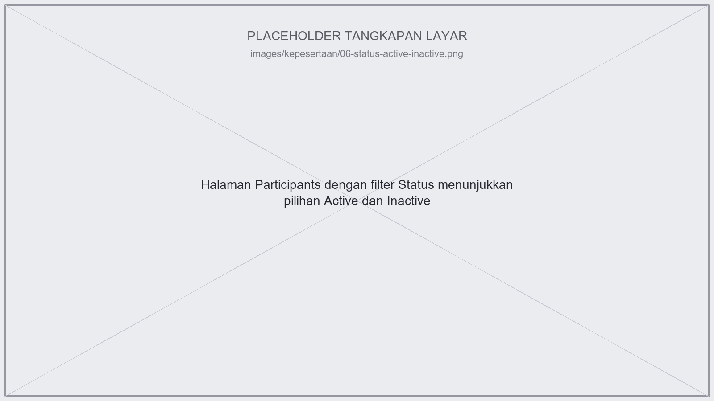

# Jejak Digital {#sec-jejak-digital}

::: {.callout-warning}
Bagian **"Melihat Aktivitas Peserta Kelas"** di bawah ini masih kerangka judul — isinya akan ditulis menyusul. Bagian **"Menjaga Jejak Aktivitas Mahasiswa yang Lulus/Keluar"** sudah ditulis penuh (dipindahkan dari @sec-kepesertaan supaya penjelasannya tidak berulang di dua bab).
:::

## Melihat Aktivitas Peserta Kelas {#sec-aktivitas-peserta}

Akan membahas menu **Reports** (Logs, Live logs, Course participation, dll.) dari sudut pandang dosen.

## Menjaga Jejak Aktivitas Mahasiswa yang Lulus/Keluar {#sec-suspend-vs-unenrol}

Seperti disinggung di @sec-manajemen-lulus, Moodle punya dua cara berbeda untuk "mengeluarkan" mahasiswa dari kursus, dan efeknya terhadap jejak digital mereka sangat berbeda:

- **Suspend** (ubah Status jadi Inactive): mahasiswa tetap terdaftar sebagai peserta, tapi aksesnya diblokir. Semua data historis — nilai, keanggotaan grup, dan log aktivitas — tetap tersimpan dan tetap bisa ditelusuri lewat laporan kursus.
- **Unenrol** (hapus total dari daftar peserta): **menghapus** nilai, keanggotaan grup, preferensi, dan data terkait pengguna lainnya dari kursus tersebut.

::: {.callout-warning}
## Kalau Anda pernah kecewa kehilangan log mahasiswa setelah unenrol di sistem lama — itu memang perilaku standar, bukan bug
Dokumentasi resmi Moodle secara eksplisit menyebutkan opsi "Unenrol user from course" **"purges grades, group memberships, preferences and other user related data from the courses"**. Kalau Anda butuh menelusuri jejak aktivitas mahasiswa (misalnya kapan mereka membuka tugas sebelum dikumpulkan) untuk mahasiswa yang sudah lulus, **Unenrol penuh akan menghilangkan kemungkinan itu**.
:::

::: {.callout-important}
## Belum teramati langsung
Kursus contoh yang dijelajahi belum punya siklus kelulusan/pergantian mahasiswa yang benar-benar teramati (lihat catatan di @sec-manajemen-lulus). Klaim di atas didasarkan pada dokumentasi resmi Moodle, bukan hasil pengecekan langsung men-*suspend* lalu memeriksa laporan aktivitas mahasiswa tersebut di kuliah2.itera.ac.id.
:::

**Rekomendasi**: pakai **Suspend** (bukan Unenrol) untuk mahasiswa yang lulus atau keluar di akhir semester, supaya jejak aktivitas dan nilai mereka tetap bisa ditelusuri kalau suatu saat dibutuhkan (misalnya untuk keperluan akreditasi atau audit). Filter status Active/Inactive di halaman Participants membuat mahasiswa yang di-*suspend* tidak mengganggu tampilan peserta aktif sehari-hari. Simpan **Unenrol penuh** untuk kondisi yang benar-benar butuh "bersih-bersih" data, misalnya di akhir siklus akreditasi — bukan sebagai langkah rutin tiap semester.

Langkah men-*suspend* mahasiswa:

1. **Participants**, centang mahasiswa yang ingin di-*suspend* (bisa lebih dari satu).
2. Pilih aksi **"Edit selected user enrolments"**.
3. Ubah **Status** menjadi **Suspended**, simpan.
